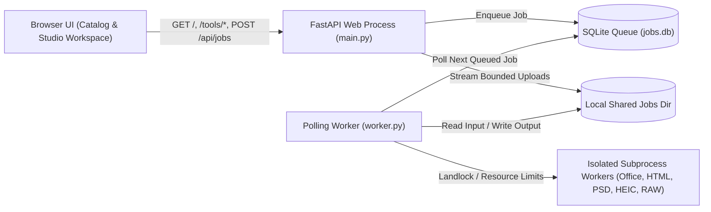

# Architecture

**Pattern:** Self-hosted Dual-Process Monolith (Web API/UI + Isolated Local Queue Worker)

## High-Level Structure

## Identified Patterns

### 1. Streaming Upload Enforcement
- **Location:** `src/i_love_open_converter/main.py` (`LimitedMultiPartParser`)
- **Purpose:** Reject oversized files, excessive file counts, or aggregate byte limits while bytes are still streaming in, before temporary files exhaust disk space.

### 2. Polling Job Queue & Terminal Artifacts
- **Location:** `src/i_love_open_converter/database.py`, `src/i_love_open_converter/worker.py`
- **Purpose:** Decouples HTTP request latency from CPU-heavy PDF/image/AI/Office conversions without requiring Redis or external brokers.

### 3. Domain-Adaptive Studio UI
- **Location:** `src/i_love_open_converter/templates/index.html`, `src/i_love_open_converter/static/css/app.css`, `src/i_love_open_converter/static/js/app.js`
- **Purpose:** Provides an iLovePDF (Crimson Coral) and iLoveIMG (Cobalt Indigo) 2-column Studio Workspace above a unified 50-tool catalog, while complex multi-step PDF editors (`pdf-edit`, `pdf-forms`, `pdf-organize`, `pdf-crop`, `pdf-redact`, `scan-to-pdf`) use dedicated `/tools/*` routes sharing the same navigation shell.
