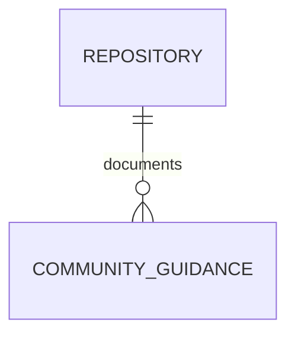

# Community health and maintenance

**Approved:** 2026-11-22 - user authorized continuing the planned work and creating/merging PRs; issue #39 is a focused repository-health task, not application modularization.
**Settled mid-build:** none.
**Review:** sent at f815521.
**Fix pass:** done - addressed all three review findings with GitHub Report content/support routing, explicit feature-form operation/reproduction prompts, and PR CI that checks the uv lock, Ruff, tests, and two-architecture container builds.

## Problem

Contributors lack clear support, security, and contribution routes. The repository also has no issue forms, PR checklist, changelog, or dependency update cadence.

When this ships, GitHub surfaces accurate community guidance and routes issues, contributions, private security reports, and dependency updates through bounded, reviewable workflows.

## Shape

Add only applicable health files, reuse the existing `CONTRIBUTING.md`, use GitHub's private vulnerability reporting for security reports, and configure Dependabot for uv, Docker, Docker Compose, and GitHub Actions. No runtime or application code changes.

Data: none - repository files and GitHub settings are maintained outside application storage.
New: nothing - this change adds no data entities or relations.

**Changes underneath**

| Front | What changes |
| --- | --- |
| Repository guidance | Add conduct, security, support, changelog, issue form, PR template, and Dependabot files; link the README and contribution guide. |
| GitHub settings | Enable private vulnerability reporting so the documented security route is usable. |
| Application | No application or data model changes. |

Data: none - this feature changes repository guidance and GitHub repository settings, not application data.

## Surface

| Route | In | Out | Status | Who |
| --- | --- | --- | --- | --- |
| Root community files | Markdown documents | Conduct, security, support, and changelog guidance | `200` | anyone |
| `.github/ISSUE_TEMPLATE/` | Public bug/feature issue | Focused forms and private vulnerability-report link | `200` | anyone |
| `.github/PULL_REQUEST_TEMPLATE.md` | Pull request body | Contributor validation and documentation checklist | `200` | anyone |
| `.github/dependabot.yml` | Weekly package ecosystem configuration | Bounded dependency update PRs | `200` | anyone |
| Repository private vulnerability reporting setting | GitHub repository setting | Private vulnerability intake | `204` when enabled; `200` when read; `403` for unauthorized updates | anyone |

## Landing

| Decision | Chosen behavior | Alternative |
| --- | --- | --- |
| Security contact | Use GitHub private vulnerability reporting; public issue templates never request security details. | Untracked email or public issue. |
| Conduct reports | Use GitHub's Report content flow; if the repository-admin route is not available, use GitHub Support's abuse-report form. | Inventing maintainer email or repurposing the vulnerability-only route. |
| Release history | Start with `Unreleased`; do not backfill unverified tags. | Guessing past release contents. |
| Dependabot labels | Omit custom labels because the repository does not currently define a dependency label. | Configure a nonexistent label and risk failed PR creation. |

## Assumptions

| Assumption | Default | Rationale |
| --- | --- | --- |
| Support channel | GitHub issues labeled `question`; Discussions are currently disabled. | Use an existing public route that works today. |
| Maintainer contact | GitHub project profile only; publish no personal email. | Avoid inventing contact details. |
| Dependency automation | Weekly PRs with bounded open PR count; maintainers review compatibility before merging. | Keeps updates visible and reviewable. |

**Open questions:** none. Discussions were verified as disabled; private vulnerability reporting was enabled through the connected repository administrator.

## Criteria

### S1: Publish community health files (P1)

**Acceptance Criteria**

1. WHEN a contributor opens the repository THEN GitHub SHALL surface conduct, security, support, and contribution guidance without publishing unselected maintainer contact details.
2. WHEN a visitor opens a bug or feature form THEN it SHALL request version/profile, host architecture, operation, and sanitized reproduction details, and SHALL warn against sharing private files or secrets; security reports SHALL use the enabled private reporting route.
3. WHEN a contributor opens the PR template THEN it SHALL ask for validation, docs/spec updates, and third-party dependency/model review.
4. WHEN Dependabot runs THEN it SHALL check uv, Dockerfile, Docker Compose, and GitHub Actions weekly with bounded open PR counts; pull-request CI SHALL check the locked uv environment, Ruff, browser-backed tests, and multi-architecture image build when build/dependency inputs change. On GitHub-hosted runners, the two PSD subprocess integration cases that require Landlock are excluded because the runner cannot provide that sandbox.
5. WHEN the changelog is opened THEN it SHALL begin with Unreleased and contain no unverified release history.
6. WHEN README or CONTRIBUTING are opened THEN they SHALL link to applicable community files, and existing development setup instructions SHALL remain intact.

## Out of scope

- No application refactor, modular dependency profiles, or tool implementation changes.
- No FUNDING or CODEOWNERS file without a real funding path or ownership structure.
- No invented release notes or private maintainer email.

## Acceptance Criteria

1. WHEN a contributor opens the repository THEN GitHub SHALL surface conduct, security, support, and contribution guidance, and security reports SHALL use the enabled private reporting route.
2. WHEN a visitor opens a bug or feature form THEN it SHALL request version/profile, host architecture, operation, and sanitized reproduction details, and SHALL warn against sharing private files or secrets.
3. WHEN a contributor opens the PR template THEN it SHALL ask for validation, docs/spec updates, and third-party dependency/model review.
4. WHEN Dependabot runs THEN it SHALL check uv, Dockerfile, Docker Compose, and GitHub Actions weekly with bounded open PR counts; uv updates SHALL retain a lockfile update.
5. WHEN the changelog is opened THEN it SHALL begin with Unreleased and contain no unverified release history.
6. WHEN README or CONTRIBUTING are opened THEN they SHALL link to the applicable community files, and existing development setup instructions SHALL remain intact.

## Sources

- GitHub issue #39 - requested community health and dependency automation scope.
- GitHub repository metadata - confirmed Discussions are disabled and private vulnerability reporting was initially disabled.
- GitHub Dependabot ecosystem documentation - `uv`, Docker, and GitHub Actions are supported package ecosystems.
- GitHub abuse-report documentation - Report content can be routed to repository admins when available or to GitHub Support.

## Build evidence

- GitHub private vulnerability reporting enabled and read back as enabled.
- `uv` (with its `uv.lock`), Dockerfile, Compose file, and GitHub Actions configured for weekly bounded updates.
- `validate_plan.py community-health` passed with 0 errors and 0 warnings.
- PyYAML parsed all five GitHub YAML files successfully; `git diff --check` passed.
- Pull-request CI now runs `uv sync --all-groups --locked`, Ruff check/format, installs Chromium, runs browser-backed tests while excluding the two PSD integration tests that require unavailable Landlock, and builds the non-publishing `linux/amd64` plus `linux/arm64` image when dependency or image inputs change.

## Review fix pass

Addressed the independent review findings: conduct reporting now uses GitHub's Report content flow and Support abuse-report form without inventing contact details; feature forms explicitly request related operation and sanitized reproduction details; added pull-request CI for locked uv dependencies, Ruff, tests, and `linux/amd64` plus `linux/arm64` image builds. The initial format check exposed existing repository-wide formatting drift, so CI checks changed Python files only instead of failing on unrelated baseline files. The first CI run also exposed missing Chromium and four PSD subprocess tests that require Landlock, which is unavailable on GitHub-hosted runners; CI now installs Chromium, omits only those four PSD integration cases, and runs the expensive multi-architecture image build only when build/dependency inputs change. The CI runs on every pull request and main push; maintainers must merge only after its checks pass.
