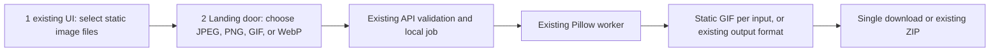

# Conversion coverage and release maturity

**Approved:** 2026-11-22 - user: "SÓ VAI. E não pergunta mais nada até acabar todas as camadas de implementação que temos!!!!"
**Settled mid-build:** none.
**Review:** pending.
**Fix pass:** pending.

## Problem

The approved project roadmap has a final stage for conversion coverage and release maturity. The general image engine can write static GIF files, but the API and form hide that output outside the dedicated JPEG-to-animated-GIF tool. The bilingual README matrix omits SVG and HEIC, the English matrix describes HTML as a PDF output, and the feature inventory still calls offline translation planned.

When this ships, visitors can choose a static GIF output from the general image converter, see the exact supported conversion paths and limits in both READMEs, and understand the first three steps from the home page. The docs will describe shipped features without implying unsupported pairs.

## Shape

1. A visitor selects the existing general image converter, selects one or more supported static raster files, and chooses JPEG, PNG, GIF, or WebP.
2. `main.py` accepts GIF only for `image.convert` in addition to the existing dedicated `image.from_jpg` GIF path; the shared worker produces one static GIF per generic-converter input and packages batches with the existing ZIP behavior.
3. The bilingual home page states the three-step flow and lists the general converter’s output formats in its card hint and selector.
4. The English and PT-BR READMEs publish the supported input/output pairs and limits for raster, SVG, PSD, HEIC/HEIF, RAW, PDF, office, and local HTML conversions. The project feature inventory is reconciled to the shipped RAW converter and offline PDF translation.
5. `.env.example` and the existing Compose quick-start remain the self-host setup path; repository checks verify their documented settings stay synchronized.

Data: none - reuse existing jobs and artifacts.

### Changes underneath

| Existing element | Change | Readers and consequence |
| --- | --- | --- |
| Generic image output contract | Permit GIF only for `image.convert`; keep output validation operation-specific and preserve `image.from_jpg` animated GIF behavior (AD-022) | The generic converter offers a static GIF for each source; animated GIFs still come from the dedicated JPG tool. |
| Shared image form | Show GIF for `image.convert`, keep it hidden for operations that do not support it, and list all generic output formats in the converter card | The UI and API expose the same supported output set. |
| Home-page first-use flow | Add three concise steps: choose a tool, add a file, download the result | New visitors can understand the workflow without leaving the home page. |
| Bilingual format matrix | Reconcile both README tables with active converters, outputs, important limitations, and conditional PDF/A availability | Readers can confirm supported input/output pairs before self-hosting or uploading. |
| Feature inventory and deployment quick start | Mark RAW and offline translation implemented; validate `.env.example`, Compose configuration and setup steps | Repository scope and beginner self-host guidance match the shipped app. |

## Surface

| Route | Input | Output | Status | Who |
| --- | --- | --- | --- | --- |
| `POST /api/jobs` (existing; `image.convert` adds GIF output) | 1 to configured maximum supported static raster images; JPEG, PNG, GIF, or WebP | One selected-format image per input; existing ZIP for batches | `202`; existing `413`, `415`, and `422` behavior | anyone |
| `GET /` (existing) | none | Bilingual home catalog and three-step guide | `200` | anyone |
| `GET /api/jobs/{job_id}/download` (unchanged) | successful job id | One image or existing ZIP | `200`, `404`, or `409` | anyone with the job id |

## Landing

| One-way door | Literal shape | Alternative rejected |
| --- | --- | --- |
| Generic GIF output | A one-frame static GIF is produced for each input to `image.convert`; animation remains in `image.from_jpg`, which combines JPEG inputs | Overloading the generic multi-file converter with animation timing, ordering, and frame controls changes the existing batch contract. |
| Generic output formats | JPEG, PNG, GIF, and WebP only | Advertising BMP/TIFF outputs is unsupported by the current generic worker contract and is unnecessary to make the existing input formats more useful. |
| Capability catalog | Bilingual README tables document only routes and format pairs present in the application, including the 40 MP / 100 MiB RAW limits and conditional PDF/A support | A literal universal “any format to any format” matrix would promise paths no installed engine can guarantee. |

## Criteria

### S1: Extend generic static image conversion and publish exact coverage (P1)

**Acceptance Criteria**

1. WHEN a visitor uses `image.convert` THEN the API and form SHALL offer JPEG, PNG, GIF, and WebP for supported static raster input; a GIF output SHALL contain exactly one frame per input image.
2. WHEN a visitor submits one input in `image.convert` with GIF selected THEN the worker SHALL return a valid `image/gif` artifact with the GIF filename extension; WHEN multiple inputs are submitted THEN it SHALL return one static GIF per input in the existing ZIP bundle.
3. WHEN a visitor selects `image.from_jpg` with GIF output THEN the existing animated-GIF behavior SHALL remain intact; IF the API receives an output not supported by the selected operation THEN it SHALL return `422` without creating a job.
4. WHEN the home page is displayed in PT-BR or English THEN it SHALL show the localized three-step guide and an accurate generic-converter output hint; GIF SHALL be selectable only for the generic converter and JPG-to-GIF tool.
5. WHEN either README’s format matrix is read THEN it SHALL include the generic raster-to-JPEG/PNG/GIF/WebP pairs, JPEG-to-animated-GIF, SVG/PSD/HEIC/RAW image conversions, PDF and office conversions, local HTML conversions, and material size or environment constraints; it SHALL not list unsupported paths.
6. WHEN repository checks validate the format matrix and deployment docs THEN they SHALL fail if the shipped RAW or offline PDF translation capabilities are marked planned, if the generic GIF output is omitted, or if `.env.example` and Compose settings drift.
7. WHEN the app is opened at a 360 CSS-pixel viewport in PT-BR and English THEN the first-use guide, catalog, output controls, job status, and download result SHALL remain usable without horizontal page overflow.
8. WHEN an operator follows the bilingual quick-start THEN copying `.env.example`, running `docker compose up -d`, checking service status, and stopping without deleting stored files SHALL be clear and valid.

## Out of scope

- New codec dependencies, animated-GIF timeline controls, video conversion, network URL rendering, cloud processing, and a claim that every arbitrary format converts to every other format.
- Changing any existing file-size, pixel, page-count, isolation, or privacy limits.
- Replacing existing PDF, PSD, SVG, HEIC/HEIF, or RAW conversion pipelines.

## Assumptions

| Assumption | Chosen default | Rationale | Confirmed? |
| --- | --- | --- | --- |
| Static GIF output | A single static GIF per `image.convert` input | Pillow’s existing worker path already supports GIF output and the API/UI are the only missing gates. | y - user delegated completion of the approved roadmap |
| GIF animation | Keep animation creation in `image.from_jpg` | The dedicated tool already defines JPEG frame ordering and animation behavior. | y - preserve current product contract |
| Supported matrix | Describe actual current operation pairs and explicit limits, not the literal universal objective | The foundation plan explicitly requires a finite supported matrix and rejects unsupported conversion claims. | y - approved roadmap direction |

**Open questions:** none - the user delegated the remaining roadmap and routine implementation choices.

## Differences from the source

No binding screen capture was supplied for this final coverage stage. The new home-page guide follows the existing bilingual design system and does not alter existing tool-card order or names.

## Sources

- `.specs/features/project-foundation/plan.md` - approved stage 6 conversion coverage and release maturity direction.
- `.specs/features/project-foundation/feature-inventory.md` - cumulative PDF/image capability scope, to be reconciled with shipped state.
- `.specs/features/image-from-jpg/plan.md` - existing animated GIF behavior and output contract.
- `.specs/features/image-from-raw/plan.md` and `.specs/features/pdf-translation/plan.md` - shipped format, runtime, and offline translation limits.
