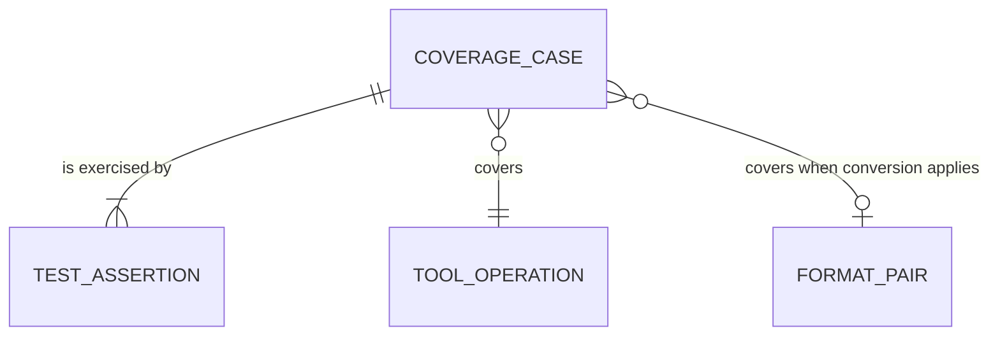

# Conversion Reliability Coverage

**Approved**: 2026-11-23 - user: "Okay, podemos seguir com a TLC Spec Lean em direção ao que precisamos pra validar o funcionamento de todas as tools conforme o plano criado por você."
**Settled mid-build:** none
**Review:** not sent
**Fix pass:** not started

## Problem

The application advertises a broad set of PDF, image, office, HTML, and URL conversion and processing tools. Tests already cover many individual operations, API validation paths, worker results, and some real decoder behavior. However, the repository has no executable map proving that every active operation and every documented conversion pair has coverage. The required CI command also excludes two PSD conversion tests, and the Docker build smoke checks cover selected engines rather than the complete set of runtime-backed converters. A regression can therefore leave a tool, a supported input/output pair, or a processing option broken while the main checks remain green.

People who self-host the application and process their files bear the cost: failed conversions, unusable output, lost time, and uncertainty about whether a tool is safe to rely on. No finite suite can prove that every arbitrary file will work; this feature will make the supported paths and their tested failure behavior explicit and enforce coverage for them.

When this ships, maintainers can see and CI can enforce which advertised tools, documented format pairs, processing choices, and important failure boundaries have executable evidence through the actual job flow and supported runtime.

## Shape

This reuses the existing FastAPI application, SQLite job queue, worker, conversion engines, fixtures, pytest suite, Docker build, and CI workflows instead of creating a second conversion path. The coverage rules run in repository tests that call the existing application and worker layers, with required CI checks exercising the same assertions.

1. The active tool catalog and documented format tables enter a test coverage matrix; `main.py` (exists) exposes the existing accepted-operation set as a module-level constant so the matrix can be compared against the API contract.
2. A matrix case supplies a representative fixture, operation, supported input/output format, and processing options to `TestClient` and `create_app` (exists); API validation creates the existing SQLite job.
3. `process_one_job` and the existing worker and conversion modules (exist) process the queued input and produce the artifact or terminal failure.
4. The test reads job status and downloads the artifact through the existing API; format-specific assertions verify parseability, declared MIME type and extension, and promised content/structure.
5. Pytest and the Docker runtime smoke suite (existing; expanded) run as required CI checks on changes to application code, tests, runtime dependencies, or container configuration.

```mermaid
flowchart LR
    A[1 README.md and templates/index.html (exists)] --> B[1 main.py accepted operations (exists)]
    B --> C[2 tests use TestClient and create_app (exists)]
    C --> D[2 API validation and SQLite jobs (exists)]
    D --> E[3 worker.process_one_job (exists)]
    E --> F[3 output artifact or terminal failure (exists)]
    F --> G[4 API status/download and semantic assertions (exists)]
    G --> H[5 CI workflows and Dockerfile (exists)]
```

**Changes underneath**

| Front | What changes |
| --- | --- |
| API operation contract | Move the existing accepted-operation set out of the request handler into a module-level constant; the set's values and API behavior stay the same, and tests compare it to the matrix. |
| Coverage matrix | Add test-only cases for every active operation and every advertised input/output conversion pair, including conditional PDF/A when the runtime reports it available. |
| Test fixtures | Reuse generated small documents and existing fixtures; add only small, redistributable samples with recorded provenance when a real decoder cannot be represented by generated input. |
| CI | Run all required tests, including the two PSD conversion tests currently excluded, and add/expand runtime image smoke checks for installed converters and bundled models. |
| Stored data | Nothing to migrate; no production job or artifact format changes. |
| Readers | API clients and UI visitors see no contract or workflow change. |



New: nothing - the matrix and fixture metadata are test-only and do not persist at runtime. Data: none - production jobs, files, and API contracts are unchanged.

## Surface

None - no route or response signature changes.

## Landing

None - existing test conventions and dependencies are reused; moving the existing accepted-operation set to a module-level constant is a reversible refactor with unchanged values and behavior.

## Criteria

### S1: Make supported capability coverage complete and machine-checkable (P1)

Every active tool and advertised conversion path has an explicit executable coverage case, and newly advertised capabilities cannot silently bypass the matrix.

**Acceptance Criteria**

1. WHEN the coverage suite runs THEN its operation matrix SHALL equal the application's accepted operation set, and every active catalog tool SHALL map to at least one matrix case; adding or removing an accepted operation without updating its case SHALL fail the suite.
2. WHEN a tool supports file conversion THEN the matrix SHALL include every input/output pair documented in both README format tables; the English and PT-BR tables SHALL agree with the matrix, including generic raster outputs, animated JPEG-to-GIF, SVG, PSD, HEIC/HEIF, RAW, PDF/Office, HTML, and URL paths.
3. WHERE a capability is conditional on runtime dependencies, including PDF/A, the matrix SHALL exercise it when the runtime reports it available and SHALL assert the existing unavailable behavior when it is not.
4. WHEN a maintainer adds or changes a processing option shown by a tool form THEN a test SHALL cover its default and at least one valid non-default value; numeric or enumerated constraints SHALL also have lower/upper boundary and invalid-value cases where those limits apply.

### S2: Prove successful processing through the real application job flow (P1)

Every matrix success case submits a representative supported input, processes it through the application worker, and inspects the delivered result.

**Acceptance Criteria**

5. WHEN a positive matrix case runs THEN it SHALL submit through `POST /api/jobs`, process through `process_one_job`, read terminal status, and download through the existing job URL; the assertion SHALL validate the output opens with the expected parser, MIME type, extension, and operation-specific content or structure, not merely that bytes exist.
6. WHEN an operation accepts a batch THEN the matrix SHALL cover the minimum valid batch and a multi-file batch; the downloaded ZIP SHALL open, contain exactly the expected entries, and each entry SHALL pass its format-specific validation.
7. WHEN a conversion has meaningful semantic invariants THEN its assertion SHALL check them: page count/order/text for PDF operations, dimensions/frame count/pixel properties for image operations, openability and expected content for Office outputs, and valid page/image archives for HTML and PDF exports.
8. WHEN a processing choice changes the output THEN tests SHALL assert the effect of that choice, including output format, rotation/crop/resize dimensions, compression constraints, page selection/order, language/direction, or privacy edit regions as applicable to the operation.

### S3: Verify invalid inputs, limits, and clean failure behavior (P1)

Each tool rejects malformed or unsupported work at the correct boundary and never presents a partial artifact as a successful result.

**Acceptance Criteria**

9. IF an upload is empty, malformed, truncated, mismatched to its filename, or unsupported by the selected operation THEN the API/worker SHALL return the existing documented 4xx or terminal failure contract; API rejections SHALL create zero jobs and worker failures SHALL expose no downloadable partial output.
10. IF an input exceeds a configured file, aggregate, count, page, pixel, dimension, or operation-specific limit THEN it SHALL be rejected at the existing boundary with the established status and error code; each bound SHALL have an accepted-at-limit case and a rejected-over-limit case.
11. IF a job fails after processing begins, including a later item in a batch, THEN its status SHALL be terminal `failed`, download SHALL return `409`, and no partial output directory or archive SHALL be available.
12. WHEN security-sensitive or isolated formats are processed THEN tests SHALL continue to prove the active safeguards: streamed upload limits, networkless Office processing, per-file decoder restrictions, PSD object/render limits and linked-smart-object rejection, SVG external-resource rejection, URL destination checks, PDF redaction restrictions, and password separation from public job options/logs.
13. WHEN tests add real sample files THEN each sample SHALL have a checked-in source and license record; fixtures SHALL be small enough for routine CI and SHALL not contain personal data.

### S4: Require runtime and architecture evidence in CI (P1)

Required CI checks exercise the engines and bundled runtime assets that unit-level fakes cannot verify.

**Acceptance Criteria**

14. WHEN a pull request changes `src/`, `tests/`, `pyproject.toml`, `uv.lock`, `Dockerfile`, `compose.yaml`, or `docker/` THEN required CI SHALL run the full pytest suite without excluding the PSD conversion or grayscale-output tests and SHALL run the Docker runtime smoke suite.
15. WHEN the Docker runtime smoke suite runs THEN it SHALL use the final Python 3.14 image, with network disabled during inference/conversion checks, and exercise real representative HEIC, PSD, RAW, Office, OCR, PDF/A, translation, summary, background-removal/model, and HTML conversion paths for which those engines are shipped.
16. WHEN runtime image checks run for a supported architecture THEN each required engine smoke case SHALL pass on that architecture; failures or unavailable required binaries/models SHALL fail the image check rather than silently skip.
17. WHEN any required coverage case fails or is unexpectedly skipped in the Linux CI environment THEN the required workflow SHALL fail and identify the operation/case; intentional platform-only checks SHALL report the platform reason and SHALL not count as coverage for the skipped operation matrix case.

## Out of scope

| Excluded | Why |
| --- | --- |
| A guarantee that every arbitrary file will process successfully | File variants are unbounded; the enforceable promise is coverage of advertised inputs, options, limits, and failure contracts. |
| A universal conversion matrix for every format to every other format | The project defines finite, operation-specific supported pairs in its catalog and READMEs. |
| Changing conversion algorithms, output quality policy, upload limits, API error contracts, privacy behavior, or UI layout | This feature adds evidence and CI enforcement for existing product behavior; behavior changes require their own approved feature. |
| Fuzzing campaigns, performance benchmarks, load tests, and production telemetry | These require separate infrastructure and product decisions and are not necessary to establish deterministic per-operation regression coverage. |

## Assumptions

| Assumption | Chosen default | Rationale | Confirmed? |
| --- | --- | --- | --- |
| CI duration | Required deterministic operation/matrix tests run on every relevant pull request; the actual-runtime smoke suite runs in the Docker job for the supported architectures when relevant source or runtime files change. | A green merge should cover both application behavior and the native/model runtime; source changes can affect runtime compatibility even when the Dockerfile is unchanged. | n |
| Fixture policy | Prefer generated small fixtures; add redistributable public samples with provenance only for cases synthetic files cannot prove. | Keeps tests deterministic and legally traceable while exercising real decoders where required. | n |
| Success evidence | Validate semantic output properties, not byte-for-byte equality for outputs whose encoders may vary by dependency or architecture. | Equivalent valid output may differ across codec/runtime versions while preserving the user-visible contract. | n |

**Open questions:** none - scope and finite supported paths confirmed by the user; remaining implementation choices are assumptions above.

## Differences from the source

No binding screen, capture, or external product reference was supplied. No user-facing screen or behavior changes are planned.

## Sources

- `.specs/features/conversion-reliability-coverage/request.md` - user request; verbatim in Portuguese.
- `.specs/STATE.md` - active safeguards AD-005, AD-009 through AD-015, AD-017, and AD-019 through AD-023 constrain validation and runtime cases.
- `.specs/features/project-foundation/feature-inventory.md` - capability inventory and finite-format scope.
- `.specs/features/conversion-coverage-release/plan.md` - approved conversion catalog and format-documentation coverage.
- `src/i_love_open_converter/main.py`, `src/i_love_open_converter/worker.py`, `tests/`, `.github/workflows/ci.yml`, `Dockerfile`, `README.md`, and `README.pt-BR.md` - current operation, job, test, runtime, and format-table behavior.
