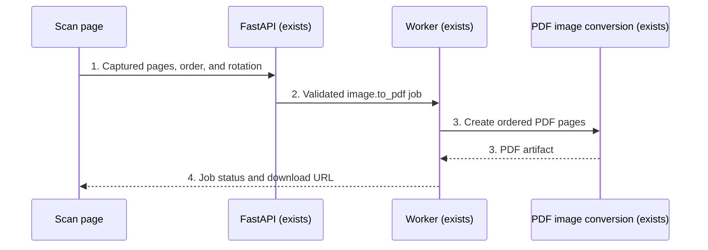
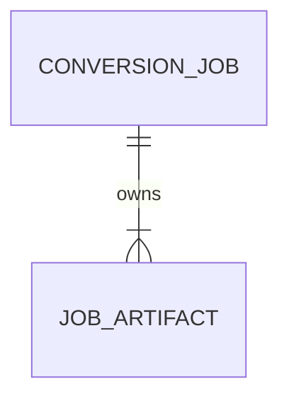

# Local document scan to PDF

**Approved:** 2026-11-21 - user: "Pode seguir nas implementações dde acordo com o tlc-spec-lean até o final. Vá abrindo PRs conforme precisar e vá seguindo tudo da implementação"
**Settled mid-build:** none.
**Review:** sent at `21becc1`; verdict pass, with no blockers; see `review.md`.
**Fix pass:** done - close both earlier P2 UX findings; the post-build review passed with no further changes.

## Problem

The catalog's “Digitalize e transforme em PDF” capability is not available. A visitor can already turn uploaded images into a PDF, but there is no scan-focused entry point for capturing pages and arranging the resulting document. The roadmap contains no usage evidence for this capability.

When this ships, a visitor can capture or select pages, arrange them, and download one locally generated PDF.

## Shape

The feature reuses the existing upload-first job lifecycle and `image.to_pdf` worker operation. Page selection, ordering and rotation are validated in the API before the existing local PDF pipeline runs.

1. The browser opens a dedicated scan page, captures/selects image pages, and sends their order and rotations.
2. `FastAPI` validates file count, image types, and per-page rotation options, then creates an `image.to_pdf` job.
3. The existing worker converts images to one PDF and records the output.
4. The browser polls job status and offers the completed PDF for download.

**Changes underneath**

| Front | What changes |
| --- | --- |
| Domain | Reuse the existing `image.to_pdf` operation and validate ordered rotation options. |
| Storage | Existing job options and input artifacts hold page order and rotation; no schema change. |
| Readers | Add a dedicated browser workflow; the existing API and worker remain the processing path. |

New: nothing - the existing job and artifact records carry the scan inputs and PDF result.

## Surface

| Route | In | Out | Status | Who |
| --- | --- | --- | --- | --- |
| `GET /tools/scan-to-pdf` | none | Local scan page | 200 | anyone |
| `POST /api/jobs` (existing) | ordered images, `image.to_pdf`, page rotation options | Existing job response and PDF artifact | 202; existing validation error codes | anyone |

## Landing

| One-way door | Literal shape | Alternative rejected |
| --- | --- | --- |
| Operation identifier | Reuse `image.to_pdf`; no new worker operation or database migration | A separate operation would duplicate the supported image-to-PDF pipeline |
| Page options | Rotation values are integers from 0, 90, 180, 270 in file order | Unvalidated client-side orientation could silently produce incorrect pages |

## Criteria

**Acceptance Criteria**

1. WHEN a visitor opens `/tools/scan-to-pdf` THEN the page SHALL explain that files are processed by the self-hosted server, in PT-BR and English.
2. WHEN a visitor captures/selects several pages THEN the page SHALL show each page and its position before submission.
3. WHEN a visitor reorders pages THEN the preview order SHALL match the resulting PDF page order.
4. WHEN a visitor rotates a page THEN the resulting PDF SHALL reflect the selected 90-degree increment for that page.
5. WHEN a visitor submits a valid scan THEN the page SHALL create one `image.to_pdf` job and offer the PDF after success.
6. IF no page is selected THEN submission SHALL be blocked and the page SHALL explain that at least one page is required.
7. IF a page is not a supported image or exceeds existing upload limits THEN the API SHALL reject the request with the existing error code and create no job.
8. IF an invalid page rotation is submitted THEN the API SHALL return 422 `invalid_options` and create no job.
9. WHILE the job is queued or processing THEN the page SHALL show progress and disable duplicate submissions; on failure it SHALL show the safe localized error and allow correction and retry.
10. WHEN the viewport is 360 CSS pixels wide THEN page previews and controls SHALL remain usable without horizontal page scrolling.

## Assumptions

| Decision | Default | Rationale | Confirmed? |
| --- | --- | --- | --- |
| Capture source | Mobile device camera picker plus local image selection; no desktop webcam stream | Native capture works in the browser's file-input flow and avoids an additional camera permission lifecycle | y - user delegated the complete goal and routine implementation decisions |
| Scan enhancements | Page ordering and rotation only; no automatic perspective detection, OCR, or filters | Image-to-PDF already supports the conversion; enhancement and OCR are separate capabilities | y - user delegated the complete goal and routine implementation decisions |

**Open questions:** none - the user delegated sequencing and implementation decisions for the complete goal.

## Out of scope

- Automatic edge detection and perspective correction.
- Text recognition; searchable PDFs are handled by the separate OCR tool.
- Uploading to or processing through a third-party service.

## Sources

- `.specs/features/project-foundation/plan.md` - approved objective roadmap, stage 4.
- No scan-specific browser captures are available in the repository.

**Open questions:** none after the capture-source and enhancement choices are settled.
