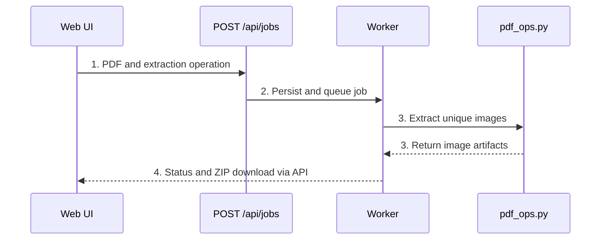
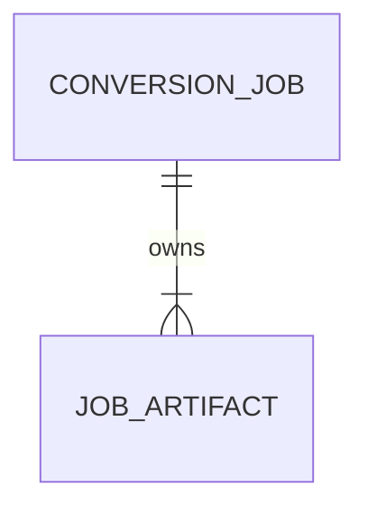

# Document and web conversion: embedded PDF images

**Approved**: 2026-11-20 - user: "Você tem total liberdade pra seguir os planos e features já definidos. SÓ VAI."
**Settled mid-build:** none
**Review:** sent at 4845194
**Fix pass:** done - include visible annotation appearance streams in image order, cover the reported case, and translate the active status when the language changes.

## Problem

A person can render PDF pages as JPG but cannot download the original embedded images through the application. The request names both workflows; it supplies no usage statistics.

This feature lets a visitor extract supported embedded images locally and download them together while the broader conversion roadmap continues.

## Shape

Reuse the existing upload-first interface, FastAPI job lifecycle, SQLite queue, local storage, worker and PyMuPDF Lite. Pinned pypdf reads image drawing order and object identities (AD-011). Validation and extraction rules run in the backend reached by API tests.

1. `Web UI` (exists) selects one PDF and chooses embedded-image extraction.
2. `POST /api/jobs` (exists) validates the operation and PDF, persists input and creates a job.
3. `Worker` (exists) reads the PDF and calls `pdf_ops.py` (exists) to extract unique embedded raster images to a ZIP.
4. `Web UI` (exists) polls the existing status endpoint and downloads the ZIP or displays a safe error.

**Changes underneath**

| Front | What changes |
| --- | --- |
| domain | `pdf.extract_images` is dispatched by API and worker. |
| stored data | Existing job options and artifacts carry the operation; no migration. |
| readers | UI offers extraction and shows result or error; worker creates ZIP; API serves status/download. |

New: nothing - existing jobs and artifacts store input and output.

## Surface

| Route | In | Out | Status | Who |
| --- | --- | --- | --- | --- |
| `POST /api/jobs` (extended) | one PDF, `operation=pdf.extract_images`, empty options | job ID and status URL | `202`; `413` upload limit; `415 unsupported_format`; `422 invalid_file` or `invalid_options` | anyone |
| `GET /tools/pdf-extract-images` (new) | none | bilingual upload-first form | `200` | anyone |

## Landing

| One-way door | Literal shape | Alternative rejected |
| --- | --- | --- |
| Job operation | `pdf.extract_images`, no options; output ZIP of uniquely referenced images | Treat extraction as page rendering, because it would replace original images with page screenshots. |
| Image-order parser (AD-011) | `pypdf==7.1.1` reads content-stream operators and image xrefs, including nested forms and inline images; PyMuPDF decodes image pixels and masks. | Infer object identity from pixel digests, which conflates distinct image objects with identical pixels. |

- No new database column or service.

## Criteria

### S1: Extract images embedded in a PDF (P1)

The visitor selects a PDF, extracts embedded images, and downloads one ZIP.

**Acceptance Criteria**

1. WHEN a visitor opens the PDF-to-JPG workflow THEN the UI SHALL offer links to page rendering and embedded-image extraction, with the latter opening `/tools/pdf-extract-images`.
2. WHEN the visitor selects a PDF and starts extraction THEN the UI SHALL show queued, processing, success or error status and offer a ZIP download on success in PT-BR and English; it SHALL remain usable at 360–1440 px without horizontal page overflow.
3. WHEN the API accepts one valid unencrypted PDF THEN it SHALL create a `pdf.extract_images` job and the worker SHALL return a ZIP containing one file per distinct embedded image object, in first-occurrence order, including images referenced on multiple pages only once.
4. WHEN extracting a supported image THEN the system SHALL preserve its decoded pixels and transparency and use a suitable PNG or JPEG extension; the ZIP names SHALL be `image-001` onward without user-controlled paths.
5. IF a PDF contains no extractable images THEN the job SHALL fail with a localized actionable message and no download; IF it is invalid or password-protected THEN the API SHALL return `422 invalid_file`.
6. IF more than one file is sent THEN the API SHALL reject it with `422 invalid_options`; existing upload limits and retention SHALL apply.

## Out of scope

| Excluded | Why |
| --- | --- |
| Office to PDF, PDF to Office/Markdown and HTML/URL rendering | Remain required in the cumulative document/web roadmap and will receive separate plans, engines and isolation decisions. |
| Vector drawings rendered as image files | This operation extracts embedded image objects, not page graphics. |

## Assumptions

| Assumption | Chosen default | Rationale | Confirmed? |
| --- | --- | --- | --- |
| Delivery order | Extract embedded images first, then continue the other document and web capabilities | The user delegated sequencing and authorized continued staged implementation. | y - user delegated |
| Image reuse | Deduplicate by PDF image object identity; preserve transparency in PNG | Prevent duplicate downloads for a single image reused across pages. | y - user delegated |

**Open questions:** none - the user delegated the implementation sequence and product details.

## Differences from the source

None - continue the existing local-only identity and catalog decisions AD-006 and AD-007.

## Sources

- `.specs/features/document-web-conversion/request.md` - continuation request.
- `.specs/features/project-foundation/request.md` and `.specs/features/project-foundation/plan.md` - full cumulative objective and roadmap.
- [PyMuPDF image extraction documentation](https://pymupdf.readthedocs.io/en/latest/recipes-images.html) - embedded images and masks.
