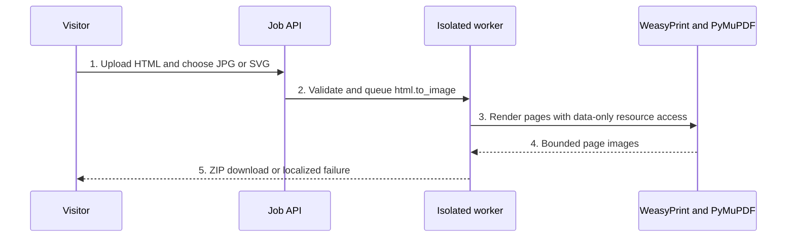

# HTML to image

**Approved**: 2026-11-21 - user authorized implementation of the complete free, open-source converter roadmap: “Pode seguir nas implementações dde acordo com o [$tlc-spec-lean](<C:\Users\Fernando Paladini\\.codex\\skills\\tlc-spec-lean\\SKILL.md>) até o final. Vá abrindo PRs conforme precisar e vá seguindo tudo da implementação”
**Settled mid-build:** none
**Review:** sent at a845b67
**Fix pass:** pending

## Build evidence

- `uv run pytest -q` - passed.
- `uv run ruff check .` - passed.
- `node --check src/i_love_open_converter/static/js/html-to-image.js` - passed.
- `docker compose config` - passed; worker retains `network_mode: none` and `OFFICE_NETWORK_ISOLATED=1`.
- Docker Linux smoke as UID 1000 with `--network none` - passed; local HTML rendered to PDF, JPG at 144 DPI and SVG, while HTTP, HTTPS, FTP, `file:` and relative resources were rejected.
- Browser review at 360 x 800 - PT-BR and English pages usable with no horizontal overflow.

## Problem

The catalog includes HTML-to-image conversion but does not offer an implemented flow. Public URL rendering introduces SSRF and subresource-fetch risks; the local HTML-to-PDF stage already establishes a secure single-file boundary.

When this stage ships, visitors can upload a local HTML file and download a JPG or SVG image for each rendered page, without the renderer retrieving any network or local-file resources referenced by the document.

## Shape

Extend the isolated WeasyPrint worker from the HTML-to-PDF stage. Accept one local `.html` or `.htm` file up to 10 MiB, inline CSS, and embedded `data:` resources. Render at 144 DPI to JPG or SVG, package pages in a ZIP, and cap the document at 100 pages and the output archive at 256 MiB. URL-based conversion remains separate.

1. The visitor opens HTML to image, selects one local HTML file, chooses JPG or SVG, and submits.
2. The API validates file count, extension, byte size, and output format before creating an `html.to_image` job.
3. The isolated Linux worker renders the HTML, rasterizes or exports each page, and creates a ZIP with stable numbered filenames.
4. The worker validates page dimensions, image signatures and aggregate output size before publishing one artifact.
5. The page displays localized queued, processing, success, and error states.

**Changes underneath**

| Front | What changes |
| --- | --- |
| domain | Add `html.to_image` API validation, worker dispatch and failure mapping. |
| stored data | Existing jobs and artifacts store the ZIP; no schema migration. |
| readers | Add bilingual HTML-to-image page and catalog link; document local-only support. |

Data: none - existing job and artifact records store input and results.
New: nothing - no new entities or relations.

## Surface

| Route | In | Out | Status | Who |
| --- | --- | --- | --- | --- |
| `POST /api/jobs` (extended) | one `.html` or `.htm`, `operation=html.to_image`, format `jpg` or `svg` | existing job ID and status URL | `202`, `413 upload_limit`, `415 unsupported_format`, or `422 invalid_options` | anyone |
| `GET /tools/html-to-image` (new) | none | bilingual HTML upload and format selector | `200` | anyone |
| `GET /api/jobs/{job_id}/download` (unchanged) | opaque job UUID | validated ZIP | `200`, `404 job_not_found`, or `409 job_not_ready` | anyone with job ID |

## Landing

| One-way door | Literal shape | Alternative rejected |
| --- | --- | --- |
| Input boundary | One local HTML upload, max 10 MiB; inline CSS and `data:` resources only | Remote URL fetching in the worker, which would widen its network access and enable SSRF. |
| Output contract | `html.to_image`, `format=jpg\|svg`, numbered files in ZIP, 144 DPI for JPG | One output file, which loses pages after the first; PNG, which is not among the source's advertised formats. |
| Processing | Existing isolated Linux HTML renderer; up to 100 pages; page pixel bound and 256 MiB aggregate ZIP cap | Unbounded document sizes or rendering inside the connected API process. |

## Criteria

### S1: Render local HTML pages to images (P1)

**Acceptance Criteria**

1. WHEN a visitor opens HTML to image THEN the bilingual page SHALL accept one `.html` or `.htm` file, explain that inline CSS and `data:` resources are supported and local/remote references are blocked, and allow JPG or SVG selection.
2. WHEN the API receives one valid HTML upload up to 10 MiB and `format=jpg` or `format=svg` THEN it SHALL create an `html.to_image` job; IF file count, extension, size or format is invalid THEN it SHALL reject the request before creating a job.
3. WHEN the worker renders input THEN it SHALL return one image per page, in page order, named `page-001` onward inside one ZIP; inline styles and embedded `data:` resources SHALL render, while HTTP, HTTPS, FTP, `file:`, and relative references SHALL fail safely without fetching them.
4. WHEN the worker processes a document THEN it SHALL require the existing Linux, network-isolation marker, loopback-only namespace and Landlock boundary; it SHALL enforce the 120-second process timeout, 2 GiB address-space limit, 100-page cap, bounded page dimensions and 256 MiB output cap.
5. WHEN output is JPG THEN pages SHALL render at 144 DPI; WHEN output is SVG THEN each page SHALL be a valid SVG document. The ZIP SHALL contain only validated files and remain downloadable through the existing job flow.
6. IF rendering, isolation, page bounds, output validation or ZIP creation fails THEN the job SHALL fail with localized actionable status and expose no partial download.
7. The catalog and both READMEs SHALL describe the supported formats, local-only resource policy, page bounds and Linux worker requirement in PT-BR and English.

## Out of scope

| Excluded | Why |
| --- | --- |
| Public URL input and remote assets | Requires separate SSRF-resistant network and redirect policy. |
| JavaScript execution and Chromium pixel parity | This stage reuses WeasyPrint's documented HTML/CSS subset. |
| Multiple HTML files or uploaded asset folders | The initial job contract is one deterministic local HTML input. |

## Assumptions

| Assumption | Chosen default | Rationale | Confirmed? |
| --- | --- | --- | --- |
| First-stage source | Local HTML upload; URLs deferred | Keeps the worker isolated and reuses the completed HTML-to-PDF boundary | y - user authorized the complete roadmap and local processing is an existing project invariant |
| Output shape | One numbered page image per rendered page in a ZIP | Preserves multi-page documents in the existing artifact model | y - delegated implementation details |
| Output resolution | 144 DPI for JPG; SVG remains vector | Offers readable output while bounding raster memory | y - delegated implementation details |

**Open questions:** none blocking this local upload stage; URL rendering remains separate roadmap work.

## Differences from the source

The source mentions pasting a page URL. This stage accepts one local HTML file and rejects every fetched resource except embedded `data:` URLs; public URL conversion remains a separate stage.

## Sources

- `.specs/features/project-foundation/request.md` - HTML-to-image capability and output formats.
- `.specs/features/project-foundation/plan.md` - local processing and staged roadmap decisions.
- `.specs/features/html-to-pdf/plan.md` - approved local-only renderer boundary and worker isolation.
- [WeasyPrint security guidance](https://doc.courtbouillon.org/weasyprint/latest/first_steps.html) - custom URL fetcher and untrusted HTML/CSS restrictions.
- [PyMuPDF page rendering](https://pymupdf.readthedocs.io/en/latest/page.html) - local page rasterization and SVG export.
