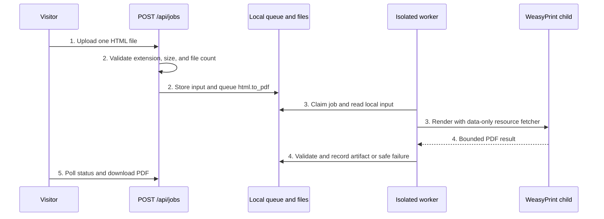
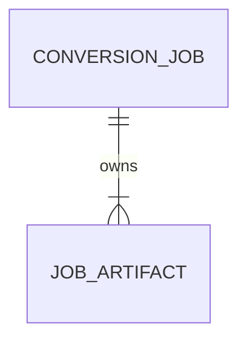

# HTML to PDF

**Approved**: 2026-11-21 - user: “Pode seguir nas implementações dde acordo com o [$tlc-spec-lean](<C:\Users\Fernando Paladini\\.codex\\skills\\tlc-spec-lean\\SKILL.md>) até o final. Vá abrindo PRs conforme precisar e vá seguindo tudo da implementação”
**Settled mid-build:** none
**Review:** sent at a15a9d2
**Fix pass:** done - added failed-job regression tests for renderer timeout, invalid PDF, output size and page bounds; expanded the Linux smoke to HTTPS, FTP, file and relative resources

## Build evidence

- `uv run pytest -q` - passed.
- `uv run ruff check .` - passed.
- `node --check src/i_love_open_converter/static/js/html-to-pdf.js` - passed.
- `docker compose config` - passed; worker retains `network_mode: none` and `OFFICE_NETWORK_ISOLATED=1`.
- Docker Linux smoke as UID 1000 with `--network none` - passed; selectable text and embedded `data:` image rendered, HTTP, HTTPS, FTP, `file:` and relative resources rejected.
- HTML regression tests - passed, including timeout, invalid PDF, oversized output and page-bound failures with no downloadable artifact.
- Browser review at 360 x 800 - PT-BR and English controls and copy visible; no horizontal overflow.

## Problem

The catalog marks HTML to PDF as coming soon even though the requested capability is to convert a web page to PDF. A remote URL renderer would let uploaded input cause the self-hosted worker to request arbitrary network and local-file resources.

When this stage ships, visitors can upload one local HTML file and download a locally rendered PDF without the worker fetching remote or filesystem resources referenced by the document.

## Shape

Add an `html.to_pdf` job using WeasyPrint 70.0 in a Linux-only worker process. Only one `.html` or `.htm` file is accepted, up to 10 MiB. Inline styles and `data:` resources are supported. The renderer's custom URL fetcher rejects every non-`data:` resource, including HTTP, HTTPS, FTP and `file:` URLs. The worker runs in the existing no-network Compose worker, requires the existing network-isolation marker and loopback-only namespace, applies Landlock and OS resource limits, and validates the generated PDF before publishing it. URL-based web-page rendering is a separate later stage.

1. The visitor opens HTML to PDF, selects one `.html` or `.htm` file and submits it.
2. The API rejects unsupported file counts, extensions or sizes before creating a job; valid input is stored locally as `html.to_pdf`.
3. The worker starts a bounded Linux child, restricts it to the job's temporary files and read-only runtime dependencies, and renders with WeasyPrint using the local-only URL fetcher.
4. The parent validates page count, PDF structure and output size, then records one downloadable PDF artifact or a safe failure.
5. The page displays localized queue, processing, success and error states.

**Changes underneath**

| Front | What changes |
| --- | --- |
| domain | Add `html.to_pdf` validation, worker dispatch and safe error mapping. |
| stored data | No schema migration; existing jobs and artifacts store the input and PDF result. |
| readers | Activate the catalog card, add a bilingual upload-first page and document local-only limits. |

Data: none - existing job and artifact records store the input, status and result.
New: nothing - no new entities or relations.

## Surface

| Route | In | Out | Status | Who |
| --- | --- | --- | --- | --- |
| `POST /api/jobs` (extended) | one `.html` or `.htm` file, `operation=html.to_pdf`, no options | existing job ID and status URL | `202`, `413 upload_limit`, `415 unsupported_format`, or `422 invalid_options` | anyone |
| `GET /tools/html-to-pdf` (new) | none | bilingual local HTML upload form | `200` | anyone |
| `GET /api/jobs/{job_id}/download` (unchanged) | opaque job UUID | one validated PDF | `200`, `404 job_not_found`, or `409 job_not_ready` | anyone with job ID |

## Landing

| One-way door | Literal shape | Alternative rejected |
| --- | --- | --- |
| Renderer | `weasyprint==70.0`, local Python API in a bounded subprocess | Browser installation adds a larger runtime; LibreOffice HTML import is less direct for the chosen engine. |
| Job contract | Operation `html.to_pdf`, one `.html` or `.htm` input, no options | A dedicated operation lets API validation and worker dispatch share an explicit contract. |
| Resource policy | Only `data:` resources; reject HTTP(S), FTP, file URLs and relative linked assets; worker also has no network namespace | Fetching remote URLs or arbitrary filesystem paths risks SSRF, leaks, and unbounded external work. |
| Input and output bounds | One HTML file up to 10 MiB; at most 100 PDF pages; 120-second subprocess timeout; 2 GiB address space; 256 MiB output | Letting unbounded markup control worker time, memory, pages, or output. |
| Runtime boundary | Linux worker with no external network, Landlock allow-list, non-root service user and per-process CPU, memory and output-file limits | Processing untrusted markup in the connected web process. |

## Criteria

### S1: Convert local HTML to PDF (P1)

**Acceptance Criteria**

1. WHEN a visitor opens HTML to PDF THEN the bilingual page SHALL accept exactly one `.html` or `.htm` file, explain that only local HTML and embedded `data:` resources are supported, and show queued, processing, success, and error states.
2. WHEN the API receives one valid HTML file up to 10 MiB THEN it SHALL create an `html.to_pdf` job with no user options; IF file count, extension, or size is invalid THEN it SHALL reject the request before creating a job.
3. WHEN the worker renders input THEN inline HTML/CSS and `data:` resources SHALL be rendered locally; references requiring HTTP, HTTPS, FTP, `file:`, or relative-resource access SHALL fail safely without fetching them.
4. WHEN the worker child starts THEN it SHALL require Linux, the existing network-isolation marker, only loopback network interfaces, and working Landlock; it SHALL enforce a 120-second timeout, a 2 GiB address-space limit, and a 256 MiB output-file limit.
5. WHEN a valid supported HTML file renders successfully THEN the result SHALL be a structurally valid PDF with 1-100 pages and be available as one download.
6. IF the renderer is unavailable, isolation cannot be established, rendering fails or times out, page count is outside bounds, or the PDF is invalid THEN the job SHALL fail with a localized actionable error and no partial download.
7. The tool catalog and README support matrix SHALL describe the supported extensions, local-only resource policy, WeasyPrint engine, Linux worker requirement and rendering limitations in PT-BR and English.

## Out of scope

| Excluded | Why |
| --- | --- |
| Fetching public URLs or remote assets | Requires a separate SSRF-resistant proxy and product decision; this stage deliberately accepts only local uploads. |
| Relative linked assets, uploaded asset bundles, JavaScript execution and browser DOM behavior | The first stage accepts one HTML file and a bounded, deterministic renderer input. |
| Guaranteeing pixel-identical output to Chromium or every CSS property | WeasyPrint supports a documented subset of HTML/CSS; unsupported constructs may render differently. |

## Assumptions

| Assumption | Chosen default | Rationale | Confirmed? |
| --- | --- | --- | --- |
| First-stage input | One locally uploaded HTML file; no public URL | Recommended choice was offered and no reply arrived; local upload preserves the repository's privacy and network-isolation invariant while work continues | n - proceeding with the recommended safe default; user may revise before merge |
| Embedded resources | Permit `data:` URLs; reject all other fetched resources | Keeps single-file HTML useful without network or local filesystem access | n - same pending scope choice |
| Renderer | WeasyPrint 70.0 in Linux child process | Current project release is Python 3.14 compatible and has documented custom URL fetcher and PDF API; WeasyPrint security documentation calls for network, filesystem, memory and time restrictions | y - implementation choice delegated |

**Open questions:** none blocking this local-only first stage; URL conversion remains a separately tracked roadmap feature.

## Differences from the source

The source mentions pasting a page URL. This first stage accepts local HTML files and defers URL retrieval because the question about URL support received no answer; no remote request or local-file fetch is performed by the worker.

## Sources

- `.specs/features/project-foundation/request.md` - original HTML-to-PDF requirement.
- `.specs/features/project-foundation/plan.md` - local processing, no-tracking and catalog decisions.
- `.specs/features/document-web-conversion/plan.md` - separate document/web conversion stages.
- [WeasyPrint 70.0 PyPI release](https://pypi.org/project/weasyprint/70.0/) - version and Python compatibility.
- [WeasyPrint installation and PDF API](https://doc.courtbouillon.org/weasyprint/latest/first_steps.html) - Pango dependencies, local rendering API, custom URL fetchers, and security requirements for untrusted HTML/CSS.

## Follow-up delivery

Public URL to PDF is now delivered by `.specs/features/remote-url-conversion/plan.md`. This original stage remains the local-file-only path and continues to reject network and local-file resources in uploaded HTML.
