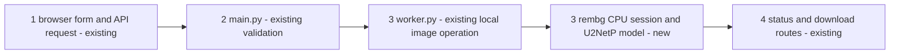

# Remove image backgrounds

**Approved**: 2026-11-21 - user delegated completing the application roadmap and implementation choices under tlc-spec-lean.
**Settled mid-build:** none
**Review:** sent at f3652639c6094c38b67827730dd36365ae87fd76
**Fix pass:** pending review

## Problem

The image catalog shows background removal as coming soon. Visitors need a simple local operation that separates the main salient object from the background and returns a transparent image, without uploading their photo to a third-party service.

## Shape

Reuse the existing image operation and job flow. Validate image content and pixel limits before creating a job, then perform CPU inference in the existing worker. Use rembg with its lightweight U2NetP model, loaded once per worker process. The model is distributed under the upstream U-2-Net Apache-2.0 license; rembg is MIT. Docker builds place the pinned model file in a read-only model directory so the network-isolated worker does not download weights at runtime. A direct local development install may let rembg download the same model to its documented cache on first use.

1. The browser submits one supported static raster image and the new `image.remove_background` operation to `POST /api/jobs`.
2. `main.py` inspects content, oriented dimensions and the 40-megapixel source limit before creating the existing local job record.
3. `worker.py` uses the existing Pillow image worker and a cached CPU rembg session with U2NetP to create one RGBA PNG at the oriented source dimensions.
4. Existing status and download routes return the completed PNG or a terminal failure without a partial file.

Data: none - use existing `conversion_jobs` and `job_artifacts`; no database schema change.

### Changes underneath

| Existing element | Change | Readers and consequence |
| --- | --- | --- |
| Image operation names | Add `image.remove_background`; require one source | API, UI and worker recognize the operation. |
| Image worker | Cache one CPU inference session per process and create transparent PNG output | Worker needs model weights present; tests stub model inference and make no network call. |
| Docker image | Install pinned CPU runtime and include a checksum-verified U2NetP model | Isolated worker can run without runtime network access. |
| Third-party notices | Attribute rembg and U-2-Net code/weights with their licenses and source URLs | Users can inspect the separately licensed software and weights. |

## Surface

| Route | Input | Output | Status | Who |
| --- | --- | --- | --- | --- |
| `POST /api/jobs` (existing, new `image.remove_background`) | One supported static raster image, at most 40,000,000 source pixels | Queued job | `202`, `422` invalid image/options/pixel cap, `415` unsupported extension | anyone |
| `GET /api/jobs/{job_id}` (existing) | Job id | Job status | `200`, `404` unknown job | anyone |
| `GET /api/jobs/{job_id}/download` (existing) | Successful job id | Transparent PNG cutout | `200`, `409` processing/failure, `404` unknown job | anyone |

## Landing

| One-way door | Literal shape | Alternative rejected |
| --- | --- | --- |
| Inference | `rembg` CPU with pinned ONNX Runtime and the U2NetP ONNX weight, checksum-verified into the Docker image | Cloud inference would transmit personal images; downloading weights at worker runtime is incompatible with the network-isolated worker. |
| Output | One PNG with RGBA alpha, at the oriented source dimensions | Multiple output choices add controls without helping the initial background-removal flow. |
| Size | Maximum 40,000,000 oriented source pixels | Unbounded decoded images can exhaust the 3 GiB worker memory limit. |

## Criteria

### S1: Remove a background locally (P1)

**Acceptance Criteria**

1. WHEN a visitor selects `Remover fundo` THEN the page SHALL show a one-image picker, PNG output disclosure, local processing notice, 40 MP source limit, and localized action in PT-BR and English.
2. WHEN a visitor submits one supported static raster image within the pixel limit THEN the API SHALL queue one `image.remove_background` job and the worker SHALL return a PNG with RGBA transparency and the oriented source width and height.
3. WHEN the worker processes an image THEN it SHALL use a cached CPU U2NetP session and SHALL NOT send the image to an external service.
4. WHEN the network-isolated Docker worker processes a job THEN the U2NetP weights SHALL already be available from the application image and no runtime network access SHALL be needed.
5. IF the request has zero/multiple files, unsupported content/extension, invalid options, or more than 40,000,000 source pixels THEN the API SHALL return an appropriate 422/415 response before creating a job.
6. IF model inference fails THEN the job SHALL become failed and download SHALL return 409 without a partial output artifact.
7. WHEN the page is opened at 360 CSS pixels wide THEN the input and action SHALL remain reachable without horizontal page overflow.
8. WHEN the feature appears in documentation and the interface THEN it SHALL disclose that segmentation quality depends on the image and does not guarantee perfect edges.

## Out of scope

- Batch processing, hand-painted mask correction, alternate background fills, hair refinement controls, cloud inference, GPU setup, and face-specific segmentation.
- Guaranteeing exact cutout quality for every image.

## Assumptions

| Decision | Chosen default | Rationale | Confirmed? |
| --- | --- | --- | --- |
| Model | U2NetP with CPU inference | Lightweight general salient-object segmentation with Apache-2.0 upstream model license | y - implementation delegated |
| Output | One PNG with transparent background | Preserves the alpha mask without adding a background-choice workflow | y - implementation delegated |
| Source size cap | 40 million oriented pixels | Bounds decoded image memory in the 3 GiB worker | y - implementation delegated |
| Model delivery | Checksum-verified Docker image asset; rembg cache for direct development | Keeps network-isolated worker inference offline | y - implementation delegated |

**Open questions:** none - implement the local one-image operation with the defaults above.

## Sources

- [rembg README: local models and CPU usage](https://github.com/danielgatis/rembg/blob/main/README.md) - identifies U2NetP as the lightweight U2Net model and warns that model weights have licenses separate from rembg's MIT license.
- [rembg on PyPI](https://pypi.org/project/rembg/) - current package metadata and CPU extra.
- [U-2-Net license](https://github.com/xuebinqin/U-2-Net/blob/master/LICENSE) - Apache-2.0 license for U2-Net source and model project.
- [ONNX Runtime Python install docs](https://onnxruntime.ai/docs/get-started/with-python.html) - CPU package installation.
