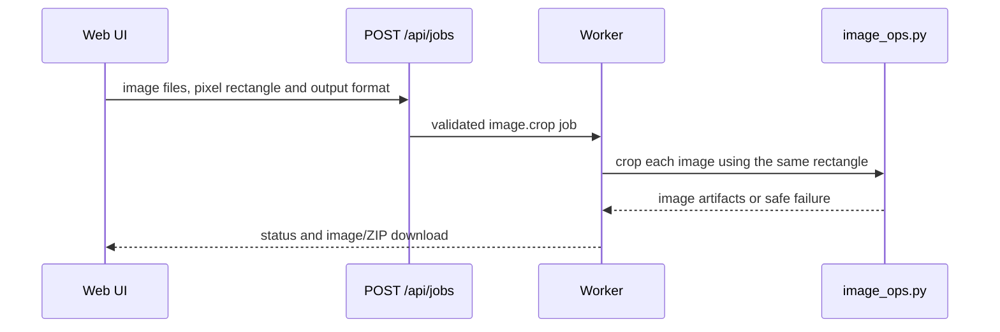
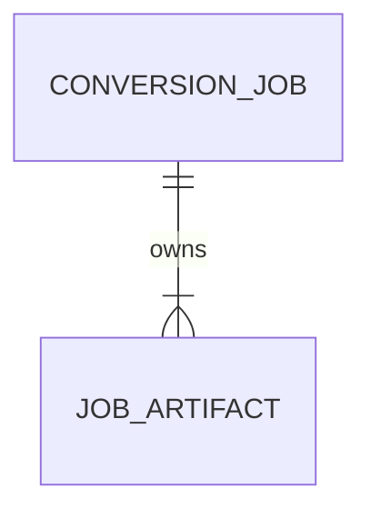

# Crop images

**Approved**: 2026-11-21 - user: "Pode seguir nas implementações dde acordo com o [$tlc-spec-lean](<C:\Users\Fernando Paladini\\.codex\skills\tlc-spec-lean\SKILL.md>) até o final. Vá abrindo PRs conforme precisar e vá seguindo tudo da implementação"
**Settled mid-build:** none
**Review:** sent at a98d84f
**Fix pass:** done - added static GIF support and closed the request mismatch; expanded tests for batch limits, single downloads, sanitized names, pixel bounds, WebP quality and UI controls

## Problem

Visitors cannot crop raster images in the local converter. They must use another service or desktop editor, interrupting the image workflow and possibly sending their files elsewhere.

When this ships, visitors can crop supported images to a chosen pixel rectangle and download the result from the self-hosted app.

## Shape

Extend the existing batch image job with `image.crop`. Each submitted image uses the same left/top/width/height rectangle in pixels, measured after EXIF orientation is applied. Reject the entire job if the rectangle does not fit every input image. Reuse existing PNG/JPEG/WebP output selection, JPEG/WebP quality, image-size limits, sanitized names and ZIP behavior.

1. Visitor selects Crop image and one or more supported raster files (existing UI; crop selection is door 1).
2. Visitor enters an integer rectangle and output settings; malformed values fail before a job is created.
3. API queues `image.crop` (door 1); the existing local worker and `image_ops.py` apply EXIF orientation, verify the rectangle against each image, crop and write output images.
4. Existing job records carry inputs and artifacts; the visitor sees queued, processing, success or localized error state and downloads one image or a ZIP.

**Changes underneath**

| Front | What changes |
| --- | --- |
| domain | Add `image.crop` options, crop processing and out-of-bounds validation. |
| stored data | No migration; existing image job and artifact records hold the result. |
| readers | Enable the crop catalog card, add rectangle controls to the shared image form, and document supported formats. |

New: nothing - the existing job and artifact entities store operation, options, inputs and outputs.

## Surface

| Route | In | Out | Status | Who |
| --- | --- | --- | --- | --- |
| `POST /api/jobs` (extended) | 1-10 supported static images, `operation=image.crop`, rectangle and format options | job ID and status URL | `202`; `413` upload limits; `422 invalid_options` for malformed rectangle | anyone |
| `GET /` (extended) | Crop image selection and pixel rectangle | shared upload and conversion UI | `200` | anyone |

## Landing

| One-way door | Literal shape | Alternative rejected |
| --- | --- | --- |
| Batch geometry | Apply one left/top/width/height rectangle to every selected image; fail the complete job if it does not fit any image | Silently vary coordinates per image or return a partial ZIP. |
| Coordinate space | Integer pixels after EXIF orientation; left/top are 0-9,999, width/height are 1-10,000, and right/bottom edges must remain within the image | Use pre-orientation coordinates, percentages, or implicit clamping that changes the selected rectangle. |
| Formats | Accept static JPEG, PNG, GIF, WebP, BMP and TIFF inputs; reject animated files; retain PNG, JPEG or WebP outputs | Add animated GIF processing or new codecs outside the current image engine. |

## Criteria

### S1: Crop supported images (P1)

**Acceptance Criteria**

1. WHEN a visitor selects `Recortar IMAGEM` THEN the system SHALL show controls for left, top, width and height in pixels, output format, JPEG/WebP quality when applicable, and the existing image upload action accepting JPG, PNG and static GIF.
2. WHEN the visitor submits one supported image with a valid rectangle THEN the worker SHALL apply EXIF orientation first and return an image whose dimensions equal the requested width and height.
3. WHEN the visitor submits 2-10 supported images THEN the worker SHALL apply the same rectangle to each image and return one sanitized image per input in input order, as individual output for one image or a ZIP for multiple images.
4. WHEN a visitor submits PNG, JPEG or WebP output options THEN the system SHALL preserve the chosen output format and apply the existing quality setting to JPEG and WebP.
5. IF rectangle values are missing or non-integer, left/top are outside 0-9,999, or width/height are outside 1-10,000 THEN the API SHALL return `422 invalid_options` before creating a job.
6. IF the rectangle extends beyond any oriented image, an input is unsupported/animated, or image bounds are exceeded THEN the job SHALL fail without a downloadable partial result.
7. WHEN the feature ships THEN PT-BR and English users SHALL see localized names, option labels, validation/error messages and status, with no horizontal page overflow at 360 px viewport width.
8. WHEN crop is selected THEN the image catalog SHALL show it as active under Edit and the shared image workflow SHALL submit `image.crop` with all four coordinates.

## Out of scope

| Excluded | Why |
| --- | --- |
| Drag-to-select preview, aspect-ratio presets and per-image rectangles | The request asks for a pixel rectangle; the direct numeric controls keep this slice simple and deterministic. |
| GIF/animated image support and new codecs | The current Pillow workflow deliberately accepts static JPEG, PNG, WebP, BMP and TIFF only. |
| Photo editing, watermarking, meme creation, upscaling, background removal, face blurring and HTML rendering | These are separate catalog stages. |

## Assumptions

| Assumption | Chosen default | Rationale | Confirmed? |
| --- | --- | --- | --- |
| Batch crop | Same rectangle for each selected file; fail the entire job on any mismatch | Existing shared image jobs support batches and all-or-nothing job output. | y - user delegated the implementation roadmap |
| Coordinate space | Oriented raster pixels, top-left origin | Matches user-facing pixel coordinates and consistent EXIF-normalized output. | y - user delegated |

**Open questions:** none - user delegated sequencing and implementation details.

## Differences from the source

The initial project plan's S2 criterion 10 establishes static JPEG, PNG, WebP, BMP and TIFF inputs and rejects animated formats. This feature adds static GIF input to meet the crop request while retaining the existing no-animation policy; no animation decoder is introduced.

## Sources

- `.specs/features/initial-project/request.md` - original crop request and full image-tool catalog.
- `.specs/features/initial-project/plan.md` - existing image formats, batch processing and bounds.
- `.specs/STATE.md` - active catalog and local-processing decisions.
