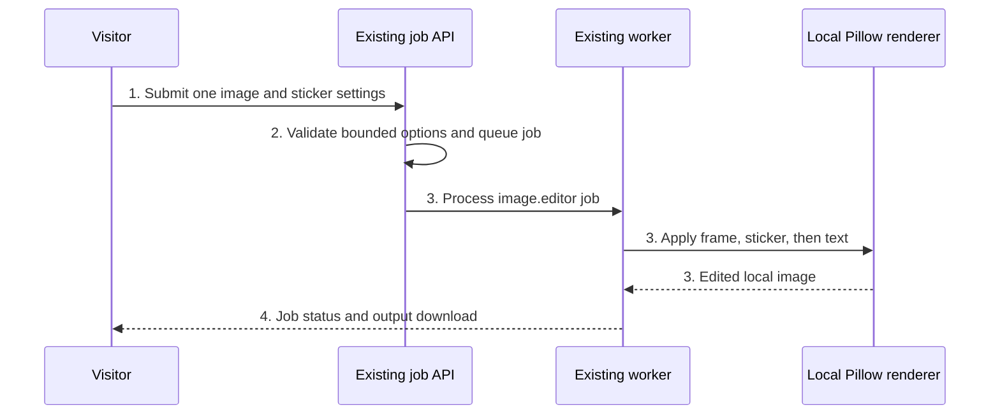
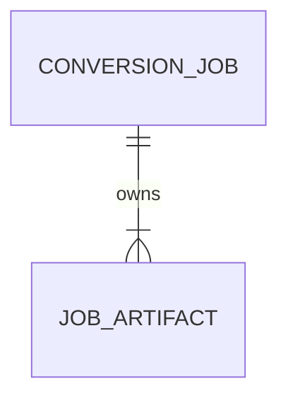

# Photo editor stickers

**Approved**: 2026-11-21 - user: “Pode seguir nas implementações dde acordo com o [$tlc-spec-lean](<C:\Users\Fernando Paladini\\.codex\\skills\\tlc-spec-lean\\SKILL.md>) até o final. Vá abrindo PRs conforme precisar e vá seguindo tudo da implementação”; user separately selected “Editor simples local (Recomendado)” and deferred stickers to a separate stage.
**Settled mid-build:** none
**Review:** sent at 2d826ed
**Fix pass:** pending

## Problem

The first photo-editor stage lets visitors add text, filters, and frames. The original editor request also names stickers, and the user chose to defer them to a separate stage. Without that stage, the editor remains short of the named capability.

When this stage ships, visitors can add one built-in vector sticker to an image locally and download the edited image.

## Shape

Extend the existing `image.editor` option schema and Pillow renderer with one optional built-in vector sticker, its anchor, size, and color. The existing upload, queue, worker, output format, and job lifecycle remain in place. Stickers render after the frame and before text so existing text remains legible on top.

1. The visitor selects one source image and opens the photo editor.
2. The visitor chooses a sticker, anchor, size, and palette color; the default `none` preserves all existing editor behavior.
3. The API validates options before creating a job; the worker draws the sticker locally and returns the selected PNG, JPEG, or WebP artifact.
4. The page reports localized status and errors and offers the output download.

**Changes underneath**

| Front | What changes |
| --- | --- |
| domain | Add bounded sticker choices and validation to `image.editor`. |
| stored data | No schema migration; existing job options store sticker settings. |
| readers | Add localized controls and documentation for the six built-in vector shapes. |

Data: none - existing job and artifact records store sticker options, inputs, status, and output; no new entities or relations.
New: nothing - the existing job and artifact entities already store all required data.

## Surface

| Route | In | Out | Status | Who |
| --- | --- | --- | --- | --- |
| `POST /api/jobs` (extended) | One supported static image; existing editor settings plus sticker, sticker position, size, and color | Existing job ID and status URL | `202`, existing upload errors, or `422 invalid_options` before job creation | anyone |
| `GET /` (extended) | Existing photo editor controls plus sticker controls | Shared local upload/editor form | `200` | anyone |

## Landing

| One-way door | Literal shape | Alternative rejected |
| --- | --- | --- |
| Sticker assets | Six built-in vector shapes: heart, star, sun, check, arrow, and speech bubble | Uploaded or remotely fetched assets add input complexity and external content handling. |
| Placement and rendering | One sticker with 9 fixed anchors, 3 sizes, 8 palette colors; draw after frame and before text | Freeform drag handles and multiple sticker layers are outside this staged editor. |
| Defaults | Sticker is `none`; existing jobs and the simple editor remain valid | Making stickers mandatory would change existing behavior. |

## Criteria

### S1: Add one local vector sticker (P1)

**Acceptance Criteria**

1. WHEN a visitor opens the photo editor THEN the page SHALL show localized sticker type, position, size, and color controls in PT-BR and English; the default sticker SHALL be `none`.
2. WHEN the visitor selects one built-in sticker and submits a valid image THEN the worker SHALL draw it locally at the chosen anchor, size, and color, after the frame and before text, preserving oriented image dimensions.
3. IF sticker type, position, size, or color is invalid THEN the API SHALL return `422 invalid_options` before creating a job.
4. WHEN sticker type is `none` THEN output pixels SHALL match the existing editor result for otherwise identical options.
5. WHEN the page is viewed at 360 px wide THEN editor controls SHALL fit without horizontal page overflow.
6. WHEN a valid edit succeeds THEN the selected PNG, JPEG, or WebP output SHALL be downloadable; when the worker fails, no partial output SHALL be downloadable.

## Out of scope

| Excluded | Why |
| --- | --- |
| Uploading custom stickers, SVG input, remote asset retrieval | This stage uses a bounded built-in set and local processing. |
| Multiple stickers, rotation, arbitrary drag placement, browser canvas preview | These require a larger editor interaction model. |
| Other editor effects, animated image editing, model-based image tools | Those are separate roadmap features. |

## Assumptions

| Assumption | Chosen default | Rationale | Confirmed? |
| --- | --- | --- | --- |
| Sticker set and controls | Reuse the six vector shapes, 9 anchors, 3 sizes, and 8-color palette already reviewed in the earlier implementation | Keeps the deferred stage bounded and consistent with the prior tested design | y - user delegated continued implementation |
| Responsive target | Existing 360 px editor baseline | Preserves the accepted project layout requirement | y - existing approved plan |

**Open questions:** none.

## Differences from the source

The original request's sticker capability was deferred from the simple first editor and is now enabled as its own stage, consistent with AD-016. No additional source behavior is removed.

## Sources

- `.specs/features/image-editor/request.md` - original request and user scope choice.
- `.specs/features/image-editor/plan.md` - accepted first-stage editor behavior and responsive baseline.
- `.specs/features/image-editor/review.md` - prior independent review of the vector sticker behavior and test coverage.
- `.specs/STATE.md` - local processing decision and AD-016.

## Build evidence

- `uv run pytest -q` passed after restoring the sticker stage; the suite covers all six shapes, chosen anchor/size/color, invalid settings before job creation, layer order, dimensions, output formats, and failed-job cleanup.
- `uv run ruff check src/i_love_open_converter tests` passed.
- `node --check src/i_love_open_converter/static/js/app.js` passed.
- Browser inspection at 127.0.0.1:8798 showed the localized sticker controls and six choices in the editor. The available browser surface used its default 1280 px viewport; the existing responsive controls use wrapping, while 360 px visual verification remains for independent review.
