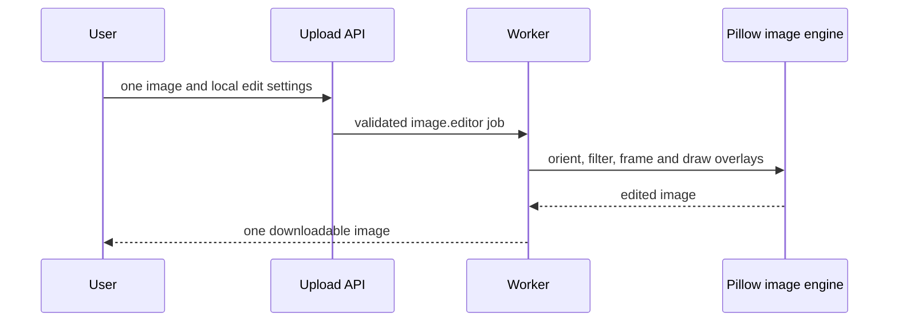
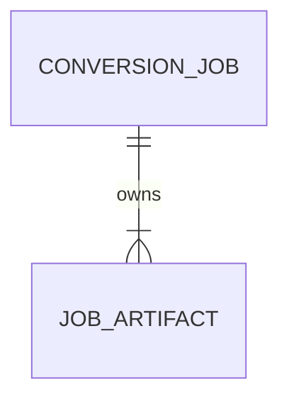

# Edit images

**Approved**: 2026-11-21 - user: "Pode seguir nas implementações de acordo com o [$tlc-spec-lean](<C:\Users\Fernando Paladini\\.codex\\skills\\tlc-spec-lean\\SKILL.md>) até o final. Vá abrindo PRs conforme precisar e vá seguindo tudo da implementação"
**Settled mid-build:** none
**Review:** completed at 5609efb; scope matched, with test coverage gaps
**Fix pass:** done - added EXIF orientation, all-position anchors, combined filter/frame/sticker/text layer-order, and UI contract regression checks; full test suite, Ruff, JavaScript syntax, and diff checks pass

## Problem

The image catalog describes a simple photo editor with text, effects, frames and stickers, but the card is disabled. Visitors need a local, bounded editor that applies these treatments to one image and downloads the result.

When this ships, visitors can upload one supported static image, combine text, one filter, a frame and one built-in sticker, then download the edited image in a supported format.

## Shape

Add `image.editor` to the existing image job flow. The API validates a single source and all edit settings before queueing. The worker applies EXIF orientation and the selected edits locally through Pillow, preserving dimensions. The existing job status and download flow delivers one result.

1. Visitor selects Photo editor and uploads one static image.
2. Visitor chooses optional text, one filter, an optional frame and one built-in sticker.
3. The API validates all choices before creating a job.
4. The worker applies edits in a documented order, then returns one image in the selected output format.

**Changes underneath**

| Front | What changes |
| --- | --- |
| domain | Add bounded text, filter, frame and vector-sticker edits. |
| stored data | No migration; existing jobs and artifacts store operation, source, options and output. |
| readers | Activate the photo-editor card, localize controls and document supported edits and output formats. |

New: nothing - existing job and artifact records store operation, options, inputs and outputs.

## Surface

| Route | In | Out | Status | Who |
| --- | --- | --- | --- | --- |
| `POST /api/jobs` (extended) | One supported static image and `image.editor` settings | job ID/status URL | `202 Accepted`, `413 Request Too Large`, `415 Unsupported Media Type` or `422 Invalid Options` | anyone |
| `GET /` (extended) | Text, filter, frame, sticker and output controls | shared upload/conversion UI | `200 OK` | anyone |

## Landing

| One-way door | Literal shape | Alternative rejected |
| --- | --- | --- |
| Source cardinality | Exactly one supported static image per edit job | Batch editing before there is a per-image editing workflow. |
| Text | Optional single line up to 80 characters, a nine-position anchor, three sizes, 10-100% opacity and a fixed accessible palette | Rich text, uploaded fonts and unbounded positioning. |
| Filter | One of original, grayscale, sepia or invert; it runs before frame and overlays | Arbitrary filter stacks and model-based effects. |
| Frame | None, solid or double; width 2-12% of the shorter oriented image dimension and selected palette color | Downloaded frame assets or external rendering. |
| Sticker | At most one locally drawn vector sticker from heart, star, sun, check, arrow and speech bubble; nine positions and three sizes | External sticker packs, network assets or arbitrary SVG upload. |
| Edit order | EXIF orientation, filter, frame, sticker, then text | Order-dependent browser-only preview state. |
| Output | PNG, JPEG or WebP; retain oriented source dimensions | Implicit format changes or enlarged canvas. |

## Criteria

### S1: Apply filter, frame and text (P1)

**Acceptance Criteria**

1. WHEN a visitor selects Photo editor THEN the UI SHALL show one-image upload, optional text, filter, frame, color, output-format controls and a submit button in PT-BR and English.
2. WHEN one valid source and valid settings are submitted THEN the API SHALL queue `image.editor`, and the worker SHALL apply EXIF orientation, the selected filter, frame and text locally while preserving the oriented dimensions.
3. WHEN text is selected THEN it SHALL appear at the chosen position, size and color; WHEN opacity is configured THEN the resulting text SHALL use that opacity.
4. WHEN a selected filter is grayscale, sepia or invert THEN output pixels SHALL exhibit that transformation before frame and text composition.
5. IF source count, text length, position, size, color, frame, filter, frame width, opacity or output format is invalid THEN the API SHALL return `422` before creating a job.

### S2: Add vector stickers (P1)

**Acceptance Criteria**

6. WHEN a visitor chooses a built-in sticker THEN the UI SHALL show sticker type, position and size controls in PT-BR and English.
7. WHEN a valid sticker is selected THEN the worker SHALL draw it locally at the selected anchor after the frame and before text, without changing image dimensions.
8. IF a sticker type or its position or size is invalid THEN the API SHALL return `422` before creating a job.
9. WHEN conversion succeeds THEN one output in the chosen PNG, JPEG or WebP format SHALL be downloadable; WHEN the worker fails THEN the job SHALL have no downloadable partial output.
10. WHEN the page is viewed at 360 px wide THEN the editor controls and result SHALL fit without horizontal page overflow.

## Out of scope

| Excluded | Why |
| --- | --- |
| Browser canvas preview and freeform drag handles | The shared job UI is upload-first; fixed choices keep this tool accessible and deterministic. |
| Multiple text layers, stickers or images | A single bounded overlay of each type fits the requested simple editor. |
| Upscaling, background removal and AI effects | These require separately reviewed model, licensing, performance and offline-runtime choices. |
| Animated image editing | The shared image engine accepts only static images. |

## Assumptions

| Assumption | Chosen default | Rationale | Confirmed? |
| --- | --- | --- | --- |
| Fixed positions | Reuse the nine-anchor vocabulary from image watermarking | Keeps placement predictable and avoids a custom canvas editor. | y - user delegated implementation details |
| Palette and sizes | Fixed accessible palette and small/medium/large choices | Avoids font and color parsing risks while supporting the requested basic edits. | y - user delegated implementation details |

**Open questions:** none - the user delegated continued implementation of the complete staged roadmap.

## Differences from source

The requested editor lists text, effects, frames and stickers without defining controls or assets. This plan limits effects to four local filters, frames to two vector styles and stickers to six locally drawn shapes; no external assets or model processing are added.

## Sources

- `.specs/features/initial-project/request.md` - original photo-editor request.
- `.specs/features/initial-project/plan.md` - static image formats, resource limits and shared local image flow.
- `.specs/STATE.md` - local processing, full catalog visibility and no external telemetry decisions.
