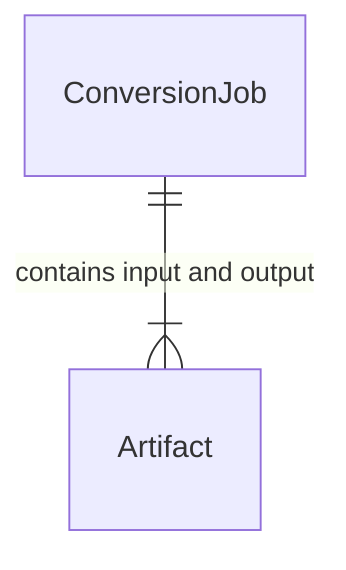

# Convert HEIC images to JPEG

**Approved**: 2026-11-22 - user: “Você tem total liberdade pra seguir os planos e features já definidos. SÓ VAI.”
**Settled mid-build:** none
**Review:**
**Fix pass:**

## Problem

The image catalog still marks HEIC conversion as coming soon. Visitors with photos saved by modern phones must install another converter or upload their files elsewhere.

When this ships, a visitor can convert one or more supported HEIC/HEIF still images to JPEG on the self-hosted service.

## Shape

The feature reuses the existing upload parser, conversion job queue, image form, job status, and artifact download. HEIF parsing and pixel decoding run in a per-file child process under resource and filesystem limits, where the rules that change an outcome are exercised by the conversion tests.

1. One or more HEIC/HEIF uploads and JPEG output enter `main.py` (exists), which checks the extension, bounded ISO-BMFF `ftyp` brands, configured upload limits, and queues one `image.from_heic` job.
2. `worker.py` (exists) sends each input to `heic_ops.py` (new), which runs `heic_worker.py` (new) under Landlock and OS limits; the child uses the pinned decode-only `heif-info` and `heif-dec` tools to check dimensions and render the primary still image.
3. `worker.py` (exists) records one JPEG per input and returns one JPEG or the existing ZIP bundle; existing job status and download routes expose the result.

```mermaid
flowchart LR
    A[1 main.py (exists): validate HEIF headers and queue] --> B[2 worker.py (exists): dispatch each input]
    B --> C[2 heic_ops.py (new): launch bounded child]
    C --> D[2 heic_worker.py (new): inspect and decode in isolation]
    D --> E[2 heif-info and heif-dec (door 1): libheif 1.23.7]
    E --> F[3 worker.py (exists): store JPEG or ZIP]
    F --> G[3 existing job status and download]
```

Data: none - reuse conversion jobs and artifacts; no schema changes or files outside normal job expiry.

**Changes underneath**

| Front | What changes |
| --- | --- |
| image operation | Add `image.from_heic` for HEIC/HEIF still images; accept a batch within existing per-job limits and emit JPEG. |
| native decoder | Build libheif 1.23.7 from its pinned source archive with the LGPL libde265 decoder and JPEG output enabled; disable x265, AV1, and plugin loading. Run only `heif-info` and `heif-dec`, never the decoder in the API process; isolate each file in a bounded Landlock child on the network-isolated worker (AD-021). |
| image limits | Keep the existing 100 MiB per-file limit; inspect dimensions in the child before decode and reject above 40 megapixels or 32,768 pixels on either side; cap child memory, CPU, and output. |
| image catalog and form | Replace the coming-soon HEIC/RAW entry with an enabled HEIC converter card; allow HEIC/HEIF uploads, select JPEG, and explain local processing in PT-BR and English. |
| stored data | No schema or persisted-data changes. |
| readers | Existing job status and download routes expose the JPEG or batch ZIP. |



New: nothing - use the existing job and artifact relation. One-way constraints: none in stored data.

## Surface

| Route | In | Out | Status | Who |
| --- | --- | --- | --- | --- |
| `POST /api/jobs` (existing; new `image.from_heic`) | 1 to configured maximum HEIC/HEIF files, each within configured upload bytes; JPEG output | Existing queued job response | `202`; `400` malformed multipart; `413` byte limit; `415` extension mismatch; `422` invalid options, file signature, or count | anyone |
| `GET /api/jobs/{job_id}` (existing) | Job id | Existing job state and localized conversion error | `200`, `404` unknown job | anyone |
| `GET /api/jobs/{job_id}/download` (existing) | Successful job id | One JPEG or existing ZIP of JPEGs | `200`, `404` unknown job, `409` pending or failed | anyone |

## Landing

| One-way door | Literal shape | Alternative rejected |
| --- | --- | --- |
| HEIF native decoder | Build libheif `1.23.7` from `https://github.com/strukturag/libheif/releases/download/v1.23.7/libheif-1.23.7.tar.gz`, SHA-256 `f7483e818503ea6224c8863e4a56ac02c7089021a98472c811c12aa19faf2475`; enable the LGPL `libde265` decoder and JPEG output, disable x265/AV1/plugins, and invoke `heif-info`/`heif-dec` only in the isolated child. Retain upstream license notices and source references. | The current `pillow-heif` wheels bundle x265 under GPLv2 and introduce a Pillow 13 compatibility transition; importing a native decoder inside the API also expands its parser exposure. A decode-only CLI built from the current security release avoids both choices. |
| HEIF pixel processing | 1 to configured maximum inputs; existing 100 MiB per-file limit; 40,000,000 pixels and a maximum width or height of 32,768 pixels per image; one static primary image per source; output JPEG quality 92 with transparency composited onto white; strip EXIF/XMP; fail closed on sequences, unsupported codecs, corrupt files, timeout, or resource limits. | Unbounded raster allocation and exporting embedded auxiliary images would exceed this local conversion tool's limits and output contract. |
| Decoder isolation | Child process with 3 GiB address-space limit, 120 CPU seconds, 256 MiB output-file limit, Landlock access only to the per-job temporary root and required application files; rely on the worker container's `network_mode: none`. | Running libheif in the API or shared worker process would allow malformed native input to affect other requests or jobs. |

- No database schema change, backfill, or API route is added.

## Criteria

### S1: Convert bounded HEIC/HEIF still images to JPEG locally (P1)

The coming-soon catalog entry becomes a bilingual, end-to-end local HEIC converter.

**Acceptance Criteria**

1. WHEN a visitor selects “Converter de HEIC” THEN the page SHALL offer HEIC/HEIF uploads, JPEG output, the 40 MP and 32,768-pixel maximum dimension limits per image, and the local-processing notice in PT-BR and English.
2. WHEN a visitor submits 1 to the configured maximum number of supported `.heic`, `.heif`, or `.hif` files with a valid format THEN the API SHALL queue exactly one `image.from_heic` job and the worker SHALL produce exactly one JPEG per input; one output SHALL download directly and multiple outputs SHALL download as the existing ZIP format.
3. IF an upload extension is unsupported or its bounded `ftyp` box has no supported HEIF brand THEN the API SHALL reject it with `415` or `422`, respectively, before creating a job.
4. WHEN the child inspects a valid supported file with exactly one top-level primary still image no larger than 40,000,000 pixels and no dimension above 32,768 pixels THEN it SHALL decode that image, apply its HEIF orientation transform, composite transparency onto white, and write a JPEG at quality 92 with no EXIF or XMP metadata.
5. IF a file has zero dimensions, exceeds 40,000,000 pixels or 32,768 pixels in either dimension, contains a sequence or additional top-level image, uses an unsupported codec, is corrupt or truncated, or exceeds 120 CPU seconds, 3 GiB address space, or 256 MiB output THEN the worker SHALL fail the job and expose no partial download.
6. WHILE decoding a HEIF file THEN `heif-info` and `heif-dec` SHALL run only in a per-file child with Landlock filesystem restrictions and the worker's network isolation; the decoder SHALL not read linked or neighboring paths.
7. WHEN a visitor selects files, submits, observes queued/failed/succeeded state, and downloads at a 360 CSS-pixel viewport THEN all controls and localized errors SHALL remain usable without horizontal page overflow.

## Out of scope

| Excluded | Why |
| --- | --- |
| Camera RAW conversion | The approved roadmap groups RAW with HEIC, but rawpy/LibRaw has a separate parser and input contract; implement it in its own feature and PR. |
| HEIF/HEIC encoding, animated sequences, all-frame export, auxiliary/depth images, AVIF, and arbitrary MIME items | This stage is a static-image-to-JPEG conversion path. |
| Editing metadata, color profiles, or HDR range | This stage produces a flattened, metadata-free JPEG and does not promise source color-management fidelity. |
| Linked external resources or resolving paths named by input metadata | Untrusted input must not access host files. |

## Assumptions

| Assumption | Chosen default | Rationale | Confirmed? |
| --- | --- | --- | --- |
| Input count and formats | Batch `.heic`, `.heif`, `.hif` up to existing per-job limits | The approved converter roadmap includes batch conversion; using existing limits keeps upload behavior consistent. | y - user delegated implementation choices |
| Output | JPEG quality 92, white background for transparency, EXIF/XMP stripped | The roadmap names conversion to JPG; a fixed quality setting avoids another control and avoids copying sensitive metadata. | y - user delegated implementation choices |
| HEIF assets | Exactly one top-level primary still image per file; reject sequences, additional top-level images, and unsupported codecs | A simple one-input/one-output contract fits the catalog card and bounded worker. | y - user delegated implementation choices |
| Catalog wording while RAW is separate | Enable and label the card “Converter de HEIC”; the RAW converter gets its own completed stage | The current “HEIC/RAW” coming-soon entry cannot claim RAW works when only HEIC ships. | y - user delegated implementation choices |
| Maximum single raster dimension | Reject any image wider or taller than 32,768 pixels, even when total pixels are below 40 MP | The aggregate pixel limit alone does not prevent an extreme aspect ratio from stressing native decoders. | y - user delegated implementation choices |

**Open questions:** none - the user delegated implementation choices for the approved roadmap.

## Differences from the source

No binding screenshot or source UI was supplied for this converter. Reuse the existing catalog card position and upload form.

## Sources

- `.specs/features/project-foundation/plan.md` - approved advanced-image roadmap and local processing constraint.
- [libheif v1.23.7 security release](https://github.com/strukturag/libheif/releases/tag/v1.23.7) - current native parser/decoder release and security fixes.
- [libheif source archive](https://github.com/strukturag/libheif/releases/download/v1.23.7/libheif-1.23.7.tar.gz) - pinned build input.
- [libheif CMake options](https://github.com/strukturag/libheif/blob/v1.23.7/CMakeLists.txt) - decoder, encoder, and plugin build flags.
- [libheif decoder CLI](https://github.com/strukturag/libheif/blob/v1.23.7/examples/heif_dec.cc) - primary image, still-vs-sequence, metadata, and JPEG quality behavior.
- [pillow-heif 1.8.1 bundled licenses](https://github.com/bigcat88/pillow_heif/blob/v1.8.1/LICENSES_bundled.txt) - bundled wheel codec licenses considered in selecting a decode-only build.
