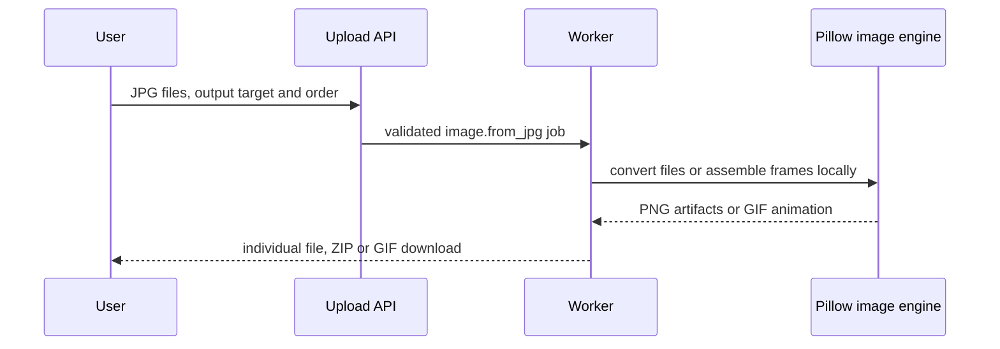
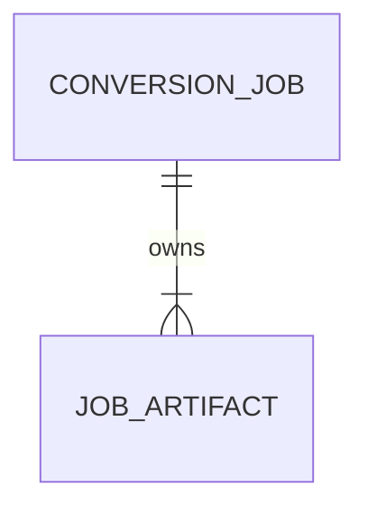

# Convert JPG to PNG or animated GIF

**Approved**: 2026-11-21 - user: “Pode seguir nas implementações dde acordo com o [$tlc-spec-lean](<C:\Users\Fernando Paladini\\.codex\\skills\\tlc-spec-lean\\SKILL.md>) até o final. Vá abrindo PRs conforme precisar e vá seguindo tudo da implementação”
**Settled mid-build:** none
**Review:** sent at ef554c9
**Fix pass:** pending review

## Problem

The catalog lists “Converter de JPG” but visitors cannot run it. They need a local way to convert JPEGs into PNGs or make an animated GIF from a selected sequence.

When this ships, visitors can convert one or more JPEG images to PNG files or produce one animated GIF from an ordered batch, without uploading files to a third-party service.

## Shape

Add `image.from_jpg` to the existing image-job API and worker. It accepts only JPEG/JPG inputs. PNG output converts each image independently, returning one file or an ordered ZIP. GIF output combines all uploaded JPEGs in upload order into one animation; one input produces a one-frame GIF. The animation uses a shared canvas sized to the largest frame, centers each source at native size on white, displays each frame for 500 ms, and loops forever. Existing image bounds, upload limits, safe names, and all-or-nothing behavior apply.

1. Visitor selects Convert from JPG and one or more JPEG files in the shared image workflow.
2. Visitor chooses PNG or GIF. PNG retains per-file batch conversion; GIF combines uploaded files into one animation in upload order.
3. The API validates JPEG content and GIF batch count before creating the job.
4. The worker converts locally and returns one static PNG, a ZIP of PNGs, or one animated GIF.

**Changes underneath**

| Front | What changes |
| --- | --- |
| domain | Add `image.from_jpg`, JPEG-only input validation, PNG conversion and GIF frame assembly. |
| stored data | No migration; existing job and artifact records hold the result. |
| readers | Enable the catalog card, expose PNG/GIF targets and describe frame order and animation defaults. |

New: nothing - existing job and artifact records store operation, options, inputs and outputs.

## Surface

| Route | In | Out | Status | Who |
| --- | --- | --- | --- | --- |
| `POST /api/jobs` (extended) | 1-10 JPEG inputs, `operation=image.from_jpg`, PNG or GIF output | job ID/status URL | `202 Accepted`, `413 Request Too Large`, `415 Unsupported Media Type` or `422 Invalid Options` | anyone |
| `GET /` (extended) | Convert from JPG selection and target format | shared upload and conversion UI | `200` | anyone |

## Landing

| One-way door | Literal shape | Alternative rejected |
| --- | --- | --- |
| GIF frames | Use uploaded order, a canvas equal to the widest and tallest frame, native-size centered frames on white, 500 ms per frame and infinite looping | Sort by filename, resize frames implicitly, use arbitrary timing, or hide the animation behavior. |
| Output semantics | PNG means independent conversions; GIF means one animation, including a one-frame GIF for one input | Return a ZIP of GIF frames or silently vary the meaning of the output target. |
| Input | Accept JPEG/JPG only; reject other formats even if their MIME claims JPEG | Trust filenames or multipart MIME types. |

## Criteria

### S1: Convert JPEGs to PNG (P1)

**Acceptance Criteria**

1. WHEN the visitor selects `Converter de JPG` THEN the system SHALL show JPEG-only input, PNG and GIF output choices, upload controls and localized status.
2. WHEN one JPEG is submitted with PNG output THEN the worker SHALL return one PNG with the source pixel dimensions and image content.
3. WHEN 2-10 JPEGs are submitted with PNG output THEN the worker SHALL return one sanitized PNG per input in upload order as a ZIP.
4. IF a file is not JPEG content, is animated, malformed, or exceeds existing image resource bounds THEN the API/job SHALL reject it without a downloadable partial result.

### S2: Create animated GIF (P1)

**Acceptance Criteria**

5. WHEN 2-10 JPEGs are submitted with GIF output THEN the worker SHALL return one animated GIF with frames in upload order, 500 ms duration and infinite looping.
6. WHEN GIF frames have different dimensions THEN the worker SHALL center each unscaled frame on a white canvas with the maximum frame width and height.
7. WHEN one JPEG is submitted with GIF output THEN the worker SHALL return a valid one-frame GIF.
8. IF GIF animation canvas dimensions multiplied by frame count exceed 25 million pixels, the output SHALL fail without a partial download.
9. IF GIF output receives more than 10 inputs or malformed options THEN the API SHALL return `422` before creating a job.
10. WHEN the feature ships THEN the PT-BR and English image workflow SHALL display the active catalog tool, GIF/PNG target choice, correct JPEG input filter and responsive layout without horizontal page overflow at 360 px.

## Out of scope

| Excluded | Why |
| --- | --- |
| Frame delay, loop-count, scaling and canvas controls | Fixed readable defaults keep this initial catalog operation straightforward. |
| Animated input formats | The request calls for JPG inputs used as GIF frames; accepting animated input would create separate semantics. |
| Output GIF optimization or palette editor | The initial operation prioritizes expected behavior and bounds. |

## Assumptions

| Assumption | Chosen default | Rationale | Confirmed? |
| --- | --- | --- | --- |
| Uploaded order defines frame order | Preserve multipart order | It is the visitor's explicit selection order and avoids filename-based surprises. | y - user delegated roadmap details |
| Variable frame dimensions | White max-size canvas, center, no scaling | Preserves the original pixels and produces consistent animation dimensions. | y - user delegated |
| One JPEG with GIF target | Produce a valid one-frame GIF | Keeps the target predictable for every valid input count. | y - user delegated |

**Open questions:** none - user delegated sequencing and implementation details.

## Differences from source

The source description does not specify frame duration, ordering for mismatched dimensions or one-file GIF behavior. This plan defines those defaults; it does not add browser-side editing or new image codecs.

## Sources

- `.specs/features/initial-project/request.md` - original image-tool catalog.
- `.specs/features/initial-project/plan.md` - local image processing and resource bounds.
- `.specs/STATE.md` - active catalog and local-processing decisions.
