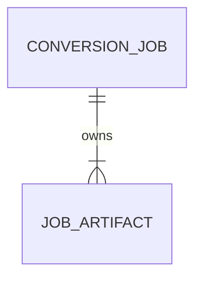

# Convert camera RAW images to JPEG

**Approved:** 2026-11-22 - user: "Você tem total liberdade pra seguir os planos e features já definidos. SÓ VAI."
**Settled mid-build:** none.
**Review:** sent at e187b35.
**Fix pass:** done - enforce the RAW 100 MiB cap during multipart streaming, verify no excess bytes are spooled, and cover the 40 MP area guard before demosaicing.

## Problem

The image catalog still marks camera RAW conversion as coming soon. People with photos from supported cameras must install another converter or send files to a third party. The approved roadmap names RAW-to-JPEG conversion but supplies no usage evidence.

When this ships, a visitor can convert one or more supported camera RAW files into local JPEG downloads.

## Shape

The feature reuses the existing upload parser, job queue, image form, job status, and artifact download. The API validates the upload extension and byte limits, while LibRaw decoding and image bounds run in the per-file Linux child reached by worker conversion tests.

1. A visitor selects the active RAW catalog card and uploads one or more RAW files with JPEG output selected.
2. `main.py` (exists) enforces the extension, per-file and aggregate byte limits, stores inputs, and creates one `image.from_raw` job.
3. `worker.py` (exists) dispatches each input to `raw_ops.py` (new), which copies that file into a private temporary root and launches `raw_worker.py` (new) with resource limits and Landlock.
4. `raw_worker.py` (new) uses `rawpy` linked to the pinned shared LibRaw 0.22.3 decoder, checks dimensions before demosaicing, then writes one metadata-free sRGB JPEG.
5. `worker.py` (exists) stores each JPEG or the existing ZIP bundle; existing job status and download routes expose the result.

```mermaid
flowchart LR
    A[1 main.py (exists): validate and queue] --> B[2 worker.py (exists): dispatch each input]
    B --> C[3 raw_ops.py (new): isolate one file]
    C --> D[4 raw_worker.py (new): bounded LibRaw decode]
    D --> E[5 worker.py (exists): store JPEG or ZIP]
    E --> F[5 existing status and download routes]
```

**Changes underneath**

| Front | What changes |
| --- | --- |
| image operation | Add `image.from_raw`; one to the configured maximum of supported camera RAW inputs produces JPEG outputs. |
| native decoder | Add `rawpy==0.28.0` and build it against stable LibRaw 0.22.3 in a Docker build stage; keep the LGPL shared library and its notices in the runtime image. Disable OpenMP and optional GPL demosaic packs. |
| image limits | Keep the configured 100 MiB per-file upload limit; reject decoded images above 40 megapixels or 32,768 pixels on either side; cap child address space, CPU, and output. |
| image catalog and form | Enable the RAW card, accept the supported extension list, lock output to JPEG, and localize capability limits and errors in PT-BR and English. |
| stored data | No schema change or backfill; use existing job and artifact records. |
| readers | The catalog, shared converter form, job status, and download flow consume the new operation. |



New: nothing - the existing job and artifact records represent source files and JPEG outputs.

## Surface

| Route | In | Out | Status | Who |
| --- | --- | --- | --- | --- |
| `POST /api/jobs` (existing; new `image.from_raw`) | 1 to configured maximum supported RAW files, within existing byte limits; JPEG output | Existing queued job response | `202`; `400` malformed multipart; `413` byte limit; `415` unsupported extension; `422` invalid options or file count | anyone |
| `GET /api/jobs/{job_id}` (unchanged) | Job id | Existing state and localized failure | `200`, `404` unknown job | anyone with the job id |
| `GET /api/jobs/{job_id}/download` (unchanged) | Successful job id | One JPEG or the existing ZIP of JPEGs | `200`, `404` unknown job, `409` pending or failed | anyone with the job id |

## Landing

| One-way door | Literal shape | Alternative rejected |
| --- | --- | --- |
| RAW decoder | Pin `rawpy==0.28.0` and build it against the stable LibRaw `0.22.3` shared library in Docker; disable OpenMP and optional GPL demosaic packs; include rawpy MIT and LibRaw LGPL-2.1 notices. | The published rawpy wheel is built against the prior LibRaw 0.22.2 release; compiling the same stable wrapper against 0.22.3 includes the current bugfix release for anonymous, untrusted uploads without using a public snapshot. |
| Input contract | Accept `.3fr`, `.ari`, `.arw`, `.bay`, `.cap`, `.cr2`, `.cr3`, `.crw`, `.dcr`, `.dcs`, `.dng`, `.drf`, `.eip`, `.erf`, `.fff`, `.gpr`, `.iiq`, `.k25`, `.kdc`, `.mdc`, `.mef`, `.mos`, `.mrw`, `.nef`, `.nrw`, `.orf`, `.pef`, `.ptx`, `.raf`, `.raw`, `.rw2`, `.rwl`, `.sr2`, `.srf`, `.srw`; accept only files LibRaw can decode. | Extension-only conversion claims can accept files that are not camera RAW or use unsupported codecs. |
| Disabled parser formats | Do not accept Foveon `.x3f` while LibRaw's optional X3F parser is disabled for untrusted uploads. | LibRaw disables this optional parser because of its robustness history with malformed files. |
| Output and resource bounds | JPEG quality 92, 8-bit sRGB, camera white balance and embedded orientation, no EXIF/XMP/ICC copied; 100 MiB input, 40,000,000 decoded pixels, 32,768-pixel maximum side, 3 GiB address space, 120 CPU seconds, and 256 MiB output per file. | Preserving camera metadata or accepting unbounded sensor dimensions increases privacy and parser resource exposure. |

- The decoder receives only the file copied into its per-file temporary root, required application/runtime files, and no network; inability to apply Landlock fails closed.
- The worker processes a batch sequentially; every input must convert for the job to succeed, and a failed job has no downloadable partial output.

## Criteria

### S1: Convert supported camera RAW files to JPEG locally (P1)

The coming-soon RAW catalog card becomes a bilingual, batch-capable local converter.

**Acceptance Criteria**

1. WHEN a visitor selects the RAW converter THEN the shared form SHALL show one or more RAW file inputs, JPEG as the only output, the supported extension list, the 40 MP and 32,768-pixel limits, and the local-processing notice in PT-BR and English.
2. WHEN a visitor submits 1 to the configured maximum number of supported RAW files with valid options THEN the API SHALL queue exactly one `image.from_raw` job and the worker SHALL produce exactly one JPEG per input; one output SHALL download directly and multiple outputs SHALL use the existing ZIP bundle.
3. IF any filename extension is outside the listed input contract THEN the API SHALL return `415 unsupported_format` and create no job; IF the file has an allowed extension but LibRaw cannot decode it or its data is corrupt/truncated THEN the worker SHALL fail the job with a safe localized error and expose no partial download.
4. IF any file exceeds the configured per-file limit or the upload exceeds the aggregate limit THEN the streaming upload parser SHALL return `413` before creating a job or retaining the excess bytes.
5. IF an invalid output format, unsupported option, zero inputs, or too many inputs is submitted THEN the API SHALL return the existing `422` error code and create no job.
6. WHEN the child decodes a file no larger than 40,000,000 pixels and 32,768 pixels on either side THEN it SHALL apply LibRaw camera white balance and orientation, output 8-bit sRGB JPEG at quality 92, and copy no EXIF, XMP, or ICC metadata.
7. IF decoded dimensions exceed 40,000,000 pixels or either side exceeds 32,768 pixels, or if processing exceeds 3 GiB address space, 120 CPU seconds, or 256 MiB output THEN the worker SHALL fail the job and provide no downloadable partial file.
8. WHILE LibRaw processes a source THEN it SHALL run in a per-file child with Landlock limited to that file's private temporary root and required runtime files, with no `/tmp` sibling access, no network, and sequential batch processing; if isolation is unavailable, conversion SHALL fail closed.
9. WHILE a job is queued or processing THEN the shared form SHALL show its existing progress state and prevent duplicate submission; on failure it SHALL show the safe localized error and allow correction and retry.
10. WHEN the converter is used at a 360 CSS-pixel viewport THEN its controls and job result SHALL remain usable without horizontal page overflow.

## Out of scope

| Excluded | Why |
| --- | --- |
| TIFF, JPEG, or embedded-preview extraction presented as RAW development | The output must be developed from sensor data through LibRaw, not copied from an embedded preview. |
| Editing, resizing, color-profile preservation, noise reduction, sharpening, exposure controls, batch settings per file, and metadata preservation | This is a fixed local conversion path with bounded output and privacy behavior. |
| Every proprietary RAW variant or files LibRaw cannot decode | The UI and docs list accepted extensions, but successful decoding depends on LibRaw's supported cameras/codecs and the actual file. |
| HEIC/HEIF conversion, already delivered in the preceding feature | Keep the RAW decoder and security review isolated from HEIC changes. |

## Assumptions

| Assumption | Chosen default | Rationale | Confirmed? |
| --- | --- | --- | --- |
| Number of source files | 1 to the existing configured batch maximum | RAW-to-JPEG is part of the existing batch converter; the worker decodes files sequentially under per-file limits. | y - user delegated implementation details |
| Demosaicing and camera defaults | rawpy stable defaults with camera white balance, embedded orientation, sRGB 8-bit output, and automatic brightness | Produces a direct JPEG without adding a settings panel; actual color appearance varies by camera. | y - user delegated implementation details |
| Installation size | Add LibRaw and the rawpy wrapper to the self-hosted Docker image | RAW processing requires a native decoder; the user delegated implementation choices and approved local processing. | y - user delegated implementation details |
| Unsupported files | Fail the job safely without a partial output | Many RAW extensions and compression variants exist; extension acceptance cannot guarantee decoder support. | y - user delegated implementation details |

**Open questions:** none - the user delegated the complete approved roadmap and implementation choices.

## Differences from the source

The original example names `.raw` as a RAW input. The product also accepts the explicit camera RAW extension list in `Landing`; decoder success remains limited to formats supported by LibRaw.

## Sources

- `.specs/features/project-foundation/plan.md` - approved stage 5 conversion roadmap and local-processing requirement.
- `.specs/features/image-from-heic/plan.md` - separate HEIC/HEIF delivery and per-file decoder isolation precedent.
- [LibRaw 0.22.3 release](https://github.com/LibRaw/LibRaw/releases/tag/0.22.3) - stable bugfix release.
- [LibRaw 0.22.3 source archive](https://www.libraw.org/data/LibRaw-0.22.3.tar.gz) - pinned build input; SHA-256 `789f3c33466210a1a0907f747a97c715d21bbf4af712f257fcbbd90111b227e4`.
- [LibRaw install instructions](https://www.libraw.org/docs/Install-LibRaw.html) - shared-library build and install flags.
- [LibRaw licenses and update policy](https://www.libraw.org/) - LGPL-2.1 or CDDL licensing and stable-release guidance for untrusted files.
- [LibRaw optional parser policy](https://www.libraw.org/node/2566) - X3F support requires an optional parser that is disabled by default for malformed-file safety.
- [rawpy 0.28.0 release](https://github.com/letmaik/rawpy/releases/tag/v0.28.0) - pinned MIT wrapper release and its LibRaw 0.22.2 baseline.
- [rawpy 0.28.0 parameters](https://letmaik.github.io/rawpy/api/rawpy.Params.html) - output color, bit depth, camera white balance, brightness and orientation behavior.
- [CC0 camera RAW test fixtures](https://github.com/tellodaniel/revelraw-sample-raw-files) - source of a small, redistributable integration-test fixture.
