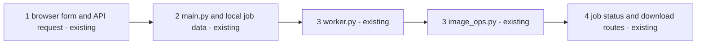

# Create image memes

**Approved**: 2026-11-21 - user: "Pode seguir nas implementações dde acordo com o [$tlc-spec-lean](<C:\\Users\\Fernando Paladini\\.codex\\skills\\tlc-spec-lean\\SKILL.md>) até o final. Vá abrindo PRs conforme precisar e vá seguindo tudo da implementação"
**Settled mid-build:** none
**Review:** sent at 79290af
**Fix pass:** done - consolidated the duplicate plan sections, added a one-pixel bold overdraw, tested centering/wrapping/outline/ellipsis and fail-before-queue for invalid meme requests, and checked PT-BR/English UI labels; full test suite, Ruff, JavaScript syntax, diff check, and plan validation pass

## Problem

The image catalog contains a disabled meme maker, so visitors cannot caption an image in the self-hosted toolbox. A visitor who wants a meme must leave the site or edit the image elsewhere. When this ships, visitors can add captions to their own images on the server they control.

## Shape

Reuse the existing image pipeline and queued job flow; do not duplicate upload, persistence, or download code. The rules that affect outcomes run in `main.py`, `worker.py`, and `image_ops.py`, which the repository tests exercise.

1. The browser submits one image and `image.meme` caption/format options to `POST /api/jobs`; the existing UI and API validate the operation and options before queueing.
2. `main.py` stores the input in the existing local job files and the operation/options in the existing job tables.
3. The existing worker claims the job and calls `image_ops.process_image` (exists), which applies EXIF orientation, wraps and draws captions, and writes one output image.
4. The existing status and download routes return the terminal state and the result, or an error without a partial output.

Data: none - the operation reuses existing `conversion_jobs` and `job_artifacts`; captions live in the existing generic options JSON for this job. No table or migration is added.

### Changes underneath

| Existing element | Change | Readers and consequence |
| --- | --- | --- |
| `image.*` operation names | Add `image.meme` to supported image operations and require one input image | API, UI, and worker recognize this operation; each has a regression check. |
| `conversion_jobs.options_json` | Store validated `top_text`, `bottom_text`, and output format for `image.meme` | The image worker consumes these fields. Existing jobs and other operation options remain unchanged. |
| `job_artifacts` and local job files | Continue storing input/output artifacts through existing APIs | Existing status, cleanup, and download readers remain authoritative. |
| Meme catalog entry | Change from disabled catalog card to an active tool card | UI filtering and selection expose the operation. |

## Surface

| Route | Input | Output | Status | Who |
| --- | --- | --- | --- | --- |
| `POST /api/jobs` (existing, new `image.meme` operation) | One multipart image, JSON options with `top_text` and/or `bottom_text` (1-300 Unicode characters each), optional `format` (`JPEG`, `PNG`, `WEBP`) | Queued job | `202`, `422` invalid settings/count, `415` unsupported extension | anyone |
| `GET /api/jobs/{job_id}` (existing) | Job id | Job status | `200`, `404` unknown job | anyone |
| `GET /api/jobs/{job_id}/download` (existing) | Successful job id | One image | `200`, `409` while processing or after failure, `404` unknown job | anyone |

## Landing

None - no schema, public route signature, or new runtime dependency is introduced; the existing generic job contract carries operation-specific options.

## Criteria

### S1: Create a local meme image (P1)

**Acceptance Criteria**

1. WHEN a visitor selects the `Gerador de memes` card THEN the page SHALL show one image picker, top and bottom caption fields, an output-format selector defaulting to JPEG, and the `Criar meme` action.
2. WHEN the visitor uploads one supported static image, enters at least one non-whitespace caption, selects JPEG, PNG, or WebP, and submits THEN the existing job flow SHALL return one downloadable image with the selected format and oriented input dimensions.
3. WHEN captions are rendered THEN the system SHALL center each caption, wrap it to the image width, scale text to fit the top or bottom half, draw visibly bold high-contrast white glyphs with a dark outline, and end with an ellipsis when a small image cannot show the entire caption without changing image dimensions.
4. WHEN a PNG or WebP image with transparency is processed THEN the system SHALL retain alpha; WHEN a transparent image is output as JPEG THEN the system SHALL composite it onto white.
5. WHEN an image has EXIF orientation THEN the system SHALL apply that orientation before sizing or positioning captions and retain the resulting oriented dimensions.
6. IF the request has zero or multiple images, no non-whitespace caption, a field longer than 300 Unicode characters, or an unsupported output format THEN the API SHALL return 422 before creating a job.
7. IF the uploaded image has an unsupported extension or content THEN the API SHALL return 415 or 422 respectively and SHALL NOT create a job.
8. IF image processing fails THEN the worker SHALL mark the job failed and the download route SHALL return 409 without an output artifact.
9. WHEN a visitor switches between PT-BR and English THEN the page SHALL localize the card, title, field labels, placeholders, and submit action.
10. WHEN the page is opened at 360 CSS pixels wide THEN the meme controls SHALL remain reachable without horizontal page overflow.

## Out of scope

- Stock or bundled photographic templates, externally licensed meme images, remote fonts, stickers, freeform canvas editing, batch generation, and AI image generation.
- User claims or guarantees about copyright status of uploaded images.

## Assumptions

| Decision | Chosen default | Rationale | Confirmed? |
| --- | --- | --- | --- |
| Image/template source | User supplies one image; no stock templates are bundled | Avoids third-party image licensing and keeps uploads within the existing local tool flow | y - user delegated completion of the roadmap |
| Caption style | Centered white text with dark outline and a one-pixel bold overdraw using Pillow's bundled font | Keeps captions readable without fetching remote fonts or adding a dependency | y - user delegated implementation details |
| Empty captions | Both fields may be empty individually, but at least one must contain non-whitespace text | A blank caption should not produce an unchanged result | y - user delegated implementation details |
| Caption length | Up to 300 Unicode characters per field | Bounds layout work and supports a short multiline caption | y - user delegated implementation details |
| JPEG transparency | Composite onto white | JPEG cannot preserve alpha; white is a predictable background | y - user delegated implementation details |

**Open questions:** none - the user delegated the remaining product details and the defaults above keep the feature local.

## Sources

- nothing - no screenshots, captures, or external source are provided for this feature.

