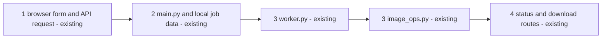

# Upscale images

**Approved**: 2026-11-21 - user: "Pode seguir nas implementações dde acordo com o [$tlc-spec-lean](<C:\\Users\\Fernando Paladini\\.codex\\skills\\tlc-spec-lean\\SKILL.md>) até o final. Vá abrindo PRs conforme precisar e vá seguindo tudo da implementação"
**Settled mid-build:** none
**Review:** pending
**Fix pass:** pending review

## Problem

The image catalog shows image upscaling as coming soon, leaving visitors without a local way to make an image larger for reuse. When this ships, visitors can enlarge one image at 2x or 4x without sending it to a third party and can see the exact output dimensions before downloading it.

## Shape

Reuse the existing image operation and job flow; do not duplicate uploads, job records, or downloads. Validation and dimension limits run in `main.py`, image processing runs in `image_ops.py`, and tests exercise both.

1. The browser submits one image and `image.upscale` options (`scale`, format) to `POST /api/jobs`; existing UI and `main.py` validate fields and the resulting oriented dimensions before queueing.
2. `main.py` stores the input and validated options in existing local job artifacts and SQLite.
3. Existing `worker.py` calls `image_ops.process_image`, which applies EXIF orientation, Lanczos resizing, and a fixed unsharp mask, then writes one output.
4. Existing status and download routes return the result or a terminal failure without a partial output.

Data: none - the operation uses existing `conversion_jobs` and `job_artifacts`; no schema change is made.

### Changes underneath

| Existing element | Change | Readers and consequence |
| --- | --- | --- |
| Image operation names | Add `image.upscale`; require exactly one input | API, UI, and worker recognize the operation; each has a regression check. |
| Generic job options JSON | Store validated scale and output format | The image worker reads these values; other job options and existing rows are unchanged. |
| Image catalog | Activate the existing upscale card | Category filtering and tool selection show the new operation. |

## Surface

| Route | Input | Output | Status | Who |
| --- | --- | --- | --- | --- |
| `POST /api/jobs` (existing, new `image.upscale` operation) | One multipart static image; `scale` 2 or 4; optional `format` `PNG`, `JPEG`, or `WEBP` | Queued job | `202`, `422` invalid settings or output pixel limit, `415` unsupported extension | anyone |
| `GET /api/jobs/{job_id}` (existing) | Job id | Job status | `200`, `404` unknown job | anyone |
| `GET /api/jobs/{job_id}/download` (existing) | Successful job id | One upscaled image | `200`, `409` while processing or after failure, `404` unknown job | anyone |

## Landing

None - no schema, public route signature, or runtime dependency is introduced; existing image and job contracts are extended with one operation.

## Criteria

### S1: Upscale one image (P1)

**Acceptance Criteria**

1. WHEN a visitor selects the `Melhorar imagem` card THEN the page SHALL show a single-image picker, a 2x/4x scale selector defaulting to 2x, a PNG/JPEG/WebP output selector, a visible 40-megapixel output limit, and a localized action.
2. WHEN a visitor submits one supported image with scale 2 or 4 THEN the existing job flow SHALL return one image whose oriented width and height are each multiplied by the selected scale.
3. WHEN the image is resized THEN the worker SHALL use Pillow Lanczos resampling followed by the fixed unsharp mask and SHALL preserve oriented dimensions apart from the selected scale.
4. WHEN a transparent PNG or WebP is upscaled to PNG or WebP THEN the system SHALL retain alpha; WHEN JPEG is selected THEN transparent pixels SHALL be composited onto white.
5. IF scale is not 2 or 4, the output format is unsupported, the request has zero or multiple images, or the scaled output exceeds 40,000,000 pixels THEN the API SHALL return 422 before creating a job.
6. IF the image has unsupported content or extension THEN the API SHALL return 422 or 415 respectively and SHALL NOT create a job.
7. IF worker processing fails THEN the job SHALL become failed and its download route SHALL return 409 without an output artifact.
8. WHEN a visitor changes PT-BR/English or the scale selector THEN the page SHALL localize the tool and submit the selected scale with the job.
9. WHEN the page is opened at 360 CSS pixels wide THEN the input, scale, and output controls SHALL remain reachable without horizontal page overflow.

## Out of scope

- AI or generative detail reconstruction, cloud inference, batch processing, arbitrary scales, and face enhancement.
- Promising that interpolation restores detail absent from the source image.

## Assumptions

| Decision | Chosen default | Rationale | Confirmed? |
| --- | --- | --- | --- |
| Upscaling method | Pillow Lanczos plus a fixed unsharp mask; no model | Keeps processing local, reproducible, and free of a large model or network dependency | y - user delegated implementation details |
| Available scales | 2x and 4x, default 2x | Covers common enlargement while bounding controls and work | y - user delegated implementation details |
| Output cap | 40,000,000 pixels after scaling | Bounds image allocation; reject before queueing | y - user delegated implementation details |
| JPEG with alpha | Composite on white | JPEG does not support alpha and matches existing image conversion behavior | y - user delegated implementation details |
| Output format default | PNG | Preserves detail and transparency by default | y - user delegated implementation details |

**Open questions:** none - the user delegated the feature choices and these defaults keep it simple and local.

## Sources

- [Pillow `Image.resize` reference](https://pillow.readthedocs.io/en/stable/reference/Image.html) - Lanczos resampling API.
- [Pillow `ImageFilter.UnsharpMask` reference](https://pillow.readthedocs.io/en/stable/reference/ImageFilter.html) - fixed local sharpening API.
