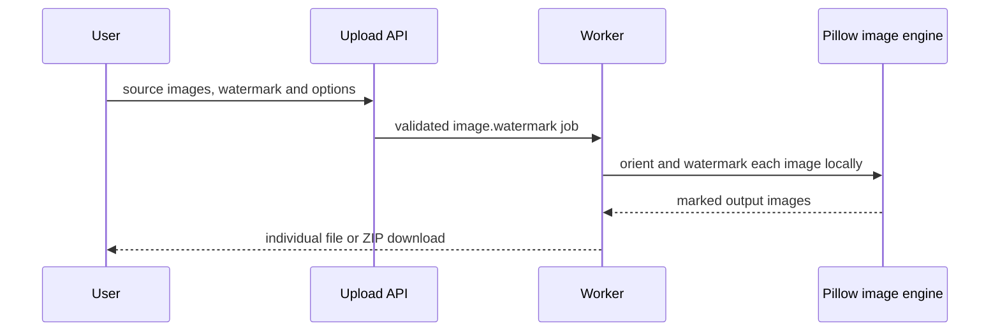
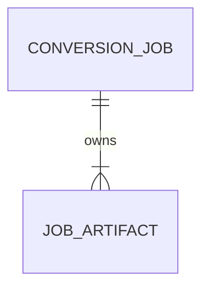

# Watermark images

**Approved**: 2026-11-21 - user: “Pode seguir nas implementações dde acordo com o [$tlc-spec-lean](<C:\Users\Fernando Paladini\\.codex\\skills\\tlc-spec-lean\\SKILL.md>) até o final. Vá abrindo PRs conforme precisar e vá seguindo tudo da implementação”
**Settled mid-build:** none
**Review:** pending implementation
**Fix pass:** pending review

## Problem

The image catalog lists watermarking as coming soon. Visitors need to apply a short text label or a reusable image mark to one or more local images, with visible control over opacity and placement.

When this ships, visitors can select text or image watermarking, choose its position and opacity, and download marked images in their chosen supported format.

## Shape

Add `image.watermark` to the existing image job flow. Text mode receives only the source image batch; image mode receives the same batch plus one separately selected PNG/JPEG/WebP overlay. The API records source count and validates all options before queueing. The worker applies EXIF orientation and watermarking locally to every source, then uses existing single-file or ordered ZIP download behavior. The overlay file is not emitted as an output.

1. Visitor selects Watermark image and chooses Text or Image mode.
2. Visitor enters a short text or uploads one reusable overlay, then selects a position, opacity and output format.
3. The API validates the source batch and optional overlay before creating the job.
4. The worker applies the same mark to each source; one result downloads directly and multiple results download as a ZIP.

**Changes underneath**

| Front | What changes |
| --- | --- |
| domain | Add text and image watermark modes, placement, opacity and optional overlay processing. |
| stored data | No migration; existing jobs and artifacts store source, overlay, options and outputs. |
| readers | Activate catalog card, show mode-specific controls, document limits and output behavior. |

New: nothing - existing job and artifact records store operation, options, inputs and outputs.

## Surface

| Route | In | Out | Status | Who |
| --- | --- | --- | --- | --- |
| `POST /api/jobs` (extended) | 1-10 source images, optional PNG/JPEG/WebP overlay, `image.watermark` options | job ID/status URL | `202 Accepted`, `413 Request Too Large`, `415 Unsupported Media Type` or `422 Invalid Options` | anyone |
| `GET /` (extended) | Text/image mode, mark, placement and opacity controls | shared upload/conversion UI | `200 OK` | anyone |

## Landing

| One-way door | Literal shape | Alternative rejected |
| --- | --- | --- |
| Modes | Text mode requires nonempty text up to 120 characters; image mode requires exactly one PNG/JPEG/WebP overlay reused across the selected sources | Infer mode from filenames or silently omit a missing overlay. |
| Placement | Nine fixed positions with a small proportional inset | Freeform drag coordinates or per-image positions. |
| Opacity | Integer 10-100 percent applied to the watermark alpha | Separate opacity semantics per watermark mode. |
| Image overlay size | Preserve aspect ratio and fit within 25% of the source's shorter dimension; do not enlarge beyond its source size | Cover original content or arbitrarily stretch the mark. |
| Text appearance | Pillow default font sized to 5% of the shorter source dimension with a 12 px minimum and a dark outline for contrast | Add font installation, font upload or rich text styling. |
| Upload count | At most 10 multipart files total; image mode therefore permits at most 9 source images plus the one overlay | Exceed the app's existing parser limit. |

## Criteria

### S1: Add text watermark (P1)

**Acceptance Criteria**

1. WHEN a visitor selects Watermark image and Text mode THEN the system SHALL show a text field, nine positions, opacity, supported output formats and the existing source image workflow in PT-BR and English.
2. WHEN 1-10 supported source images are submitted with valid text options THEN the worker SHALL apply text at the selected position and opacity after EXIF orientation.
3. WHEN a single source is submitted THEN the visitor SHALL download one marked image; WHEN multiple sources are submitted THEN the visitor SHALL download one sanitized output per source in input order as a ZIP.
4. IF text is empty or longer than 120 characters, position is unknown, opacity is outside 10-100, or output format is unsupported THEN the API SHALL return `422` before creating a job.

### S2: Add image watermark (P1)

**Acceptance Criteria**

5. WHEN a visitor selects Image mode THEN the UI SHALL require exactly one overlay image in PNG, JPEG or WebP and reuse it for every source image.
6. WHEN a valid overlay and source batch are processed THEN the worker SHALL preserve overlay aspect ratio, apply its alpha and the chosen opacity, fit it within the defined size limit, and position it consistently.
7. IF the overlay is absent, duplicated, unsupported, malformed, exceeds image resource bounds, or a source fails THEN the job SHALL fail without a downloadable partial result.
8. WHEN the feature ships THEN PT-BR and English users SHALL see localized controls and errors, and the page SHALL have no horizontal overflow at 360 px.

## Out of scope

| Excluded | Why |
| --- | --- |
| Freeform positioning, tiling and rotation | Nine fixed positions cover the requested placement control with predictable output. |
| Font selection and color controls | Defaults keep this first image-watermark tool simple and avoid system font installation. |
| Animated image input | The current image worker accepts static formats only. |

## Assumptions

| Assumption | Chosen default | Rationale | Confirmed? |
| --- | --- | --- | --- |
| Overlay mode applies one mark to the batch | Reuse one image overlay for each source | Matches one operation form and keeps input limits clear. | y - user delegated implementation details |
| Position inset | 2% of the shorter source dimension, minimum 4 px | Keeps marks off the edge without requiring a second control. | y - user delegated |

**Open questions:** none - user delegated sequencing and implementation details.

## Differences from source

The source description does not specify font, mark size, image scaling, inset or exact allowed positions. This plan defines restrained, repeatable defaults; it does not add freeform editing or custom fonts.

## Sources

- `.specs/features/initial-project/request.md` - original image watermark request.
- `.specs/features/initial-project/plan.md` - local image processing, static formats and resource limits.
- `.specs/STATE.md` - local processing and catalog decisions.
