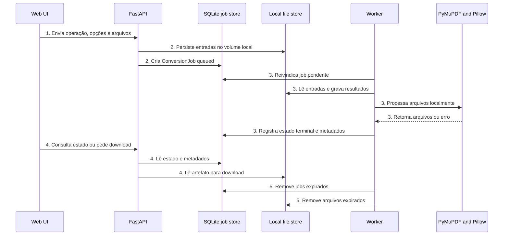
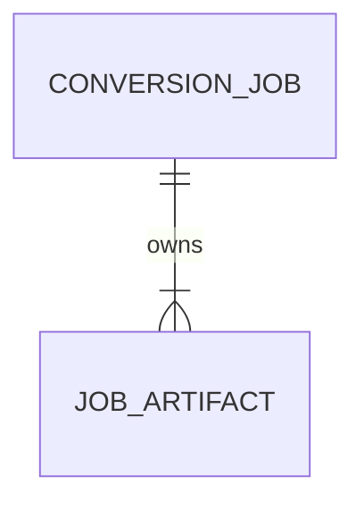
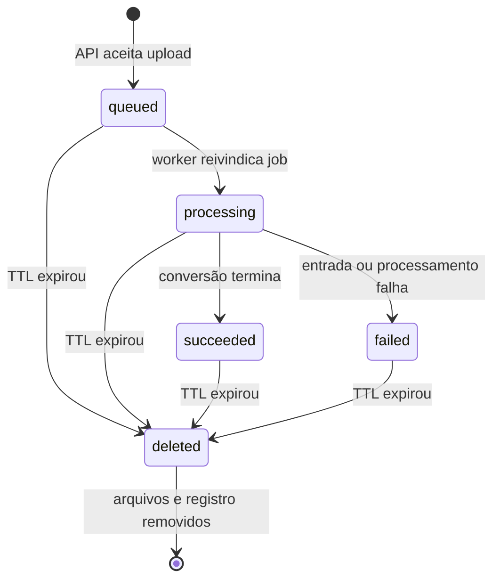

# I Love Open Converter — primeira versão utilizável

**Approved**: 2026-11-19 - user: "Continue working toward the active thread goal."
**Settled mid-build:** The PDF dependency is `pymupdf-lite==2.1`, which retains the PyMuPDF API while avoiding optional layout-model dependencies in the base image; basic PDF operations remain local and AGPL-licensed.
**Review**: not sent
**Fix pass**: not started

## Problem

Quem quer converter arquivos em um HomeLab precisa alternar entre ferramentas separadas ou instalar e aprender programas e dependências. A solicitação aponta isso como barreira para pessoas sem familiaridade técnica; não apresenta métricas de usuários ou de tempo perdido.

Quando esta versão estiver pronta, qualquer pessoa com acesso ao serviço poderá escolher uma operação de PDF ou imagem no navegador, enviar arquivos, acompanhar o processamento e baixar o resultado. Os arquivos e o processamento permanecerão no host self-hosted, sem anúncios ou telemetria externa.

## Shape

O projeto reutiliza bibliotecas open-source de PDF e imagem, SQLite e o sistema de arquivos local em vez de manter conversores próprios ou exigir um broker externo. Regras de validação, limites, estados dos jobs e expiração ficam no backend Python, acessíveis à suíte de testes do projeto.

1. O navegador carrega `Web UI` (new), apresenta as ferramentas em português ou inglês e envia arquivos e opções para `FastAPI` (new).
2. `FastAPI` (new) valida operação, parâmetros e limites; grava os arquivos no `Local file store` (new) e cria um `ConversionJob` no `SQLite job store` (new).
3. `Worker` (new) reivindica jobs pendentes no SQLite, lê os arquivos locais e chama `PyMuPDF` e `Pillow` (new dependencies) para converter; registra resultado ou erro e grava os artefatos no armazenamento local.
4. `FastAPI` (new) lê o estado do job e entrega metadados ou o arquivo de resultado; `Web UI` (new) atualiza o andamento e oferece o download até a expiração.
5. `Worker` (new) remove registros e artefatos expirados segundo `JOB_RETENTION_HOURS`.

**Changes underneath**

| Front | What changes |
| --- | --- |
| domain | `ConversionJob` é um job de conversão assíncrono com estado `queued`, `processing`, `succeeded` ou `failed`; nenhum domínio existente para preservar. |
| stored data | Novo SQLite local; sem migração de dados preexistentes. O volume mantém banco e arquivos juntos. |
| readers | `FastAPI` lê estado e metadados para status/download; `Worker` reivindica jobs e limpa itens expirados. Ambos recebem os mesmos caminhos e configurações pelo Docker Compose. |

New: `ConversionJob` contém operação, estado, opções validadas, timestamps e expiração; `JobArtifact` relaciona cada entrada ou saída ao job e ao caminho relativo em disco. One-way constraints: `ConversionJob.id` é um identificador aleatório opaco e único; `JOB_ARTIFACT.job_id` referencia `ConversionJob.id` (door 1).

## Surface

| Route | In | Out | Status | Who |
| --- | --- | --- | --- | --- |
| `GET /` | nenhum | HTML da interface responsiva | `200` | anyone |
| `POST /api/jobs` | `multipart/form-data`: `operation`, repetidos `files`, e `options` JSON conforme a operação | `{ "job_id", "state", "status_url" }` | `202`; `413 file_too_large` ou `request_too_large`; `415 unsupported_format`; `422 invalid_file` ou `invalid_options` | anyone |
| `GET /api/jobs/{job_id}` | UUID opaco | `{ "job_id", "state", "error?", "download_url?" }` | `200`; `404 job_not_found` para id inexistente ou expirado | qualquer pessoa com o id |
| `GET /api/jobs/{job_id}/download` | UUID opaco | arquivo de resultado; ZIP quando a operação produz vários arquivos | `200`; `404 job_not_found`; `409 job_not_ready` | qualquer pessoa com o id |
| `GET /healthz` | nenhum | `{ "status": "ok" }` quando o web está pronto | `200`; `503 service_unavailable` | anyone |

## Landing

| One-way door | Literal shape | Alternative rejected |
| --- | --- | --- |
| Licença do projeto (AD-002) | `AGPL-3.0-only` no arquivo `LICENSE`; código fonte oferecido aos usuários do serviço conforme os termos da licença | MIT/Apache-2.0, pois não preservam a obrigação de oferecer o código de modificações servidas pela rede que o usuário explicitamente deseja manter abertas |
| Estado durável de jobs (AD-003) | SQLite em `./data/i-love-open-converter.sqlite3`, tabela `conversion_jobs` com `id TEXT PRIMARY KEY`, `operation TEXT`, `state TEXT`, `options_json TEXT`, `created_at`, `updated_at`, `expires_at`, `error_code`; tabela `job_artifacts` com FK `job_id`, papel (`input`/`output`), nome original sanitizado, caminho relativo, MIME e tamanho em bytes; WAL e reivindicação de job por transação condicional | Redis + broker dedicado, pois aumenta serviços e configuração para o alvo single-host; sem banco, pois o worker e a interface precisam compartilhar estado durável após reinícios |
| Identificador de download sem conta | UUIDv4 gerado com fonte criptográfica; APIs não expõem listagem global de jobs; status e download exigem o id completo | Id incremental, pois permite adivinhar e ler trabalhos de outras pessoas em uma instalação sem autenticação |
| Motor de PDF | PyMuPDF Lite/MuPDF (`pymupdf-lite==2.1`) sob AGPL-3.0 para manipulação, rasterização e compressão sem perdas; versão fixada por lockfile; sem extras de layout/OCR no caminho básico | Instalar o pacote completo e suas dependências opcionais de modelos, pois isso aumenta imagem e complexidade sem necessidade para conversões básicas |
| Motor de imagem | Pillow sob dependência fixada por lockfile; codecs habilitados na imagem Docker documentados | conversores remotos ou formatos cujo suporte exigiria serviços externos, pois arquivos devem permanecer no host |
| Implantação local | Docker Compose com `web` e `worker`, volume compartilhado `./data:/data`, arquivo `.env` não versionado e `.env.example` versionado | instalação manual obrigatória e dependências externas, pois a meta é self-host simples em HomeLab |
| Interface | FastAPI + Jinja, CSS e JavaScript servidos pelo mesmo host; fontes e scripts locais, sem CDN, analytics ou chamadas de runtime para terceiros | SPA com toolchain independente, pois aumenta o conjunto de serviços/builds para uma interface inicial de uma página e jobs |

- Nada além dessas escolhas introduz contrato ou dado persistente difícil de reverter.

## Criteria

### S1: Converter uma imagem e baixar o resultado (P1)

Uma pessoa percorre o fluxo central no navegador sem login: envia uma imagem, escolhe o formato de saída, aguarda o worker e baixa o resultado.

**Acceptance Criteria**

1. WHEN qualquer pessoa abre `/` THEN o sistema SHALL mostrar ferramentas agrupadas em PDF e imagem, com alternância de idioma PT-BR/EN, estado vazio que orienta a selecionar uma ferramenta/arquivo e controles operáveis por teclado.
2. WHEN a pessoa escolhe `Converter imagem`, seleciona um arquivo JPEG/PNG/WebP/BMP/TIFF e formato de saída PNG/JPEG/WebP, e aciona `Converter` THEN o sistema SHALL enviar um job sem exigir conta e mostrar `Na fila`, `Convertendo`, `Concluído` ou uma mensagem de erro acionável.
3. WHEN `POST /api/jobs` recebe operação válida e arquivos dentro dos limites THEN o sistema SHALL responder `202` com `job_id`, `state: queued` e `status_url`; opções inválidas SHALL responder `422 invalid_options`.
4. IF um arquivo exceder `MAX_FILE_SIZE_MB` (padrão `100`) THEN o sistema SHALL responder `413 file_too_large`; IF o corpo exceder `MAX_TOTAL_UPLOAD_MB` (padrão `500`) THEN SHALL responder `413 request_too_large`; IF a quantidade exceder `MAX_FILES_PER_JOB` (padrão `10`) THEN SHALL responder `422 too_many_files`.
5. IF o conteúdo não for válido para o formato alegado THEN o sistema SHALL rejeitar o job com `422 invalid_file`; IF o formato não estiver entre os suportados THEN SHALL responder `415 unsupported_format`; nomes de arquivo serão normalizados e nunca usados como caminho absoluto.
6. WHEN o worker processa um job aceito THEN `GET /api/jobs/{job_id}` SHALL retornar `200` com `state` em `queued|processing|succeeded|failed`; `failed` inclui `error.code` e mensagem segura, sem traceback ou caminho local.
7. WHEN o job termina com sucesso THEN o download SHALL responder `200` com nome e MIME corretos; IF o job ainda estiver na fila ou processando THEN SHALL responder `409 job_not_ready`; IF o id for inexistente ou expirado THEN SHALL responder `404 job_not_found`.
8. WHEN o navegador exibe a página entre 360 px e 1440 px de largura THEN SHALL manter os controles e nomes legíveis sem rolagem horizontal da página; listas com até 10 arquivos permanecem visíveis e a página rola verticalmente.
9. IF o navegador ainda não selecionou arquivos THEN SHALL exibir orientação vazia; WHILE o upload ou job ocorre SHALL exibir estado de carregamento; IF validação ou conversão falhar THEN SHALL exibir a mensagem correspondente e permitir retorno à seleção; WHEN concluído SHALL exibir resultado e controle `Baixar`.

### S2: Processar imagens em lote (P1)

O usuário aplica conversão, redimensionamento, compressão ou rotação a imagens raster comuns, em lote local.

**Acceptance Criteria**

10. WHEN uma pessoa escolhe `Converter imagem`, `Redimensionar imagem`, `Comprimir imagem` ou `Girar imagem` THEN o sistema SHALL aceitar imagens estáticas JPEG, PNG, WebP, BMP ou TIFF e produzir JPEG, PNG ou WebP; GIF/formatos animados, TIFF multipágina, SVG, PSD, HEIC e RAW são rejeitados com mensagem que informa formatos aceitos.
11. WHEN redimensiona uma imagem THEN o sistema SHALL aceitar largura e altura inteiras entre 1 e 10000 pixels, preservar proporção por padrão e rejeitar dimensões fora do limite com `422 invalid_options`.
12. WHEN comprime JPEG ou WebP THEN o controle `Qualidade` SHALL aceitar inteiros de 1 a 100, iniciar em `85` e aplicar a qualidade informada; para PNG SHALL otimizar sem conversão com perdas e exibir o tamanho original e o final sem prometer redução.
13. WHEN gira imagem THEN a pessoa SHALL escolher `90`, `180` ou `270` graus no sentido horário; a orientação EXIF SHALL ser aplicada antes da transformação.
14. WHEN uma operação em lote retorna várias imagens THEN o sistema SHALL disponibilizar um único ZIP com nomes sanitizados e extensão do formato escolhido; cada arquivo de entrada SHALL manter a correspondência com uma saída.

### S3: Organizar e converter PDFs (P1)

O usuário executa operações essenciais de PDF sem enviar conteúdo a terceiros.

**Acceptance Criteria**

15. WHEN a pessoa escolhe `Mesclar PDF` e seleciona de 2 a 10 PDFs THEN o sistema SHALL mesclá-los na ordem mostrada na lista reordenável e disponibilizar um PDF.
16. WHEN a pessoa escolhe `Dividir PDF` THEN SHALL aceitar intervalos de páginas no formato `1-3,5`; intervalos são baseados em páginas a partir de 1, preservam a ordem digitada e geram um ZIP com um PDF por intervalo; página inexistente, formato vazio ou sobreposição inválida responde `422 invalid_options`.
17. WHEN a pessoa escolhe `Girar PDF` THEN SHALL aceitar `90`, `180` ou `270` graus no sentido horário e aplicar a todas as páginas.
18. WHEN a pessoa escolhe `Comprimir PDF` THEN SHALL executar otimização sem perdas (coleta de objetos não usados, deduplicação e deflação de streams) e mostrar tamanho anterior e posterior; a mensagem não afirma redução quando o resultado não é menor.
19. WHEN a pessoa escolhe `PDF para imagem` THEN SHALL renderizar cada página como JPG a 150 DPI com qualidade 85 e fornecer um ZIP com uma imagem por página.
20. WHEN a pessoa escolhe `Imagem para PDF` THEN SHALL criar um PDF com uma página A4 por imagem estática, orientação escolhida para acompanhar a proporção da imagem, imagem ajustada dentro de margens brancas de 10 mm e ordem igual à lista de entrada.
21. IF um PDF exigir senha, estiver danificado ou for inválido THEN o job SHALL falhar de forma controlada com `422 invalid_file` e mensagem acionável; a API nunca retorna traceback ou conteúdo de outro job.

### S4: Self-host, privacidade e retenção local (P1)

O operador configura e inicia os dois serviços sem cadastro, dependência externa ou envio de arquivos para fora do host.

**Acceptance Criteria**

22. WHEN o operador copia `.env.example` para `.env` e executa `docker compose up -d` THEN os serviços `web` e `worker` SHALL iniciar, compartilhar o volume local `/data` e servir a interface em `APP_PORT` (padrão `8080`).
23. WHEN o operador configura `MAX_FILE_SIZE_MB`, `MAX_TOTAL_UPLOAD_MB`, `MAX_FILES_PER_JOB` ou `JOB_RETENTION_HOURS` no `.env` THEN web e worker SHALL usar os mesmos valores; `JOB_RETENTION_HOURS` inicia em `24` e aceita inteiro positivo.
24. WHEN job atinge `expires_at` THEN o worker SHALL remover entradas, resultados e registro SQLite; status e download para id expirado SHALL responder `404`.
25. WHILE processa arquivos THEN o sistema SHALL manter banco e artefatos em `./data`, sem serviço de nuvem, CDN, anúncios, analytics ou telemetria outbound; requisições feitas pelo usuário e downloads ocorrem apenas para o host configurado.
26. WHEN o operador consulta `GET /healthz` THEN SHALL receber `200 {"status":"ok"}` se o web está pronto e `503` caso contrário.
27. WHEN o visitante usa o seletor de idioma THEN todas as telas, rótulos, estados e erros próprios da aplicação SHALL estar disponíveis em português do Brasil e inglês; a escolha persiste no navegador.
28. WHEN o visitante escolhe uma ferramenta THEN o controle SHALL abrir o formulário correspondente; `Adicionar arquivos` SHALL abrir o seletor local e `Converter` SHALL validar opções e iniciar um job; `Baixar` SHALL transferir o artefato do job concluído.
29. WHEN o leitor abre `README.md` ou `README.pt-BR.md` THEN SHALL encontrar proposta, capacidades, limites, requisitos, configuração local, início rápido Compose, privacidade, licença e instruções para contribuir no idioma do arquivo.

## Out of scope

| Excluded | Why |
| --- | --- |
| Promessa literal de conversão de qualquer formato para qualquer outro formato | O conjunto é aberto e alguns formatos exigem conversores, codecs ou licenças adicionais; a primeira versão declara sua matriz suportada e permite expansão futura. |
| Word/Excel/PowerPoint/HTML e outros formatos Office/documento | Dependem de conversores adicionais (por exemplo, LibreOffice) e ampliam muito as dependências e a verificação da primeira versão. |
| OCR, busca, PDF para Word/Excel/PowerPoint/Markdown, sumarização ou tradução por IA, PDF/A, reparo avançado, formulários e comparação de documentos | Fase posterior; qualidade e processamento desses recursos excedem o conjunto inicial de operações locais. |
| Editar texto/elementos de PDF, assinatura eletrônica, proteger/desbloquear, marca d'água, numeração, recorte, redaction e ordenação/exclusão de páginas | Ferramentas avançadas que não são necessárias ao fluxo inicial de conversão e operações essenciais. |
| HEIC, RAW, SVG, PSD, GIF animado, TIFF multipágina, desfoque de rosto/placa, remoção de fundo, upscale, editor de fotos, stickers e memes | Exigem codecs, detecção ou manipulação especializados; primeira versão limita-se a imagens raster estáticas com codecs comuns. |
| Contas, cadastro, permissões, interface administrativa e autenticação OIDC/LDAP | O usuário decidiu que qualquer pessoa que alcance o HomeLab poderá usar o serviço e que a configuração não precisa de UI administrativa. |
| Armazenamento na nuvem, sincronização, envio de e-mail, publicação de resultados, telemetria e anúncios | Arquivos ficam locais e o usuário pediu uma ferramenta gratuita sem telemetria externa ou anúncios. |
| Multi-host, autoescalonamento e fila distribuída | O destino inicial é um host HomeLab com Docker Compose; a ADR documenta o limite single-host. |

## Assumptions

| Assumption | Chosen default | Rationale | Confirmed? |
| --- | --- | --- | --- |
| Operações iniciais | Converter/redimensionar/comprimir/girar imagens; mesclar/dividir/girar/comprimir PDF; PDF para JPG e imagens para PDF | O usuário respondeu “Escolha você conforme viabilidade”; conjunto cobre os fluxos frequentes com dependências open-source locais. | y - user delegated |
| Formatos iniciais de imagem | Entrada JPEG, PNG, WebP, BMP, TIFF estáticos; saída JPEG, PNG, WebP | Suporte comum do Pillow; evita instalar codecs especializados e documenta claramente o limite. | y - user delegated |
| Configuração operacional | `.env` interpolado pelo Compose; `.env.example` documenta portas, limites e retenção; arquivo `.env` fica fora do Git | O usuário delegou o mecanismo de configuração ao agente. | y - user delegated |
| Retenção inicial | 24 horas após a criação do job, configuráveis em `JOB_RETENTION_HOURS` | Valor padrão dá tempo para o download e limita acúmulo; usuário pediu retenção configurável e delegou a forma de configuração. | y - user delegated |
| Limites de lote | 10 arquivos e 500 MB por job, ambos configuráveis; teto por arquivo é 100 MB configurável | Valores limitam uso inesperado de disco/RAM; limite de 100 MB por arquivo foi escolhido explicitamente pelo usuário. | y - 100 MB; 10 arquivos/500 MB user delegated |
| Conversão de imagem para PDF | Página A4, orientação acompanhando a imagem, margem branca de 10 mm | Decisão simples para resultado imprimível sem adicionar editor de layout na primeira versão. | y - user delegated |
| Idiomas de documentação | README em inglês e README.pt-BR em português do Brasil | Projeto comunitário open-source e interface bilíngue servem ambos os públicos sem duplicar idioma em um único arquivo. | y - user delegated |
| Licença | AGPL-3.0 | Escolhida pelo usuário para manter aberta a versão servida pela rede. | y |
| Autenticação | Nenhuma; qualquer visitante com acesso ao host pode criar jobs | Escolha explícita do usuário; IDs opacos impedem enumeração simples, mas não representam identidade ou isolamento de conta. | y |
| Viewports | Layout suporta 360 px a 1440 px | Faixa confirmada pelo usuário, incluindo celular e desktop. | y |

**Open questions:** none - the user delegated remaining choices and confirmed the viewport range.

## Differences from the source

None - cited products are inspiration, not binding references; the first release implements a subset of their described capabilities.

## Sources

- User's feature request in `request.md` - binding for project goals and named capability examples.
- ILovePDF PT - non-binding - user: "inspiração forte" - informs PDF tool groupings and familiar upload/process/download flow.
- ILoveIMG PT - non-binding - user: "inspiração forte" - informs image tool groupings and batch operations.
- [PyMuPDF document operations and save/compression options](https://pymupdf.readthedocs.io/en/latest/document.html) - primary library documentation for PDF operations and lossless stream optimization.
- [PyMuPDF license information](https://pymupdf.readthedocs.io/en/latest/about.html) - primary source for AGPL/commercial licensing terms.
- [Pillow image format support](https://pillow.readthedocs.io/en/stable/handbook/image-file-formats.html) - primary library documentation for supported image codecs and animation caveats.
- [Docker Compose service dependencies and healthchecks](https://docs.docker.com/reference/compose-file/services/) - primary documentation for the two-service deployment and readiness check.
- [ADR 0001: Local SQLite job queue](../../adr/0001-local-job-queue.md) - accepted architecture decision for job processing and single-host storage.
