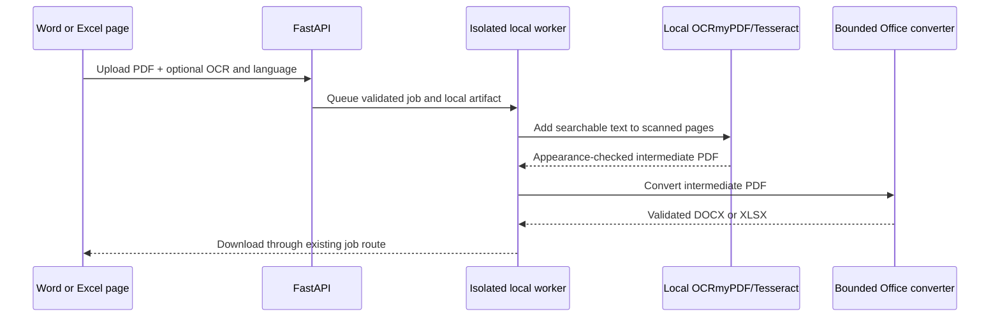

# OCR-assisted PDF exports to Office

**Approved:** 2026-11-23 - user: "É pra seguir, e ir criando PRs de tudo, mergeando, até finalizar completamente a implementação do nosso plano original!"
**Settled mid-build:** none.
**Review:** 2026-11-23 - fresh sub-agent review; implementation checks out, but combined OCR-to-Office output and API rejection paths had no regression coverage.
**Fix pass:** added combined PDF-to-DOCX and PDF-to-XLSX worker-flow regressions, invalid-option and 20-page-limit checks that assert no job is created, and deletion of the OCR intermediate after Office conversion. The first fix-pass CI run exposed an assertion using FastAPI's nested error shape instead of this app's flat `{"error": ...}` response; the assertions now match the app contract. No changes were needed to OCR processing or isolation decisions.

## Problem

The converter can create a searchable PDF from scans and can export selectable PDF content to Word or Excel, but those export tools reject scan-only documents. The referenced PDF service provides OCR-assisted Word and Excel conversion, so the current set of headline PDF workflows is incomplete.

Visitors will be able to opt into OCR while converting a PDF to Word or Excel. OCR runs locally in the existing network-isolated worker, preserves the source page appearance, and recognizes Portuguese, English, or both. The existing text-based conversion remains the default. OCR-assisted exports are limited to 20 pages, matching the already shipped OCR engine's enforced bound.

## Shape

1. The Word and Excel upload pages offer an optional checkbox to recognize scanned pages, a language selector, and a clear 20-page/local-processing disclosure.
2. `POST /api/jobs` accepts `{}` for existing conversions and, only for `pdf.to_word` and `pdf.to_excel`, accepts `{"ocr": true, "language": "eng" | "por" | "por+eng"}`. Invalid options and over-limit PDFs are rejected before job creation.
3. The existing isolated worker checks its Linux/network isolation before opening the PDF. When OCR is enabled, it runs the existing `make_searchable_pdf` pipeline into a private intermediate artifact, then dispatches that intermediate PDF to the current bounded Word or Excel converter.
4. The existing status/download lifecycle returns one validated DOCX or XLSX. A failed OCR or conversion publishes no output. The original selectable-text path and PDF-to-PowerPoint path do not change.

**Changes underneath**

| Existing element | Change | Readers and consequence |
| --- | --- | --- |
| Job options | `pdf.to_word` and `pdf.to_excel` may receive the validated OCR flag and language; jobs without OCR options retain current meaning | API validates before job creation; worker branches before conversion. |
| OCR engine | Reuse existing OCRmyPDF/Tesseract local pipeline and page-appearance verification | The worker creates a private intermediate PDF only when OCR is enabled. |
| Tool pages | Add optional OCR and language controls to Word and Excel pages | UI submits the option and explains the 20-page bound and local processing. |
| Persisted data | No schema change; reuse `options_json` and existing input/output artifacts | Existing job status and download clients remain unchanged. |

Data: none - reuse the existing job options and local input, intermediate, and output artifacts; no new entity or persisted contract is introduced.

## Surface

| Route | Input | Output | Status | Who |
| --- | --- | --- | --- | --- |
| `GET /tools/pdf-to-word` | none | Optional local OCR controls in English/PT-BR | `200` | anyone |
| `GET /tools/pdf-to-excel` | none | Optional local OCR controls in English/PT-BR | `200` | anyone |
| `POST /api/jobs` | One unencrypted PDF, operation `pdf.to_word` or `pdf.to_excel`, optional OCR options | Existing queued job and one DOCX/XLSX download | `202`; `422 invalid_options`, `invalid_file`, or `page_limit_exceeded`; existing upload and worker errors | anyone |

## Landing

| One-way door | Literal shape | Alternative rejected |
| --- | --- | --- |
| Operation option contract | OCR is opt-in; `{}` retains current behavior; OCR options are exactly `ocr=true` and one supported language (`eng`, `por`, `por+eng`) | Always running OCR would waste resources on born-digital files and alter a stable conversion path. |
| OCR boundary | Reuse `make_searchable_pdf`, enforce its 20-page cap, and run only after the existing worker-isolation guard | A hosted OCR API or renderer-side network access would violate local-only processing. |
| OCR result semantics | `pdf.to_word` produces an editable DOCX from recognized text while retaining any source page imagery the existing converter can preserve; `pdf.to_excel` extracts recognized text and detected tables into literal worksheet cells | Claiming perfect layout or table reconstruction for arbitrary scans would mislead users. OCR recognition and downstream layout fidelity vary. |

## Criteria

### S1: Export scanned PDF pages to Word or Excel with local OCR (P1)

**Acceptance Criteria**

1. WHEN a visitor selects PDF to Word or PDF to Excel THEN the page SHALL show an opt-in OCR checkbox and, when enabled, a language selector for English, Portuguese, or both; English SHALL be selected by default.
2. WHEN OCR is not selected THEN the existing conversion request, output, limits, and error behavior SHALL remain unchanged.
3. WHEN a visitor enables OCR and uploads a valid unencrypted PDF with 1–20 pages THEN the API SHALL queue the job with only the validated OCR flag and language; the output SHALL be one valid DOCX or XLSX through the existing download flow.
4. WHEN OCR is enabled THEN the worker SHALL recognize scanned pages locally, preserve page appearance and existing selectable text using the existing OCR verification, and pass the verified intermediate PDF into the selected Office converter.
5. IF OCR options are malformed, enabled with an unsupported language, or supplied for another operation THEN the API SHALL reject the request with `422 invalid_options` before creating a job.
6. IF OCR is enabled for a PDF above 20 pages, an invalid/encrypted PDF is supplied, or local OCR/conversion fails or times out THEN the job SHALL fail safely without a downloadable partial artifact.
7. WHEN the job is processed THEN all OCR and Office conversion work SHALL remain on the self-hosted server and execute behind the existing network-isolated worker boundary; no external model, telemetry, or network service SHALL receive document data.
8. WHEN either tool is viewed or used in English or Brazilian Portuguese THEN the controls, limit and local-processing disclosure, processing status, errors, and download state SHALL be localized and usable on narrow screens.

## Out of scope

- OCR-assisted PDF-to-PowerPoint conversion; current reference tool catalog does not advertise that path.
- Perfect document layout reconstruction, guaranteed OCR accuracy, or automatic correction of recognized text.
- Changing the standalone searchable-PDF OCR tool or the default non-OCR Word/Excel conversions.
- Allowing OCR on PDFs larger than the existing 20-page OCR limit.

## Assumptions

| Assumption | Chosen default | Rationale | Confirmed? |
| --- | --- | --- | --- |
| OCR mode | Explicit opt-in on Word and Excel pages | Preserves the already shipped text-based conversion path while enabling scan support. | y - user authorized continuing the original feature plan |
| OCR languages | `eng` selected by default; `por` and `por+eng` available | The project ships both local language packs and the English interface is now the default. | y - user authorized continuing the original feature plan |
| Page bound | 20 pages for OCR-assisted exports | Reuses the existing OCR pipeline's tested processing bound. | y - user authorized continuing the original feature plan |

**Open questions:** none - the user explicitly asked to continue the approved plan and not pause for repeated questions.

## Differences from the source

No source screen capture exists for an OCR checkbox on these conversion pages. The controls follow the existing local-processing disclosure and bilingual form style. No third-party cloud import, paid option, or account behavior is added.

## Sources

- `.specs/features/project-foundation/plan.md` - local processing and cumulative PDF conversion roadmap.
- `.specs/features/pdf-to-office/plan.md` and `.specs/features/pdf-to-excel/plan.md` - existing Word/Excel contracts and security boundaries.
- `.specs/features/pdf-ocr/plan.md` - local OCR behavior, supported languages, 20-page limit, and output appearance validation.
- [iLovePDF tool catalog](https://www.ilovepdf.com/) - current PDF-to-Word OCR workflow.
- [iLovePDF supported tools](https://www.ilovepdf.com/user/premium) - PDF-to-Word OCR and PDF-to-Excel OCR are presented as distinct supported tools.
