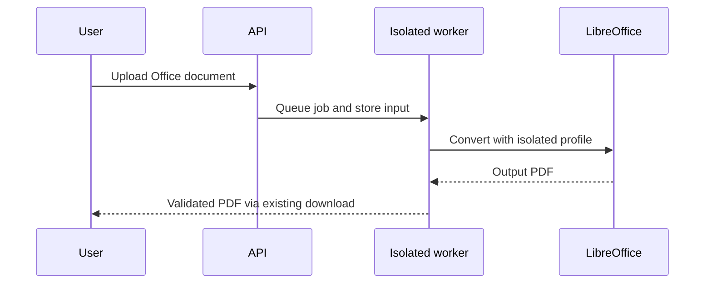
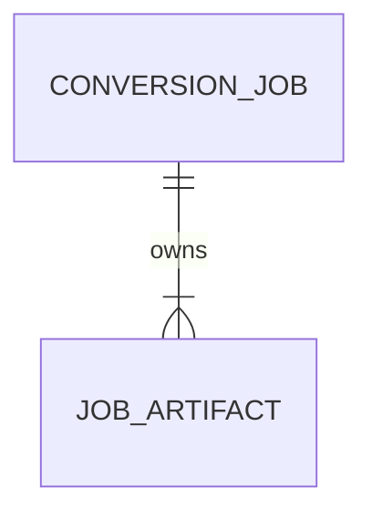

# Office documents to PDF

**Approved**: 2026-11-20 - user: "Você tem total liberdade pra seguir os planos e features já definidos. SÓ VAI."
**Settled mid-build:** none
**Review:** sent at e1042b1
**Fix pass:** done - bounded OOXML expansion, converter address space, CPU and individual files, and worker memory, process count and temporary storage; added expansion and timeout tests and verified resource limits in the container probe.

## Problem

The roadmap requires local conversion of Word, PowerPoint and Excel documents to PDF. The catalog currently marks those tools unavailable. Office documents can contain macros, linked content and other active elements, so a converter must not acquire network access or run macros when processing uploads.

## Shape

Extend the upload-first interface and job API with one Office-to-PDF operation per document family. The existing worker uses a local LibreOffice headless process with a separate profile, Linux Landlock filesystem restrictions and a timeout. The packaged Compose worker runs without networking, and the deployment documentation makes that isolation a prerequisite for processing untrusted documents. Generated files are opened as PDFs before being published. Other deployment modes must not silently claim this isolation.

1. The visitor chooses Word, PowerPoint or Excel and uploads one supported document.
2. The API validates the family and input format, stores the upload and queues the existing job.
3. The worker converts in a private temporary directory, rejects conversion failures and validates the generated PDF.
4. The visitor sees localized status and downloads the PDF through the existing job lifecycle.

**Changes underneath**

| Front | What changes |
| --- | --- |
| domain | Office family operations and explicit input extensions |
| stored data | Existing job and artifact tables; no migration |
| readers | Bilingual upload pages, worker, documented capability matrix |

New: nothing - existing jobs and artifacts store input and output.

## Surface

| Route | In | Out | Status | Who |
| --- | --- | --- | --- | --- |
| `POST /api/jobs` | one supported Office document and family operation | job ID | `202`, `413`, `415` or `422` | anyone |
| `/tools/office-to-pdf/{family}` | family of `word`, `powerpoint` or `excel` | upload-first form | `200`, `404` | anyone |

## Landing

| One-way door | Literal shape | Alternative rejected |
| --- | --- | --- |
| Renderer | Local LibreOffice, isolated from network and configured not to run macros, with Linux Landlock limiting access to the current temporary job and runtime files | Hosted conversion would send files away from the user's server. |
| Output | One validated PDF | Trusting a successful process exit without inspecting output. |

## Criteria

### S1: Convert Office documents to PDF (P1)

**Acceptance Criteria**

1. WHEN a visitor opens a Word, PowerPoint or Excel to PDF tool THEN the page SHALL allow a single file of the documented family, show localized progress and errors, and offer the resulting PDF in PT-BR and English.
2. WHEN a valid supported document is submitted THEN the API SHALL queue the matching operation and the worker SHALL produce a readable, nonempty PDF with the document content.
3. IF the file is unsupported, malformed, password-protected, multiple, or the converter fails or times out THEN the system SHALL return or record a safe failure without publishing an output.
4. WHEN the packaged worker converts a document THEN its container SHALL have no network connectivity, Linux Landlock SHALL prevent the converter from reading other job files, and its converter profile SHALL disable macro execution; each conversion SHALL use a separate bounded process and temporary profile.
5. WHEN the converter is unavailable or the required isolation cannot be established THEN Office conversion SHALL fail closed with an actionable explanation rather than processing the document with network access.
6. The support matrix and deployment documentation SHALL list supported extensions, the LibreOffice dependency, conversion fidelity limitations and isolation requirements; existing operations SHALL remain available.

## Out of scope

PDF-to-Office, PDF-to-Markdown, and HTML or URL conversion remain required by the cumulative roadmap and will be delivered separately.

## Assumptions

| Assumption | Chosen default | Rationale | Confirmed? |
| --- | --- | --- | --- |
| Sequencing and formats | Implement Office families together; disclose exact supported extensions | Covers all three named workflows | y - user delegated |
| External dependencies | Self-hosted LibreOffice and isolated worker | Preserves local processing | y - existing project decision |

**Open questions:** none - user delegated choices and sequencing.

## Differences from the source

None beyond existing decisions AD-006 and AD-007.

## Sources

- `.specs/features/office-to-pdf/request.md` - continuation request.
- `.specs/features/project-foundation/plan.md` - cumulative roadmap and local processing requirements.
- [LibreOffice conversion filters](https://help.libreoffice.org/latest/en-US/text/shared/guide/convertfilters.html) - headless output filters.
- [Docker Compose network modes](https://docs.docker.com/compose/how-tos/networking/) - network isolation.
