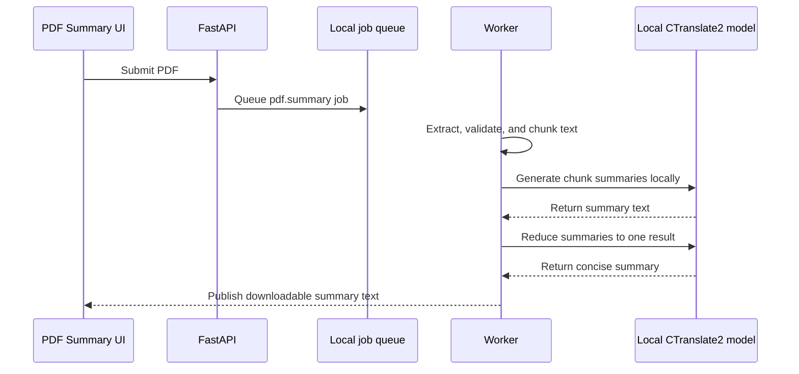

# Local abstractive PDF summary

**Approved**: 2026-11-22 - user authorized implementation and merge of all remaining original-plan features.
**Review:** complete; one input-size finding fixed. Runtime inference was not exercised.
**Fix pass:** complete; full image build succeeded. Model loading and generation still need runtime verification.

## Problem

The current PDF summary selects up to twelve source sentences with TF-IDF/TextRank. The original product request names an AI summary that produces a concise account of the document's key points. Sentence extraction does not fulfill that behavior.

When this ships, the self-hosted Docker app generates a concise abstractive summary locally with a pinned, quantized, open-weight model. Existing extractive behavior remains a clearly labeled fallback when the optional model runtime is unavailable.

## Shape

Use Google's FLAN-T5-small checkpoint, pinned to Hugging Face revision `0fc9ddf78a1e988dac52e2dac162b0ede4fd74ab`, and convert it to CTranslate2 INT8 in a disposable Docker build stage. Copy only the converted model and tokenizer into the runtime image. The model is 77M parameters, supports Portuguese, and is Apache-2.0 licensed. The runtime already contains CTranslate2 and SentencePiece for PDF translation.

1. Docker builds download the pinned checkpoint and convert it to the existing local CTranslate2 runtime format; no PyTorch or Transformers packages enter the runtime image.
2. `pdf.summary` extracts selectable PDF text, chunks it within the model's input limit, generates local summaries, and recursively reduces chunk summaries into one concise result.
3. Summaries retain the existing 100-page and 2,000-sentence limits and add a 100,000-character text limit. Output states whether it is an AI summary or extractive fallback and tells readers to verify details against the source.
4. The existing tool UI and catalog explain that summarization runs on the self-hosted server. No request or document content is sent to a hosted model.

**Changes underneath**

| Front | What changes |
| --- | --- |
| build | A pinned FLAN-T5 checkpoint is converted to quantized CTranslate2 format; only model output is copied to runtime |
| worker | The existing `pdf.summary` operation uses local abstractive generation when its model is installed and preserves extractive fallback behavior |
| API/UI | Keep the job contract; clarify local generation, fallback, and source verification |
| stored data | None; extracted text, chunks, and summaries remain in the current job's local processing path |

New: no persistent entities or API operation. One-way constraint: the existing `pdf.summary` result changes to an abstractive summary when the model is present, with a labeled extractive fallback when absent.
Data: none - input and generated text stay on the self-hosted worker.

## Surface

| Route | In | Out | Status | Who |
| --- | --- | --- | --- | --- |
| `POST /api/jobs` (existing `pdf.summary`) | one unencrypted PDF | local abstractive or labeled extractive `summary.txt` | existing 202/job statuses; existing invalid PDF and size errors | anyone |
| `GET /tools/pdf-summary` (existing) | none | upload-first local summarization workflow | 200 | anyone |

## Landing

| One-way door | Literal shape | Alternative rejected |
| --- | --- | --- |
| `pdf.summary` output content | Retain the same `summary.txt` artifact and job operation; generate a concise summary with local FLAN-T5 when installed, otherwise emit the existing extractive summary with an explicit fallback label | A new job operation and queue path would duplicate upload, worker, status, and download behavior for the same product action |

- No user documents, prompts, or generated text leave the host.
- The Docker build pins the model checkpoint and license; runtime inference has no model hub calls or update checks.
- Existing no-model development installs continue using extractive summarization.

## Criteria

### S1: Generate an AI summary locally (P1)

A self-hosted visitor can request a concise summary of a text-based PDF without sending the document to a service.

**Acceptance Criteria**

1. WHEN Docker builds the app THEN the build SHALL convert the pinned FLAN-T5-small checkpoint to INT8 CTranslate2 format and copy its model and SentencePiece tokenizer into the final image; the final runtime SHALL not include PyTorch or Transformers.
2. WHEN a valid PDF within the existing limits is summarized and the local model is available THEN the worker SHALL generate an abstractive summary locally, chunking long input and reducing chunk summaries before producing one concise output.
3. WHEN the local model is unavailable THEN the worker SHALL preserve the current extractive result and label the fallback clearly.
4. IF a PDF has no selectable text, is protected/invalid, exceeds 100 pages, 2,000 sentences, or 100,000 extracted characters THEN the existing safe error flow SHALL return no summary artifact.
5. WHEN a summary is downloaded THEN it SHALL state whether it used the local model or extractive fallback and SHALL remind readers to verify details against the source.
6. WHEN the tool page or catalog card appears in English or Brazilian Portuguese THEN the local processing and review guidance SHALL be accurate and localized.
7. WHEN the local model generates a summary THEN the operation SHALL not make network requests or send document text to a third party.

## Out of scope

| Excluded | Why |
| --- | --- |
| Hosted inference, remote APIs, user accounts, or telemetry | Violates the approved local-processing product constraints |
| OCR of image-only PDFs | Visitors must use the existing local OCR tool first |
| Guaranteed factual accuracy or replacement of the source document | Generative summaries can omit details or be wrong; the output must ask the reader to verify it |
| General model profile / dependency modularization | Issues #33–#37 are deferred; this feature adds only the model needed for the approved summary capability |

## Assumptions

| Assumption | Chosen default | Rationale | Confirmed? |
| --- | --- | --- | --- |
| Model | `google/flan-t5-small`, pinned revision, INT8 via CTranslate2 | Small 77M parameter Apache-2.0 model; Portuguese support; reuses existing inference runtime |
| Summary language | Same language as source text | Preserves the language of the source without adding a separate user choice |
| Model absence | Existing local extractive summary remains as an explicitly labeled fallback | Keeps non-Docker development and constrained deployments useful |
| Long input | Chunk within tokenizer bounds and recursively summarize chunk outputs | Fits documents longer than the model's input window while preserving one output artifact |

**Open questions:** none - the user delegated completion of the original approved scope.

## Differences from the source

None - the feature adds the requested AI summary while keeping the document local and its output concise. The source does not prescribe a model, so the plan selects a small local checkpoint that fits the existing runtime.

## Sources

- `.specs/features/initial-project/request.md` - binding - AI PDF summarization is an explicit requested tool.
- `.specs/features/project-foundation/plan.md` - binding - summaries remain local and local AI models may be self-hosted.
- [FLAN-T5-small model card](https://huggingface.co/google/flan-t5-small) - official license, checkpoint details, supported languages, and limitations.
- [CTranslate2 Transformers guide](https://opennmt.net/CTranslate2/guides/transformers.html) - official T5/FLAN-T5 conversion and local inference APIs.
- [CTranslate2 quantization](https://opennmt.net/CTranslate2/quantization.html) - official INT8 conversion and execution support.
- [Hugging Face Summarization task guide](https://huggingface.co/docs/transformers/tasks/summarization) - official abstractive summarization task shape and chunked sequence-to-sequence approach.
