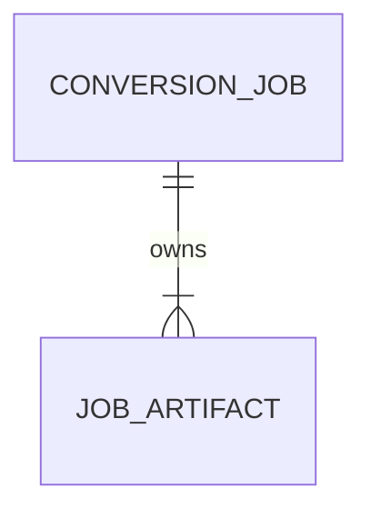

# Plan

**Approved**: 2026-11-23 - user: "É pra seguir, e ir criando PRs de tudo, mergeando, até finalizar completamente a implementação do nosso plano original!"
**Settled mid-build:** Reuse the configurable per-job file limit; one PDF downloads as a PDF and multiple results download as a ZIP.
**Review:** sent at bee2e3d
**Fix pass:** done - The over-limit regression now also asserts that no conversion job was created.

## Problem

The PDF compressor only accepts one file, so a person with several PDFs must submit them one by one. When this ships, they can compress a group of PDFs with one upload and download all results together.

## Shape

The feature extends the existing `pdf.compress` operation and existing multipart/job/ZIP flow. Upload count is bounded in the API before job creation; per-file compression runs in the existing worker and produces separate PDFs that the worker packages using its existing archive behavior. Regression tests exercise API limits, archive names, and ordering.

### Changes underneath

| Front | What changes |
| --- | --- |
| API | `pdf.compress` accepts 1 through `MAX_FILES_PER_JOB` PDFs; compression profile validation remains unchanged. |
| Worker | Existing PDF processor handles each input separately; its existing multi-output packaging creates the ZIP. |
| Browser | The file picker allows multiple files for PDF compression; selected files stay in the displayed upload order. |
| Stored data | Data: none - existing job and artifact records already support multiple input files and ZIP results. |

New: nothing - existing job and artifact entities only.

### Surface

| Surface | Contract | Who | Status |
| --- | --- | --- | --- |
| PDF compression form | File picker permits multiple PDFs. Existing profile selector applies to every PDF. One input produces one PDF; multiple inputs produce a ZIP. | Anyone | 200 on form load; existing job errors remain localized |
| `POST /api/jobs` | `pdf.compress` accepts 1 to configured maximum files; more than the maximum returns HTTP 422 `too_many_files`. | Anyone with service access | 202 accepted; 422 invalid count or options |
| Download | One input returns `application/pdf`; multiple inputs return `application/zip` with one compressed PDF per source. | Anyone with job id | 200 ready; 404 missing/expired job; 409 job not ready |

### Landing

| One-way door | Literal shape | Alternative rejected |
| --- | --- | --- |
| Batch output | One input keeps the existing `compressed.pdf` output. Multiple inputs produce `<source-stem>-compressed.pdf` entries in upload order; duplicate stems receive `-2`, `-3`, and so on. The result ZIP is `converted-files.zip`, matching the existing worker archive path. | Always returning ZIP for a single input breaks existing download behavior; duplicate archive names overwrite or become ambiguous. |
| Compression profile | The selected lossless, recommended, or extreme profile is applied independently to every input PDF. | One profile per file would add an unnecessary per-file control and option contract. |

## Criteria

**Acceptance Criteria**

1. WHEN a visitor selects PDF compression THEN the file picker SHALL allow 1 through the configured maximum number of PDF files in English and Brazilian Portuguese.
2. WHEN the API receives `pdf.compress` with 1 through `MAX_FILES_PER_JOB` valid PDFs THEN it SHALL create one job and retain the existing profile behavior, including the lossless default.
3. IF the API receives `pdf.compress` with more than `MAX_FILES_PER_JOB` files THEN it SHALL reject the request with HTTP 422 `too_many_files` before creating a job.
4. WHEN a one-file compression job completes THEN the download SHALL be one `application/pdf` named `compressed.pdf`.
5. WHEN a multi-file compression job completes THEN the download SHALL be one `application/zip` named `converted-files.zip` containing one independently compressed PDF per input in upload order.
6. WHEN multiple uploaded PDFs share the same filename stem THEN the ZIP SHALL contain unique names using `-2`, `-3`, and later suffixes for repeated stems.
7. WHEN a visitor selects files in a different order THEN the file list and the ZIP entries SHALL retain that order.

## Out of scope

| Excluded | Why |
| --- | --- |
| Per-file compression profiles | The same selected profile applies consistently to every file in a batch. |
| Larger batch limit than the configured job limit | Existing upload count, aggregate bytes, and disk safeguards remain authoritative. |
| Password-protected PDF batches | The existing compression tool does not support PDF passwords; adding per-file secrets needs a separate API and UI contract. |

## Assumptions

| Assumption | Chosen default | Rationale | Confirmed? |
| --- | --- | --- | --- |
| Maximum batch size | Existing `MAX_FILES_PER_JOB` setting (default 10) | Reuses the already approved streaming upload limit and keeps resource bounds consistent | y - initial project plan |
| Archive entry names | Source stem with `-compressed` and deterministic duplicate suffixes | Keeps names recognizable and prevents collisions | n |

Open questions: none - naming is reversible, and the approved project plan already supplies the file limit.

## Differences from the source

The cited converter pages are non-binding product references. No binding screen capture was supplied. The local implementation retains its configured batch limit and applies the selected local profile to the entire batch.

## Sources

- `.specs/features/initial-project/plan.md`, criteria 5 and 23 - upload count bounds.
- [iLovePDF Compress PDF](https://www.ilovepdf.com/compress_pdf) and [iLovePDF user guide](https://www.ilovepdf.com/help/documentation) - non-binding reference for selecting and compressing multiple documents.
