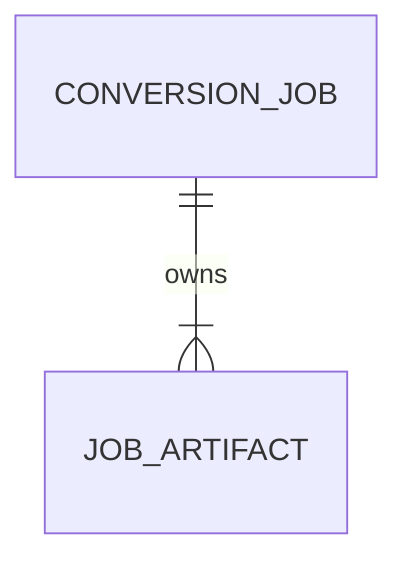

# Plan

**Approved**: 2026-11-23 - user: "É pra seguir, e ir criando PRs de tudo, mergeando, até finalizar completamente a implementação do nosso plano original!"
**Settled mid-build:** Keep lossless as the default; add lossy image profiles as an extension to the planned PDF compressor.
**Review:** pending
**Fix pass:** pending

## Problem

PDFs containing high-resolution images can remain large after the current lossless-only optimization. People who need smaller files have no way to trade image quality for size. When this ships, they can select a compression profile and compare the resulting size while retaining the existing lossless default.

## Shape

The feature extends the existing PDF compression operation and PyMuPDF document path instead of adding another conversion service. Profile validation runs in the API layer and image rewriting runs in the existing isolated worker; regression tests cover both.

The API accepts an optional `profile` string for `pdf.compress`: `lossless` (default), `recommended`, or `extreme`. The worker rewrites embedded images only for lossy profiles, then performs the existing garbage collection, stream deflation, and object-stream save. It returns one PDF. Existing size comparison remains in the completed-job UI.

### Changes underneath

| Front | What changes |
| --- | --- |
| API | Existing `pdf.compress` options gain a validated profile; no database schema change because validated options already persist as JSON. |
| Worker | Existing PyMuPDF compression branch gains image rewriting for the two lossy profiles. |
| Browser | Existing conversion form gains a localized profile selector and submits the selected value. |
| Stored data | Data: none - no new entities or persistence fields; the existing job options JSON carries the profile. |

New: nothing - existing job and artifact entities only.

### Surface

| Surface | Contract | Who | Status |
| --- | --- | --- | --- |
| Web form | For `pdf.compress`, a profile selector defaults to `lossless`; selecting another option and submitting shows the completed PDF and before/after sizes. Invalid or failed jobs use existing localized error handling. | Anyone | 200 on form load; job errors retain existing UI statuses |
| `POST /api/jobs` | Optional `options.profile`: `lossless`, `recommended`, `extreme`; omitted means `lossless`. Invalid values return HTTP 422 `invalid_options`. | Anyone with service access | 202 accepted; 422 invalid options |

### Landing

| One-way door | Literal shape | Alternative rejected |
| --- | --- | --- |
| Compatibility with existing clients | Missing profile resolves to `lossless`; no migration is required | Changing the existing behavior to lossy compression by default could reduce quality for existing clients |
| Profile definitions | `lossless`: no image rewrite; `recommended`: JPEG quality 75, downsample images above 200 DPI to 150 DPI; `extreme`: JPEG quality 45, downsample images above 150 DPI to 96 DPI | User-controlled raw quality and DPI fields introduce an expert configuration surface and unsupported combinations |

## Criteria

**Acceptance Criteria**

1. WHEN a client submits `pdf.compress` without `profile` THEN the API SHALL create a job using `lossless`.
2. IF a client submits an unsupported `profile` THEN the API SHALL reject the request with HTTP 422 `invalid_options` before creating a job.
3. WHEN a visitor opens the PDF compression form THEN the interface SHALL show `Lossless` selected by default and offer `Recommended` and `Extreme` profiles in English and Brazilian Portuguese.
4. WHEN a visitor submits each valid compression profile THEN the worker SHALL return one PDF; `lossless` SHALL skip image rewriting, `recommended` SHALL call image rewriting with quality 75 and DPI threshold/target 200/150, and `extreme` SHALL use quality 45 and DPI threshold/target 150/96.
5. WHEN compression completes THEN the existing result view SHALL show the original and output sizes for every profile and SHALL claim a reduction only when the output is smaller.
6. WHEN a lossy profile is used THEN extracted page text and page count SHALL remain unchanged.

## Out of scope

| Excluded | Why |
| --- | --- |
| Batch PDF compression | It changes upload count, output naming, collision handling, and ZIP behavior; it will be handled as a separate roadmap feature. |
| Per-image or user-entered quality/DPI controls | The three fixed profiles keep the contract bounded and understandable. |
| Grayscale conversion or rasterizing complete pages | These alter non-image content or text and are not required to reduce embedded image size. |

## Assumptions

| Assumption | Chosen default | Rationale | Confirmed? |
| --- | --- | --- | --- |
| Profile naming and numeric settings | `lossless`, `recommended`, `extreme` with values in Landing | Clear bounded choices; lossless keeps compatibility, lossy values fit PyMuPDF's supported API | n |
| Localized selector | English and Brazilian Portuguese | Matches the existing interface languages and English default | y - project decision |

Open questions: none - profile behavior preserves the approved lossless default and fixed profile settings keep the option simple.

## Differences from the source

No binding capture was supplied. The initial approved project plan remains intact: lossless is still the default and its size reporting criterion remains in force.

## Sources

- `.specs/features/initial-project/plan.md`, criterion 18 - approved lossless baseline.
- [PyMuPDF Document.rewrite_images](https://pymupdf.readthedocs.io/en/latest/document.html) - supported local image recompression and downsampling API.

