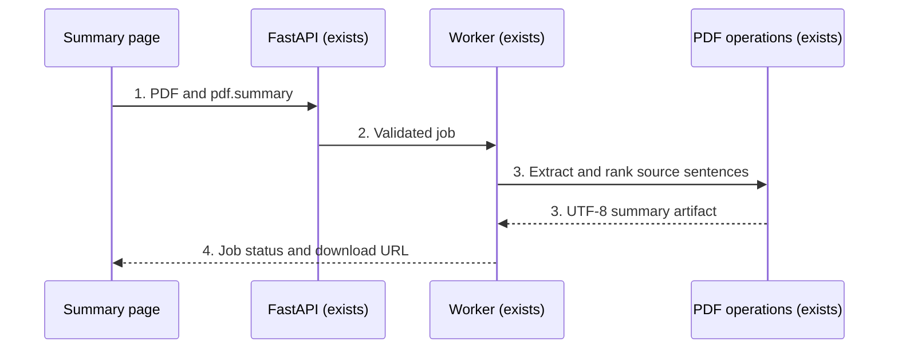
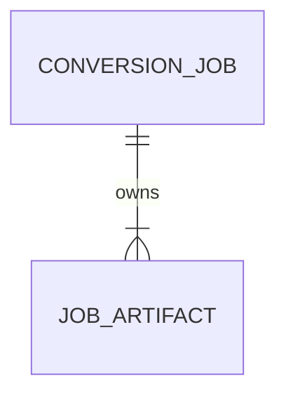

# Local PDF summary

**Approved:** 2026-11-21 - user: "Pode seguir nas implementações dde acordo com o tlc-spec-lean até o final. Vá abrindo PRs conforme precisar e vá seguindo tudo da implementação"
**Settled mid-build:** none.
**Review:** changes requested - independent review identified a P2 TextRank damping issue, recorded in `review.md`.
**Fix pass:** done - corrected PageRank weights and added a regression case for central sentence ranking; validation passed.

## Problem

The PDF catalog offers no way to produce a short overview from selectable PDF text. People must read the document page by page or use an external service, which conflicts with the local-only product goal. The roadmap contains no usage data for this tool.

When this ships, a visitor can download a short, locally generated extractive summary of a text-based PDF.

## Shape

The feature reuses the current FastAPI upload, job store, local file store, and worker pipeline. `pdf.summary` extracts selectable text and ranks source sentences with a local TextRank-style graph; it does not call an external service or generative model.

1. The browser opens `/tools/pdf-summary`, selects one PDF, and submits `pdf.summary`.
2. `FastAPI` validates the PDF and creates a job using the existing upload lifecycle.
3. The worker calls the local PDF operation, which extracts text, ranks sentences, and writes a UTF-8 summary text file.
4. The browser polls job status and offers the text file for download.

**Changes underneath**

| Front | What changes |
| --- | --- |
| Domain | Add `pdf.summary` to the API and worker operation sets; use a deterministic extractive ranking algorithm. |
| Storage | Reuse job options and artifacts; no database change. |
| Readers | Add a bilingual upload-first page; the summary is a downloadable `.txt` file. |

New: nothing - the existing job and artifact records hold the PDF input and text output.

## Surface

| Route | In | Out | Status | Who |
| --- | --- | --- | --- | --- |
| `GET /tools/pdf-summary` | none | Local summary page | 200 | anyone |
| `POST /api/jobs` (existing) | one PDF, `pdf.summary` | Existing job response and UTF-8 `.txt` artifact | 202; existing upload errors; 422 `invalid_options` or `invalid_file` | anyone |

## Landing

| One-way door | Literal shape | Alternative rejected |
| --- | --- | --- |
| Summary operation | `pdf.summary`; output file is UTF-8 plain text | Claiming the source PDF layout is preserved would be misleading for an extractive text summary |
| Summary method | Rank source sentences locally, return at most 12, keep original reading order | Sending documents to a hosted model conflicts with the local-only invariant; a bundled generative model materially increases image size |

## Criteria

**Acceptance Criteria**

1. WHEN a visitor opens `/tools/pdf-summary` THEN the page SHALL explain in PT-BR and English that the summary is extractive, uses selectable PDF text, and runs on the self-hosted server.
2. WHEN a visitor selects one valid PDF and submits THEN the API SHALL create one `pdf.summary` job.
3. WHEN the source contains related and unrelated sentence groups THEN the ranking SHALL select central related sentences ahead of unrelated ones.
4. WHEN the worker completes a summary THEN the downloadable UTF-8 `.txt` file SHALL contain no more than 12 source sentences and preserve their original order.
5. WHEN the source contains fewer than 13 non-empty sentences THEN the summary SHALL include every sentence.
6. IF a PDF contains no selectable text THEN the job SHALL fail with `summary_no_text`, return no download, and the page SHALL suggest running OCR first.
7. IF a PDF has more than 100 pages or 2,000 extracted sentences THEN the job SHALL fail with `summary_too_large` and return no download.
8. IF a visitor submits a non-PDF or malformed PDF THEN the API SHALL reject it with the existing format or file error and create no job.
9. WHILE the job is queued or processing THEN the page SHALL show the localized status and prevent duplicate submissions; on success it SHALL show the text download.
10. WHEN the viewport is 360 CSS pixels wide THEN the upload, status, and download controls SHALL remain usable without horizontal page scrolling.

## Assumptions

| Decision | Default | Rationale | Confirmed? |
| --- | --- | --- | --- |
| Summary style | Extractive TextRank-style sentence selection, not a generative model | It is deterministic, local, and keeps the image size unchanged; the interface discloses the method and limitations | y - user delegated complete goal and routine implementation decisions |
| Empty-text PDFs | Fail with `summary_no_text` and direct the user to the existing OCR tool | OCR is already a separate local operation and silently summarizing an empty result would mislead | y - user delegated complete goal and routine implementation decisions |

**Open questions:** none - the user delegated sequencing and routine implementation decisions.

## Out of scope

- Generative or abstractive summaries.
- OCR, translation, and preservation of original PDF visual layout.
- Any hosted inference or document upload to third parties.

## Sources

- `.specs/features/project-foundation/plan.md` - approved objective roadmap, stage 4.
- No summary-specific browser captures are available in the repository.
