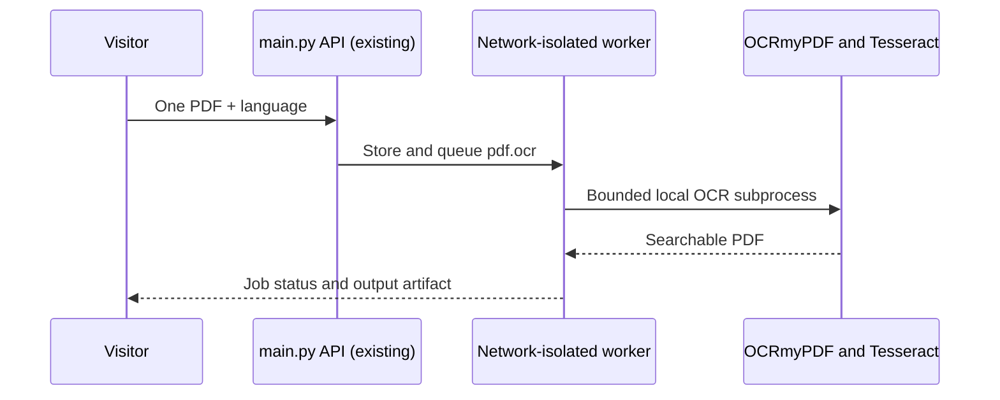
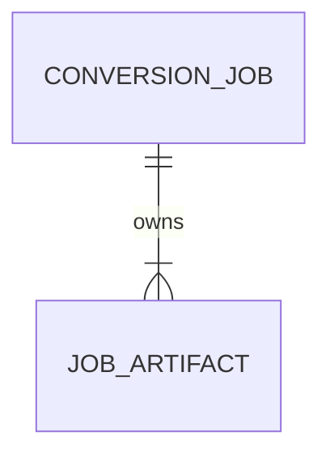

# Searchable PDF OCR

**Approved**: 2026-11-21 - user delegated roadmap implementation through completion.
**Settled mid-build:** none
**Review:** pending
**Fix pass:** pending review

## Problem

The PDF catalog lists OCR as coming soon. People with scanned documents cannot select or search the text, which makes the document difficult to navigate and reuse.

Ship one local operation that adds searchable text to a scanned PDF.

## Shape

Reuse the existing upload-first PDF tool page, job API, worker queue, and artifact download flow. Validate PDF structure, page count, selected OCR languages, and output in tested Python layers; run OCRmyPDF in a bounded subprocess inside the existing network-isolated worker.

1. A visitor selects one PDF and one of the Portuguese, English, or combined OCR language settings.
2. `main.py` (exists) validates the PDF, operation options, and page bound before queuing `pdf.ocr`.
3. `worker.py` (exists) invokes OCRmyPDF with Tesseract locally and no network access, then verifies page count and text before publishing the output.
4. Existing job status and download endpoints report a successful searchable PDF or a safe localized failure.

Data: read and write existing `conversion_jobs` and `job_artifacts`; no schema change or migration.
New: nothing - the existing job and artifact records store the submitted PDF and searchable PDF.

### Changes underneath

| Existing element | Change | Readers and consequence |
| --- | --- | --- |
| PDF operation names | Add `pdf.ocr` and accept one PDF | API, UI and worker route the operation. |
| OCR processor | Run pinned OCRmyPDF and system Tesseract in a time/memory-bounded subprocess | OCR stays local and uses the existing offline worker. |
| Container image | Install OCRmyPDF dependencies and `por`/`eng` trained data | Fresh self-hosted installs support Portuguese and English offline. |
| Catalog | Activate OCR PDF card and add bilingual upload/settings page | The current disabled card opens the working tool. |

## Surface

| Route | Input | Output | Status | Who |
| --- | --- | --- | --- | --- |
| `GET /tools/pdf-ocr` | None | Bilingual PDF upload and language selection | `200` | anyone |
| `POST /api/jobs` | One supported unencrypted PDF, `pdf.ocr`, and `language` in `por`, `eng`, `por+eng`; maximum 20 pages | Queued job | `202`, `413`, `415`, `422` invalid options/pages/PDF | anyone |
| `GET /api/jobs/{job_id}` | Job ID | Status and safe localized processing error | `200`, `404` | anyone |
| `GET /api/jobs/{job_id}/download` | Successful job ID | Searchable PDF preserving original page appearance and page count | `200`, `409`, `404` | anyone |

## Landing

| One-way door | Literal shape | Alternative rejected |
| --- | --- | --- |
| OCR engine | OCRmyPDF with local Tesseract and bundled `por` and `eng` language data | Hosted OCR would transmit private documents; runtime language downloads would break offline worker guarantees. |
| Language default | `por+eng` with explicit `por` and `eng` alternatives | A single hidden default can misrecognize the other supported language. |
| Work bound | One PDF, at most 20 pages, one OCR subprocess with one worker job | Unbounded page counts and parallel Tesseract processes can monopolize an unauthenticated self-host. |
| Existing text | Preserve pages that already contain selectable text using OCRmyPDF's skip-text behavior | Re-OCR can degrade existing text or unnecessarily rasterize a good document. |

## Criteria

### S1: Create a searchable PDF from a scan (P1)

**Acceptance Criteria**

1. WHEN a visitor opens the OCR PDF card THEN it SHALL open a bilingual page with a single PDF input, `Português`, `English`, and `Português + English` language choices (the default), a process action, a visible loading/error state, and a downloadable result.
2. WHEN a visitor submits one valid scanned PDF and a language choice THEN the worker SHALL run OCR locally without external network access and return a PDF with a selectable/searchable text layer, unchanged page count, and the same visible page content.
3. WHEN a PDF already contains selectable text THEN OCR SHALL preserve that text and visible content without replacing existing text.
4. IF the PDF is invalid, encrypted, has more than 20 pages, the language is unsupported, or multiple/no files are submitted THEN the API SHALL reject the request before creating a job with a safe `422`/`415` response.
5. IF OCR times out, exceeds resource limits, finds no text, or fails PDF verification THEN the job SHALL fail and SHALL NOT expose a partial output.
6. WHEN the worker runs OCR THEN it SHALL use the installed `por`/`eng` language data and no runtime model or language downloads.
7. WHEN a visitor reads the OCR page THEN it SHALL disclose that OCR accuracy depends on scan quality and the output must be reviewed; when opened at 360 CSS pixels, all controls SHALL remain usable without horizontal page overflow.

## Out of scope

Live camera scanning, OCR to Word/Excel/Markdown, handwriting recognition, automatic translation, arbitrary language packs, and OCR of image files without a PDF wrapper.

## Assumptions

| Decision | Chosen default | Rationale | Confirmed? |
| --- | --- | --- | --- |
| OCR languages | `por+eng`, `por`, or `eng` | These match the app's initial PT-BR and English users while keeping language assets bounded | y - user delegated roadmap implementation |
| Existing page text | Skip pages already containing text | Preserves the original selectable content and avoids avoidable rasterization | y - user delegated roadmap implementation |
| Processing bounds | 20 pages, one subprocess worker, no network | Limits unauthenticated CPU and memory use | y - user delegated roadmap implementation |

**Open questions:** none - implementation details delegated within the local self-hosted roadmap.

## Differences from the source

None - activate the existing OCR catalog item and retain its searchable/selectable PDF outcome.

## Sources

- `.specs/features/initial-project/request.md` - original OCR capability text.
- `.specs/features/project-foundation/captures/ilovepdf-home.aria.yml` - binding source card and ordering; no feature page capture is present.
- [OCRmyPDF documentation](https://ocrmypdf.readthedocs.io/en/latest/) - required local software and OCR behavior.
- [OCRmyPDF security documentation](https://github.com/ocrmypdf/OCRmyPDF/blob/main/docs/cloud.md) - deployment notes for untrusted PDFs.
- [OCRmyPDF PyPI 17.14.2](https://pypi.org/project/ocrmypdf/17.14.2/) - pinned release and Python package metadata.
