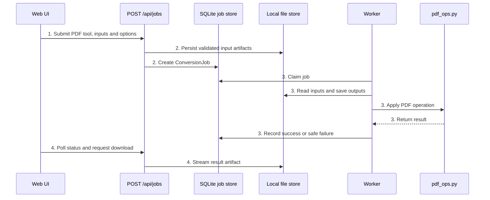
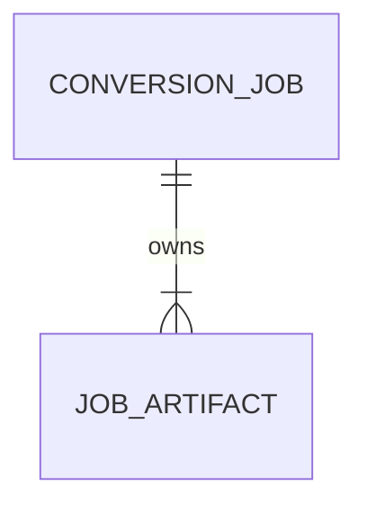

# PDF organization, editing and security

**Approved**: 2026-11-19 - user: "Você tem total liberdade pra seguir os planos e features já definidos. SÓ VAI."
**Settled mid-build:** none
**Review:** pending implementation
**Fix pass:** pending review

## Problem

People using the self-hosted converter still need separate software for PDF page organization, editing and protection. The project objective names these gaps but gives no usage or quality metrics.

When this milestone ships, a visitor can organize, edit, secure, repair, compare and archive PDFs in the browser and download results from the same local service.

## Shape

The milestone reuses the existing FastAPI job lifecycle, SQLite records, local file store, worker, PyMuPDF Lite pipeline and bilingual tool catalog. Validation and transformations run in the backend layers already reached by the repository's API and PDF tests.

1. The visitor chooses an enabled PDF tool on the home catalog and selects PDF inputs and options in the tool form.
2. `POST /api/jobs` (exists) validates tool options and PDF inputs, stores inputs locally and creates a `ConversionJob` (exists).
3. `Worker` (exists) claims the job, dispatches the selected operation through `pdf_ops.py` (exists), and stores one PDF result or a comparison report as job artifacts.
4. `GET /api/jobs/{job_id}` and `/download` (exists) expose status and result; the UI (exists) displays safe errors and download controls.

**Changes underneath**

| Front | What changes |
| --- | --- |
| domain | `ConversionJob.operation` gains the stage 2 `pdf.*` identifiers; `Worker` dispatches them through the PDF operation layer. |
| stored data | Existing `operation`, `options_json`, and `job_artifacts` fields hold inputs, options, and outputs; no schema migration. |
| readers | Home catalog enables these tools; shared form collects files/options; API validates; worker processes; status/download UI presents results. |

New: nothing - existing `ConversionJob` and `JobArtifact` records represent all inputs and outputs. One-way constraints: stable `pdf.*` operation names and their options are consumed by API, worker, and UI.

## Surface

| Route | In | Out | Status | Who |
| --- | --- | --- | --- | --- |
| `POST /api/jobs` (extended) | multipart `operation`, repeated `files`, JSON `options` | existing job response; successful status exposes result artifacts | `202`; `413` upload limit; `415 unsupported_format`; `422 invalid_file`, `invalid_options`, or `too_many_files` | anyone |
| `POST /api/pdf/pages` (new) | multipart `files`: one PDF | `{page_count}` for the local page list | `200`; `413` upload limit; `422 invalid_file` | anyone |
| `GET /tools/pdf-organize` (new) | none | upload-first page organization form | `200` | anyone |
| `GET /api/jobs/{job_id}` (unchanged) | opaque job UUID | existing state, safe error, output metadata | `200`; `404 job_not_found` | anyone with the job ID |
| `GET /api/jobs/{job_id}/download` (unchanged) | opaque job UUID | PDF or ZIP/report artifact | `200`; `404 job_not_found`; `409 job_not_ready` | anyone with the job ID |

## Landing

| One-way door | Literal shape | Alternative rejected |
| --- | --- | --- |
| Job operation identifiers and option JSON | Namespaced `pdf.organize`, `pdf.crop`, `pdf.edit`, `pdf.sign`, `pdf.protect`, `pdf.unlock`, `pdf.forms`, `pdf.redact`, `pdf.repair`, `pdf.compare`, and `pdf.pdfa`; typed JSON options validated before job creation | Multipurpose untyped payloads, because API validation and worker dispatch must agree on each operation |
| PDF protection and redaction semantics | Protect encrypts with a user-supplied password; unlock requires the current password; redaction removes selected content permanently before saving | Password bypass or visual-only redaction, because neither meets the named security outcome |
| Signature and form scope | Signature is a visual mark drawn or uploaded by the user, not a certificate-backed digital signature; forms fill existing fields only | Cryptographic signing and form authoring, because they require separate key trust and editing workflows |

- No new database column or external service is introduced. PDF/A implementation dependencies, if any, must be documented and pinned before adoption.

## Criteria

### S1: Organize PDF pages (P1)

Visitors reorder, remove, and insert pages while preserving the requested sequence.

**Acceptance Criteria**

1. WHEN a visitor chooses Organizar PDF THEN the home catalog SHALL open a bilingual upload-first tool page with PDF selection, page order controls, empty/error/result states, and no horizontal overflow from 360 px to 1440 px.
2. WHEN the visitor reorders pages or selects pages to remove THEN the preview/list SHALL show the resulting sequence before submission; removing every page SHALL be rejected.
3. WHEN the visitor inserts pages from another PDF THEN the visitor SHALL choose the insertion position and source page range; the worker SHALL place those pages at that position.
4. WHEN one valid unencrypted input (or two for insertion) and valid options are submitted THEN the API SHALL create a job and the worker SHALL return one PDF with exactly the requested page sequence.
5. IF page indexes are missing, duplicated where disallowed, out of range, or malformed THEN the API SHALL return `422 invalid_options` without creating a job; invalid/password-protected PDFs SHALL return `422 invalid_file`.

### S2: Crop and edit PDF content (P1)

Visitors crop pages and add text, images, shapes, or annotations.

**Acceptance Criteria**

6. WHEN a visitor chooses Recortar PDF or Editar PDF THEN the tool SHALL show the PDF upload step first; after upload it SHALL show page navigation and the selected page preview with localized accessible controls.
7. WHEN the visitor crops a page or a page range THEN the selected rectangle SHALL be applied to the selected pages; invalid or empty rectangles SHALL return `422 invalid_options`.
8. WHEN the visitor adds text, an image, a shape, or an annotation THEN the chosen page, position, dimensions, text/style, or image SHALL be included in the output PDF; the preview SHALL show the pending edit before submission.
9. IF edit coordinates, dimensions, colors, text length, or page references are malformed or outside the page bounds THEN the API SHALL reject the job with `422 invalid_options`.

### S3: Sign and protect PDFs (P1)

Visitors apply a visual signature and password protection or remove protection with the supplied password.

**Acceptance Criteria**

10. WHEN a visitor chooses Assinar PDF THEN the tool SHALL allow drawing a signature or uploading a PNG, choose its page and position, preview it, and download a PDF with the visual mark on the selected page(s); the UI SHALL not claim certificate-backed identity or legal validity.
11. WHEN a visitor chooses Proteger PDF THEN the tool SHALL require a non-empty password and allow the visitor to download a password-encrypted PDF; passwords SHALL not be logged, stored in job options, or included in job error messages.
12. WHEN a visitor chooses Desbloquear PDF THEN the tool SHALL require the current password and produce a readable PDF only when that password is valid; incorrect or absent passwords SHALL fail with `422 invalid_file` and a safe localized message.
13. IF signature input, page selection, or protection options are invalid THEN the API SHALL return `422 invalid_options` without creating a job.

### S4: Forms and permanent redaction (P1)

Visitors fill existing PDF fields and remove selected sensitive page regions.

**Acceptance Criteria**

14. WHEN a visitor chooses Formulários PDF THEN the tool SHALL list fillable fields in the uploaded PDF, allow supported text and checkbox fields to be filled, and retain unmodified fields; PDFs without fillable fields SHALL show a clear empty state.
15. WHEN a visitor chooses Ocultar PDF THEN the tool SHALL let the visitor select one or more page rectangles and preview the affected regions before submission; the generated PDF SHALL remove underlying text and graphics in those regions, not merely cover them visually.
16. IF a requested field is missing or a redaction rectangle is invalid/out of bounds THEN the API SHALL return `422 invalid_options`; an unsupported form field type SHALL be reported without silently changing its value.

### S5: Repair, compare and archive PDFs (P1)

Visitors attempt local repair, compare two PDFs, and convert a PDF to an archival PDF/A file.

**Acceptance Criteria**

17. WHEN a visitor chooses Reparar PDF THEN the worker SHALL attempt repair locally; if the PDF cannot be opened or repaired, the job SHALL fail safely with `invalid_file` and no claim of guaranteed recovery.
18. WHEN a visitor compares two valid PDFs THEN the worker SHALL return a comparison artifact that identifies changed, added, and removed pages and offers a readable summary in the UI.
19. WHEN a visitor chooses PDF/A THEN the tool SHALL state the supported conformance level before submission; the output SHALL be checked against that level and rejected as a failed job if validation fails.
20. WHEN any S5 operation completes THEN the visitor SHALL see queued, processing, failed, or succeeded state and a download for each result artifact; multiple artifacts SHALL download as one ZIP.

## Out of scope

| Excluded | Why |
| --- | --- |
| Certificate-backed digital signatures, timestamp authorities, or claims of legal validity | This milestone defines visual signatures only. |
| Creating new fillable form fields | This milestone fills fields already present. |
| Password cracking or bypassing unknown PDF passwords | Unlocking requires the visitor's current password. |
| Guaranteeing recovery of every damaged PDF | Repair depends on recoverable source structure. |
| Hosted converters, hosted OCR/AI, cloud storage, analytics, ads, and telemetry | Project privacy invariant keeps processing local. |
| Other roadmap stages such as Office conversion, OCR, PDF to Markdown, and advanced image tools | Tracked in the cumulative roadmap for separate plans. |

## Assumptions

| Assumption | Chosen default | Rationale | Confirmed? |
| --- | --- | --- | --- |
| Milestone scope | Include the complete stage 2 group from the approved roadmap | The user explicitly selected "Todo o grupo". | y - user: "Todo o grupo (Recomendado)" |
| Signature behavior | Visual mark drawn in browser or uploaded as PNG; no certificate-backed signing claim | Keeps this tool usable without PKI setup while distinguishing it from cryptographic signing. | y - user: "Assinatura visual (Recomendado)" |
| Form behavior | Fill existing text/checkbox fields; do not author fields | Provides a clear initial boundary for the named form operation. | y - user: "Preencher campos existentes (Recomendado)" |
| Compare output | Summary plus per-page added/removed/changed classification | Gives a useful local result without implying semantic legal review. | n |
| PDF/A support | Select a concrete level and validator only after a dependency feasibility spike; expose only a level that passes validation | Avoids promising standards compliance without an installed verifier. | n |
| UI language and layout | PT-BR and English; use existing tool form and 360–1440 px responsive baseline | Continues the accepted product constraints. | y - existing approved plan |

**Open questions:** none. PDF/A implementation choice remains a build-time feasibility check, not a product behavior decision.

## Differences from the source

| Source shows | Product shows | Confirmed |
| --- | --- | --- |
| iLovePDF and iLoveIMG branded identity, cloud imports, accounts and paid tiers | I Love Open Converter identity; local-only upload; no account or paid tier, per AD-006 | y - AD-006 |

## Sources

- `.specs/features/pdf-organization-editing-security/request.md` - current continuation request.
- `.specs/features/project-foundation/request.md` - binding long-term capability goal and named PDF operations.
- `.specs/features/project-foundation/plan.md` - approved cumulative roadmap, catalog and privacy decisions.
- `.specs/features/project-foundation/captures/ilovepdf-home.aria.yml` and `.specs/features/project-foundation/captures/iloveimg-home.aria.yml` - binding home catalog order and groupings.
- iLovePDF and iLoveIMG are non-binding product inspiration, as the original request states.
