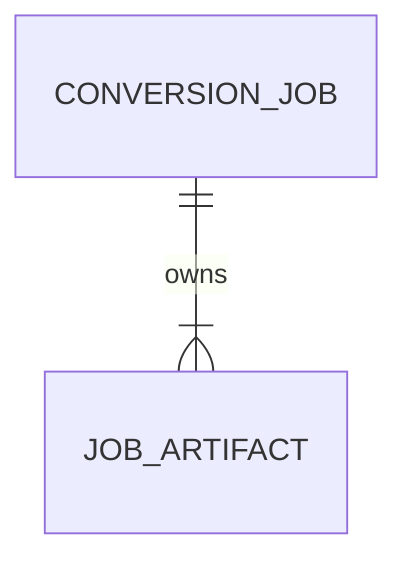

# Plan

**Approved**: 2026-11-23 - user: "Gire o PDF que quiser. Gire vários arquivos PDF de uma só vez!"
**Settled mid-build:** Apply the existing degree choice to every page of every PDF in the batch; keep one-file output unchanged and ZIP multiple outputs.
**Review:** sent at 417107c
**Fix pass:** done - The ZIP regression now compares extracted text from every output page against every source page.

## Problem

The PDF rotation tool accepts only one PDF, despite the original request naming rotation of several PDFs in one operation. People must submit multiple files one at a time. When this ships, they can rotate a batch with the existing degree selector and download all PDFs together.

## Shape

The feature extends the existing `pdf.rotate` form, API, and PyMuPDF path. It reuses the streaming parser's configured file limit and the worker's existing multi-output ZIP handling; the selected degree is applied uniformly to each page of every input PDF.

### Changes underneath

| Front | What changes |
| --- | --- |
| API | `pdf.rotate` accepts one through `MAX_FILES_PER_JOB` PDFs and retains existing degree validation. |
| Worker | A multi-input path rotates each PDF independently and returns ordered outputs. |
| Browser | The PDF rotate picker allows multiple files; the file list preserves selection order. |
| Stored data | Data: none - existing job and artifact records already support multiple input files and ZIP output. |

New: nothing - existing job and artifact entities only.

### Surface

| Surface | Contract | Who | Status |
| --- | --- | --- | --- |
| PDF rotation form | File picker permits multiple PDFs; the existing degree selector is used for the whole batch; selected-file order is shown. | Anyone | 200 on form load; existing job errors remain localized |
| `POST /api/jobs` | `pdf.rotate` accepts 1 through `MAX_FILES_PER_JOB` PDFs and `degrees` of 90, 180, or 270; more than the maximum returns HTTP 422 `too_many_files`. | Anyone with service access | 202 accepted; 422 invalid count or options |
| Download | One input returns one PDF; multiple inputs return one ZIP with one rotated PDF per source. | Anyone with job id | 200 ready; 404 missing/expired job; 409 job not ready |

### Landing

| One-way door | Literal shape | Alternative rejected |
| --- | --- | --- |
| Batch output | One input keeps existing `rotated.pdf`; multiple inputs use `<source-stem>-rotated.pdf` entries in upload order, with case-insensitive `-2`, `-3`, and later suffixes for duplicate stems. Worker result archive remains `converted-files.zip`. | Returning ZIP for a single input changes existing behavior; repeated names would collide in the archive. |
| Rotation degrees | The existing selected degree applies to every page in every input, relative to the page's current rotation. | Per-file or per-page degrees require a new editing UI and payload contract outside the original request. |

## Criteria

**Acceptance Criteria**

1. WHEN a visitor selects PDF rotation THEN the file picker SHALL allow 1 through the configured maximum PDFs in English and Brazilian Portuguese.
2. WHEN a valid `pdf.rotate` job is created THEN the API SHALL retain the selected degree of 90, 180, or 270 for every file in the job.
3. IF `pdf.rotate` receives more than `MAX_FILES_PER_JOB` files THEN the API SHALL return HTTP 422 `too_many_files` and SHALL create no job.
4. WHEN a single-file rotation finishes THEN the download SHALL remain one PDF named `rotated.pdf`.
5. WHEN a multi-file rotation finishes THEN the download SHALL be one `application/zip` named `converted-files.zip` with one rotated PDF per input in upload order.
6. WHEN multiple files share the same case-insensitive filename stem THEN the ZIP SHALL contain unique names using `-2`, `-3`, and subsequent suffixes.
7. WHEN each input PDF contains multiple pages THEN the output for that input SHALL retain its page count and text, and each page rotation SHALL equal `(previous_rotation + degrees) % 360`.
8. WHEN a visitor selects files in a different order THEN the displayed file list and ZIP entries SHALL preserve that order.

## Out of scope

| Excluded | Why |
| --- | --- |
| Different degrees per file or page | The original tool describes one rotation action for a group; per-item controls add a separate editing workflow. |
| Selecting a page range | Rotation applies to all pages in each PDF, matching the existing interface. |
| Password-protected PDFs | Existing behavior rejects protected PDFs; per-file password collection is a separate contract. |

## Assumptions

| Assumption | Chosen default | Rationale | Confirmed? |
| --- | --- | --- | --- |
| Maximum batch size | Existing `MAX_FILES_PER_JOB` setting (default 10) | Reuses the approved streaming upload limit | y - initial project plan |
| Output names | Original source stem plus `-rotated` and deterministic collision suffixes | Recognizable names without duplicate ZIP members | n |

Open questions: none - batch rotation and uniform degree follow the original request and existing UI control.

## Differences from the source

No binding screen capture was supplied. The local workflow retains its configured file limit and keeps the existing per-file rotation control.

## Sources

- `.specs/features/initial-project/request.md` - user-provided operation description: rotate several PDF files at once.
- `.specs/features/pdf-compression-batch/plan.md` - existing design for ordered PDF ZIP outputs and collision-safe member names.
