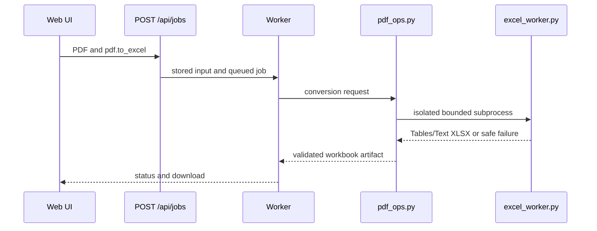
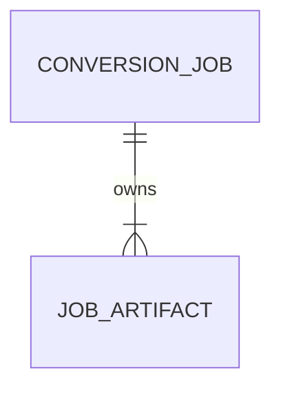

# PDF to Excel data extraction

**Approved**: 2026-11-21 - user: "Pode seguir nas implementações dde acordo com o [$tlc-spec-lean](<C:\\Users\\Fernando Paladini\\.codex\\skills\\tlc-spec-lean\\SKILL.md>) até o final. Vá abrindo PRs conforme precisar e vá seguindo tudo da implementação"
**Settled mid-build:** none
**Review:** sent at d0573c7
**Fix pass:** done - move PDF Office isolation checks before PDF parsing and assert workbook source ordering

## Problem

The catalog still marks PDF to Excel as coming soon. The approved request asks people to extract data from PDFs directly into Excel spreadsheets; they currently have to copy or retype it.

When this ships, a visitor can download a local XLSX workbook containing detected tables and selectable text from an unencrypted PDF, with source page references, without scanning pages through OCR.

## Shape

Extend the existing PDF job flow with `pdf.to_excel`. The bounded Linux child uses PyMuPDF `Page.find_tables(strategy="lines", use_layout=False)` to extract vector-line tables and text outside those tables, and XlsxWriter to produce a workbook. The `Tables` worksheet stores source page, table and row numbers followed by cell values in source order. The `Text` worksheet stores source page, line number and non-table text in reading order. All extracted values remain literal text, preserving leading zeroes and preventing PDF content beginning with `=` from becoming a formula. Scanned image-only pages produce no extracted data and do not invoke OCR.

The child rejects PDFs over 200 pages, pages above 16 million pixels at 150 DPI, more than 200,000 table cells, or more than 100,000 non-table text lines. The parent enforces a 180-second timeout, validates XLSX ZIP/XML structure and a 256 MiB output cap, and starts conversion only in the Linux network-isolated worker. A document with no extractable tables or selectable text fails without an empty workbook.

1. Web UI (exists) selects one PDF and starts PDF-to-Excel.
2. `POST /api/jobs` (exists) applies upload/PDF validation, stores the file and queues `pdf.to_excel`.
3. Worker (exists) calls `pdf_ops.py` (exists), verifies network isolation, and starts `excel_worker.py` (door 1).
4. `excel_worker.py` (door 1) extracts table cells and non-table text, writes one validated XLSX workbook, and returns the artifact.
5. Worker (exists) records completion; the bilingual browser page polls status and offers the XLSX download or an actionable error.

New: no entities or relations - the existing job and artifact records hold operation, status, input and output.

**Changes underneath**

| Front | What changes |
| --- | --- |
| domain | Add local `pdf.to_excel` dispatch and isolated extraction errors. |
| stored data | No migration; existing job and artifact records store the workbook. |
| readers | Add a bilingual tool page; enable the catalog card; document extracted structures and fidelity limits. |

## Surface

| Route | In | Out | Status | Who |
| --- | --- | --- | --- | --- |
| `POST /api/jobs` (extended) | one unencrypted PDF, `operation=pdf.to_excel`, no options | job ID and status URL | `202`, existing upload/PDF errors | anyone |
| `GET /tools/pdf-to-excel` (new) | none | bilingual upload form | `200` | anyone |

## Landing

| One-way door | Literal shape | Alternative rejected |
| --- | --- | --- |
| Table extraction | Pinned full PyMuPDF `Page.find_tables(strategy="lines", use_layout=False)`; each detected table is flattened to source-tagged rows, without claiming arbitrary layout reconstruction | Treat every PDF page as a visual image, because that produces no usable spreadsheet cells. |
| Other selectable text | Store non-table lines on a separate `Text` sheet with page and line numbers, without OCR | Drop non-table selectable text or infer rows and columns without reliable evidence. |
| Cell interpretation | All extracted cell and line values are literal strings; XlsxWriter string-to-formula and string-to-URL conversions are disabled | Interpret untrusted PDF strings as formulas or hyperlinks, or coerce identifiers and locale-dependent numbers. |
| Worker | Linux-only loopback interface check and isolation attestation; CPU/address-space or data/file limits, 180-second parent timeout, 256 MiB output cap | Parse untrusted PDF structures in the connected web process. |

## Criteria

### S1: Extract PDF data into Excel (P1)

**Acceptance Criteria**

1. WHEN a visitor opens PDF to Excel THEN the page SHALL accept exactly one PDF, display queued/processing/success/error status in PT-BR and English, and offer an `.xlsx` download on success.
2. WHEN an unencrypted supported PDF contains detected tables THEN the workbook SHALL contain their cell values in source page, table and row order on a `Tables` worksheet, with source references in dedicated columns.
3. WHEN a PDF has selectable text outside detected tables THEN the workbook SHALL include that text in reading order on a `Text` worksheet with source page and line numbers; it SHALL preserve leading zeroes and cell text literally, including values that start with `=`.
4. WHEN a workbook is generated THEN PDF strings SHALL be written as text and SHALL NOT create formulas or external hyperlinks; the XLSX SHALL contain valid workbook and worksheet XML parts and SHALL be at most 256 MiB.
5. IF a PDF contains only scanned image pages or otherwise has no detected tables or selectable text THEN the job SHALL fail with a localized `no_extractable_data` error and SHALL expose no empty download; the tool SHALL not perform OCR.
6. IF a PDF is invalid, encrypted, has over 200 pages, a page over 16 million pixels at 150 DPI, over 200,000 table cells, or over 100,000 text lines THEN processing SHALL fail without a downloadable artifact.
7. WHEN conversion runs THEN it SHALL require the network-isolated Linux worker and complete within 180 seconds; unsupported hosts and child timeouts SHALL fail closed.
8. WHEN a visitor uploads multiple PDFs THEN the API SHALL reject the request; the documentation SHALL state the supported extraction scope and OCR/layout limitations in both languages.
9. WHEN this slice ships THEN existing PDF/image tests SHALL pass and the catalog SHALL link PDF to Excel to its tool page.

## Out of scope

| Excluded | Why |
| --- | --- |
| OCR for scanned documents | OCR is a separate roadmap stage and must remain an explicit local feature. |
| Reconstructing visual formatting, page backgrounds, charts, merged cells or tables that detection misses | The supported output is extracted cell/text data with source references; arbitrary PDF layout is not a reliable data model. |
| Executable formulas, external URLs, numeric/date inference and user-configurable output schemas | Preserve untrusted source content literally and keep this first operation simple. |
| PDF to PowerPoint, HTML/URL conversion or other future roadmap features | They remain separate required stages with independent constraints. |

## Assumptions

| Assumption | Chosen default | Rationale | Confirmed? |
| --- | --- | --- | --- |
| Workbook structure | `Tables` and `Text` worksheets with source page numbers | Provides usable, attributable extracted data without guessing document layout. | y - user delegated implementation details and the full roadmap |
| Values | All extracted values remain strings | Preserves source text and identifiers and avoids formula injection and locale-dependent numeric inference. | y - user delegated |
| Processing bounds | 200 pages, 16 MP/page at 150 DPI, 200k table cells, 100k text lines, 180 seconds and 256 MiB output | Bounds resource use in the self-hosted service. | y - user delegated |

**Open questions:** none - the user delegated sequencing and technical defaults while requiring the complete roadmap.

**Review:** sent at d0573c7

**Fix pass:** pending review

## Differences from the source

None beyond existing I Love Open Converter branding and local-only processing decisions AD-006 and AD-007.

## Sources

- `.specs/features/initial-project/request.md` - original PDF-to-Excel request.
- `.specs/features/pdf-to-office/plan.md` - existing network-isolated Linux conversion boundary.
- [PyMuPDF table extraction API](https://pymupdf.readthedocs.io/en/latest/page.html) - detected table cells and text extraction.
- [XlsxWriter Workbook API](https://xlsxwriter.readthedocs.io/workbook.html) - output resource and literal-string configuration.
- [XlsxWriter worksheet write API](https://xlsxwriter.readthedocs.io/worksheet.html) - handling strings that resemble formulas or URLs.
