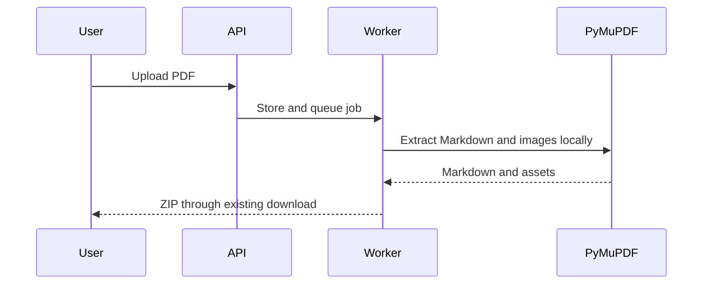
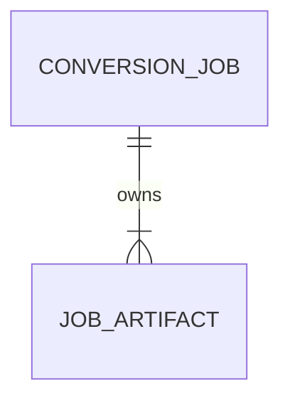

# PDF to Markdown

**Approved**: 2026-11-20 - user: "Você tem total liberdade pra seguir os planos e features já definidos. SÓ VAI."
**Settled mid-build:** none
**Review:** pending implementation
**Fix pass:** pending review

## Problem

The roadmap includes converting a PDF to Markdown, but the catalog currently presents it as unavailable. People need a local downloadable representation of extractable text, tables and figures, while retaining the existing privacy and deployment constraints.

## Shape

Use the full pinned PyMuPDF package for its local Markdown and layout engine. The existing upload-first UI queues one PDF through the existing API and worker. The worker writes a Markdown document and any generated image assets in a private output directory, then the existing download flow serves a ZIP with relative references. OCR remains a separate roadmap feature and is disabled for this conversion.

1. The visitor uploads one PDF from a bilingual tool page.
2. The existing API validates and queues a `pdf.to_markdown` job.
3. The worker converts locally, packages the Markdown and generated images, and records completion or a safe error.
4. The visitor downloads the ZIP or sees a localized error.

**Changes underneath**

| Front | What changes |
| --- | --- |
| domain | Add `pdf.to_markdown` and its validation and processing |
| stored data | Existing conversion job and artifact records; no migration |
| readers | Bilingual upload page, job worker and documented format matrix |

New: nothing - existing jobs and artifacts store input and output.

## Surface

| Route | In | Out | Status | Who |
| --- | --- | --- | --- | --- |
| `POST /api/jobs` | one unencrypted PDF and `pdf.to_markdown` | job ID | `202`, `413`, `415` or `422` | anyone |
| `GET /tools/pdf-to-markdown` | none | bilingual upload form | `200` | anyone |

## Landing

| One-way door | Literal shape | Alternative rejected |
| --- | --- | --- |
| Extraction engine | Full pinned PyMuPDF with its local layout module, installed for the supported architectures | A home-grown text dump loses document structure and tables. |
| Download | ZIP with a Markdown file and locally generated relative image references | Absolute filesystem paths would break links and disclose server paths. |

## Criteria

### S1: Convert a PDF to Markdown (P1)

**Acceptance Criteria**

1. WHEN a visitor opens the PDF to Markdown tool THEN the UI SHALL accept one PDF, show progress and errors, and offer a ZIP download in PT-BR and English.
2. WHEN a valid unencrypted PDF contains extractable text THEN the worker SHALL produce UTF-8 Markdown with that text in page order, preserving detectable headings and tables when the engine supports them.
3. WHEN the engine generates figure assets THEN the ZIP SHALL include them and the Markdown SHALL refer to them using relative paths within the ZIP, without server filesystem paths.
4. IF a PDF is invalid, password-protected or multiple files are supplied THEN the system SHALL reject it safely; IF processing fails THEN no result SHALL be published.
5. The conversion SHALL run without external network access, SHALL not perform or claim OCR, and SHALL document limitations for image-only PDFs and complex layouts.
6. The application SHALL install and run the engine on both supported Linux architectures, and existing PDF and image tools SHALL continue working.

## Out of scope

OCR, PDF-to-Office and HTML/URL conversion remain required in later roadmap work. This slice does not promise perfect reconstruction of every layout or inaccessible scanned text.

## Assumptions

| Assumption | Chosen default | Rationale | Confirmed? |
| --- | --- | --- | --- |
| Output package | One ZIP with Markdown and assets | Keeps image references portable | y - user delegated |
| Engine | Full PyMuPDF rather than the lite build | The lite build does not implement `to_markdown` | y - user delegated |

**Open questions:** none - user delegated sequencing and details.

## Differences from the source

None beyond existing decisions AD-006 and AD-007.

## Sources

- `.specs/features/pdf-to-markdown/request.md` - continuation request.
- `.specs/features/project-foundation/plan.md` - cumulative roadmap and local processing requirements.
- `.specs/features/pdf-to-markdown/research.md` - dependency and offline verification notes.
- [PyMuPDF Document API](https://pymupdf.readthedocs.io/en/latest/document.html) - Markdown and image options.
