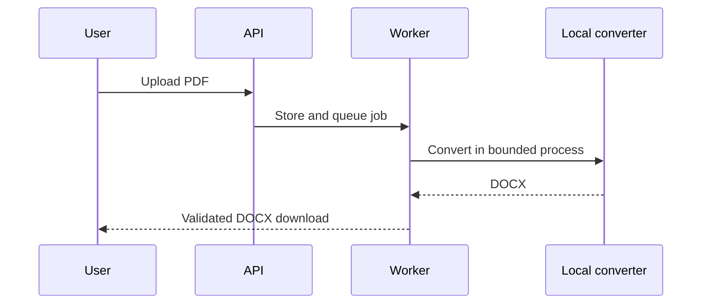
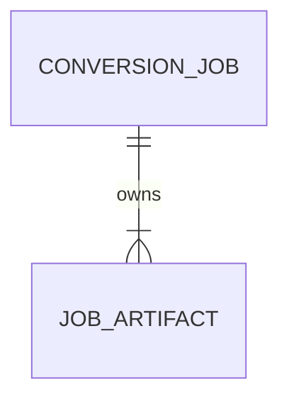

# PDF to editable Word

**Approved**: 2026-11-20 - user: "Você tem total liberdade pra seguir os planos e features já definidos. SÓ VAI."
**Settled mid-build:** none
**Review:** pending implementation
**Fix pass:** pending review

## Problem

The roadmap includes converting PDF documents to editable Word, PowerPoint and Excel files. The catalog marks all three unavailable. This slice adds Word conversion with an explicit fidelity limitation and keeps the other destinations in the cumulative roadmap.

## Shape

The existing bilingual upload-first UI and job API accept one unencrypted PDF. A network-isolated worker invokes the pinned local `pdf2docx` engine in a resource-limited child process and validates the resulting DOCX package before the existing download endpoint publishes it. Text-based documents can be reconstructed; OCR and perfect layout fidelity are not promised.

1. The visitor selects a PDF in the Word conversion tool.
2. The API validates and queues a `pdf.to_word` job.
3. The worker executes local conversion with time, memory and file-size bounds and validates the generated DOCX.
4. The visitor downloads the result or receives a localized error.

**Changes underneath**

| Front | What changes |
| --- | --- |
| domain | Add `pdf.to_word` to validation and processing |
| stored data | Existing job and artifact records; no migration |
| readers | Bilingual upload page, worker and documented capability matrix |

New: nothing - existing jobs and artifacts store input and output.

## Surface

| Route | In | Out | Status | Who |
| --- | --- | --- | --- | --- |
| `POST /api/jobs` | one unencrypted PDF and `pdf.to_word` | job ID | `202`, `413`, `415` or `422` | anyone |
| `GET /tools/pdf-to-word` | none | bilingual upload form | `200` | anyone |

## Landing

| One-way door | Literal shape | Alternative rejected |
| --- | --- | --- |
| Renderer | `pdf2docx==0.5.13` with the existing pinned PyMuPDF in a bounded subprocess | A page screenshot in DOCX would not provide editable document text. |
| Operation | `pdf.to_word` | Reusing an image-conversion operation would misrepresent the editable output. |
| Output | A single validated `.docx` | A proprietary remote conversion service would violate local-only processing. |

## Criteria

### S1: Convert PDF to editable Word (P1)

**Acceptance Criteria**

1. WHEN a visitor opens PDF to Word THEN the UI SHALL accept one PDF, show localized progress and errors, and offer a DOCX download in PT-BR and English.
2. WHEN a supported unencrypted PDF contains text THEN the output SHALL be a valid DOCX with editable text in page order, retaining detectable tables and images where supported.
3. IF the input is invalid, password-protected or multiple files are supplied THEN the API SHALL reject it safely; IF conversion fails, times out or exceeds its limits THEN no output SHALL be published.
4. The converter SHALL execute locally without network access in a bounded child process; it SHALL not perform or claim OCR and SHALL disclose layout and scanned-page limitations.
5. The image SHALL install and run the converter on AMD64 and ARM64 Linux, and existing PDF and image operations SHALL continue to work.
6. The documentation SHALL identify supported input and output, `pdf2docx` and its upstream maintenance status, and the fidelity and resource limits.

## Out of scope

PDF to PowerPoint and Excel remain required and will be implemented in subsequent reviewed slices. OCR is a separate roadmap capability.

## Assumptions

| Assumption | Chosen default | Rationale | Confirmed? |
| --- | --- | --- | --- |
| Sequence | Word first; retain PowerPoint and Excel | The user delegated delivery order | y - user delegated |
| Engine | Local pdf2docx, pinned | The local compatibility probe generated editable text using PyMuPDF 2.1 | y - user delegated |

**Open questions:** none - user delegated sequencing and details.

## Differences from the source

None beyond existing decisions AD-006 and AD-007.

## Sources

- `.specs/features/pdf-to-office/request.md` - continuation request.
- `.specs/features/project-foundation/plan.md` - cumulative roadmap and local processing requirements.
- `.specs/features/pdf-to-office/research.md` - compatibility and maintenance notes.
- [pdf2docx upstream](https://github.com/ArtifexSoftware/pdf2docx) - engine and maintenance status.
