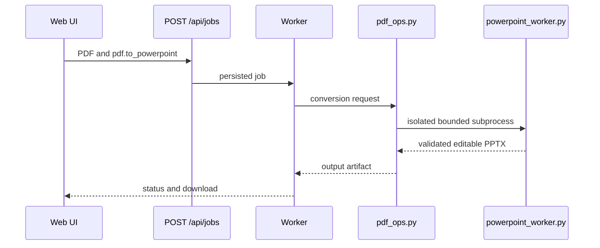
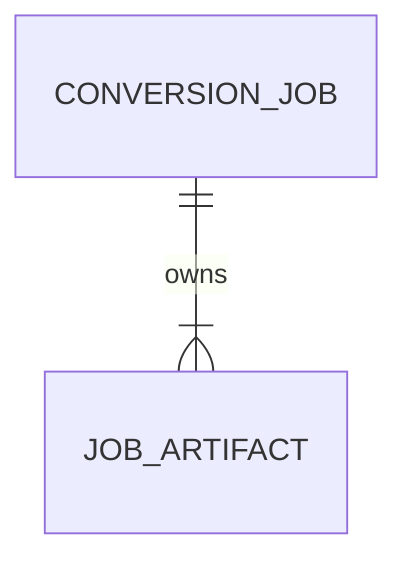

# PDF to editable PowerPoint

**Approved**: 2026-11-21 - user: "Pode seguir nas implementações dde acordo com o [$tlc-spec-lean](<C:\\Users\\Fernando Paladini\\.codex\\skills\\tlc-spec-lean\\SKILL.md>) até o final. Vá abrindo PRs conforme precisar e vá seguindo tudo da implementação"
**Settled mid-build:** none
**Review:** sent at 4b4a533
**Fix pass:** done - scaled editable font sizes from PDF points through slide inches into PowerPoint points; expanded regression tests for source-relative positioning, centering and slide bounds plus page-pixel, shape-count, timeout and output-size failures without download; confirmed the final Linux PPTX remains readable in LibreOffice.

## Problem

The catalog lists PDF to PowerPoint as coming soon. The approved request specifically asks for easy-to-edit presentations; placing one static screenshot on every slide would not meet that need.

## Shape

Extend the current local job flow with one `pdf.to_powerpoint` operation and a bilingual upload page. A bounded Linux child uses PyMuPDF to read text spans and positioned image blocks and python-pptx to create a `.pptx`; each page becomes a slide with editable text boxes and independently selectable picture objects. The first PDF page sets the deck dimensions; pages with other proportions are uniformly fitted and centered without cropping. Ordinary background fills, vector paths, charts, and complex transparency/compositing are not reconstructed. Scanned pages without selectable PDF text do not gain OCR.

The child rejects PDFs with more than 200 pages, pages exceeding 16 million pixels at 150 DPI, or more than 20,000 total slide objects. The parent enforces a 180-second wall-clock timeout, validates the PPTX ZIP/XML structure, and refuses to start unless its Linux worker has no external network interface. Output is capped at 256 MiB. Unsupported environments fail closed.

1. Web UI (exists) selects one PDF and starts the conversion.
2. `POST /api/jobs` (exists) applies the existing PDF and upload validation, persists the input, and queues `pdf.to_powerpoint`.
3. Worker (exists) calls `pdf_ops.py` (exists), checks the isolation boundary, and starts `powerpoint_worker.py` (door 1).
4. `powerpoint_worker.py` (door 1) converts supported text spans and image blocks to editable slide shapes and writes one PPTX.
5. Worker (exists) records the artifact; Web UI polls the existing status endpoint and offers the download or a localized error.

New: no entities or relations - existing jobs and artifacts already hold the operation, input, status and output.

**Changes underneath**

| Front | What changes |
| --- | --- |
| domain | Add `pdf.to_powerpoint` dispatch and fail-closed conversion errors. |
| stored data | No migration; existing jobs and artifacts store the operation and result. |
| readers | Add a bilingual tool page; create one text/picture-based slide per PDF page; document supported and excluded content. |

## Surface

| Route | In | Out | Status | Who |
| --- | --- | --- | --- | --- |
| `POST /api/jobs` (extended) | one unencrypted PDF, `operation=pdf.to_powerpoint`, no options | job ID and status URL | `202`, existing upload errors | anyone |
| `GET /tools/pdf-to-powerpoint` (new) | none | bilingual upload page | `200` | anyone |

## Landing

| One-way door | Literal shape | Alternative rejected |
| --- | --- | --- |
| PPTX authoring | `python-pptx==1.0.2` (MIT) produces Office Open XML slides containing editable text boxes and separate picture shapes | A full-page raster image per slide does not satisfy the request for editable presentations. |
| Content extraction | PyMuPDF text spans and image blocks; use page-relative geometry and fit nonmatching page sizes to the first page | Promise reconstruction of vector artwork, charts or scanned text that this first implementation cannot make editable. |
| Worker | Linux-only network-isolated subprocess with CPU, address-space/data and output-file limits; reject unsupported hosts | Running document-derived content on the connected app host. |

## Criteria

### S1: Convert a PDF to editable PowerPoint (P1)

**Acceptance Criteria**

1. WHEN a visitor opens PDF to PowerPoint THEN the page SHALL accept exactly one PDF and provide localized progress and errors plus a downloadable `.pptx` in PT-BR and English.
2. WHEN a supported PDF has selectable text and images THEN each source page SHALL map in order to one slide, extracted text SHALL be selectable/editable text boxes, and embedded raster images SHALL be separate selectable picture objects placed in their source regions.
3. WHEN source pages have different page dimensions THEN slides SHALL preserve each page's relative placement and fit all content inside the deck dimensions without cropping.
4. IF the PDF is invalid, encrypted, over 200 pages, has an over-limit page, exceeds the object limit, fails conversion or times out THEN the job SHALL fail without exposing a partial download.
5. WHEN the child worker starts THEN it SHALL require a Linux worker with only loopback networking and enforce resource limits; unsupported or connected environments SHALL fail closed.
6. WHEN a conversion succeeds THEN the output SHALL be a structurally valid PPTX with its required content-type, presentation and slide parts; output size SHALL not exceed 256 MiB.
7. The documentation SHALL name the engine, editable elements, exclusions, scanned-page limitation, input bounds, and the network-isolated worker requirement in both languages.
8. WHEN the feature ships THEN existing PDF and image operations SHALL continue to pass their tests and the catalog SHALL enable the tool.

## Out of scope

| Excluded | Why |
| --- | --- |
| Vector reconstruction, native charts/tables, original fonts, page backgrounds and exact visual fidelity | Independent PDF graphics often do not map directly to slide objects; scope requires clear bounds and editable text/images. |
| OCR and image-only scanned-page conversion | OCR is a separate roadmap capability. |
| PDF to Excel and HTML/URL conversion | Required later roadmap stages with independent extraction and network-sandbox decisions. |

## Assumptions

| Assumption | Chosen default | Rationale | Confirmed? |
| --- | --- | --- | --- |
| Layout | One slide per PDF page; text and images are editable objects positioned from source coordinates | Matches the explicit "fáceis de editar" requirement while limiting reconstruction to supported structures. | y - user delegated the complete roadmap and implementation details |
| Slide size | First page determines deck dimensions; other pages fit and center | PowerPoint has one deck canvas while PDFs can vary per page. | y - user delegated |
| Page and shape bounds | 200 pages; 20,000 shapes; 16 MP at 150 DPI per page; 256 MiB output; 180-second timeout | Prevent hostile or unexpectedly large inputs from exhausting the self-hosted worker. | y - user delegated |

**Open questions:** none - implementation choices are delegated and the complete objective remains active.

## Differences from the source

None beyond existing local processing and I Love Open Converter identity decisions AD-006 and AD-007.

## Sources

- `.specs/features/initial-project/request.md` - original requirement for an editable PowerPoint presentation.
- `.specs/features/pdf-to-office/plan.md` - prior isolated conversion worker constraints and cumulative roadmap.
- [python-pptx text boxes and pictures](https://python-pptx.readthedocs.io/en/latest/api/shapes.html) - editable slide text and image objects.
- [python-pptx MIT license](https://github.com/scanny/python-pptx/blob/master/LICENSE).
- [PyMuPDF text and image blocks](https://pymupdf.readthedocs.io/en/latest/app1.html) - block/span coordinates and image bytes.
