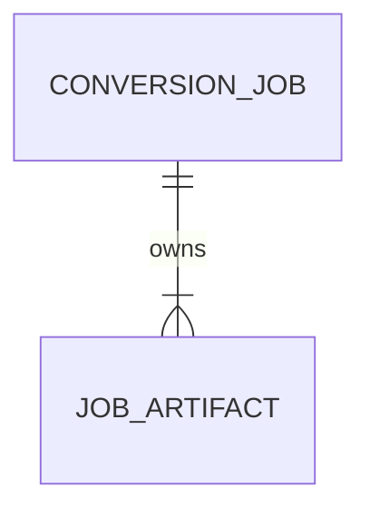

# Local PDF translation

**Approved**: 2026-11-21 - user: “Pode seguir nas implementações dde acordo com o [$tlc-spec-lean](<C:\Users\Fernando Paladini\\.codex\\skills\\tlc-spec-lean\\SKILL.md>) até o final. Vá abrindo PRs conforme precisar e vá seguindo tudo da implementação”
**Settled mid-build:** user chose “PDF textual por página (Recomendado)” for offline PT-BR ↔ English translation, with text and page breaks preserved and no layout/images retained; user approved about 200 MB of image growth. To stay near that size, use the Argos model files with direct CTranslate2 and SentencePiece rather than the PyPI Argos runtime, whose stanza dependency pulls in PyTorch.
**Review:** sent at 0188c33.
**Fix pass:** done - added API/worker tests for the successful PDF download and the missing-model failure, then covered the rejected request matrix with no-job assertions.

## Problem

The PDF tools do not translate text. A self-hosted user must copy document text into a third-party translator, exposing the content and losing its page boundaries.

When this ships, a visitor can translate a text-based PDF between Brazilian Portuguese and English into a new text-only PDF, with one output page for each source page, while the worker has no network access.

## Shape

The feature reuses the existing upload limits, local job queue, isolated worker, and PyMuPDF PDF pipeline. Pinned CTranslate2 and SentencePiece dependencies, the two pinned PT-BR/English Argos model files, and a Unicode font are installed into the container image at build time; translation itself uses only those local assets. Output pages contain translated text only and retain the source page order and page dimensions.

The browser submits one PDF and an explicit direction (`pt-BR` to `en` or `en` to `pt-BR`) to `pdf.translate`. The worker extracts selectable text page by page, translates each page separately, and writes one text-only page per input page. It does not use a hosted service, infer the source language, or perform OCR.

**Changes underneath**

| Front | What changes |
| --- | --- |
| Domain | Add `pdf.translate`, pair validation, bounded extraction and translation, text-only PDF output, and localized worker errors. |
| Runtime | Pin CTranslate2 and SentencePiece; download and verify the two versioned Argos model assets during Docker build; smoke-test both directions. |
| Storage | Reuse the current job and artifact tables; no migration. |
| Readers | Add a bilingual upload page, PDF catalog card, README capability descriptions, and third-party notices. |

New: nothing - the existing conversion job and artifact records hold the PDF input and translated PDF output.

## Surface

| Route | In | Out | Status | Who |
| --- | --- | --- | --- | --- |
| `GET /tools/pdf-translate` | none | Bilingual upload page | 200 | anyone |
| `POST /api/jobs` | one PDF, `pdf.translate`, direction | Existing job response and translated PDF artifact | 202; existing upload/PDF errors; 422 `invalid_options` | anyone |

`pdf.translate` worker operation maps input page i to output page i. Empty pages remain empty and do not shift later pages. Source sentences are segmented locally and passed through the bundled SentencePiece and CTranslate2 models. Worker error codes are `translation_no_text`, `translation_too_large`, `translation_page_overflow`, and `translation_unavailable`.

## Landing

- CTranslate2, SentencePiece, and the font are pinned or supplied by the base image. The two Argos 1.9 language packages are installed during Docker build from their versioned official model URLs into an explicit local model directory. Their SHA-256 values are checked before extraction. The worker smoke check verifies both directions.
- Model package attribution and license notices are recorded in `THIRD_PARTY_NOTICES.md` and linked from both READMEs.
- No hosted inference, automatic source-language detection, OCR, images/layout preservation, text editing, or language pairs beyond PT-BR and English.

| One-way door | Literal shape | Alternative rejected |
| --- | --- | --- |
| Translation operation | `pdf.translate`; one text-only output page for every source page | Rebuilding layout or images would misrepresent the chosen text-only product scope and add separate reconstruction work |
| Translation models and runtime | The versioned Brazilian Portuguese and English Argos model archives with direct CTranslate2 and SentencePiece inference; model archives total 130.3 MB and installed assets total 158 MiB | The PyPI Argos 1.11.0 package depends on Stanza/PyTorch; avoiding that runtime keeps the self-hosted image near the user-approved size while retaining the same official model files |
| Model attribution | Attribute Argos Translate and OPUS-MT; identify the two model packages as CC-BY 4.0 and link the license | Omitting upstream attribution would violate the package READMEs and the listed model license |
| Translation scope | Only PT-BR ↔ English, with an explicit source direction | Auto-detection and additional languages are outside the approved first version |

## Criteria

### S1: Translate a text-based PDF locally (P1)

**Acceptance Criteria**

1. WHEN a visitor opens `/tools/pdf-translate` THEN the page SHALL show a single-PDF upload, a required direction selector for PT-BR→English or English→PT-BR, and localized instructions that the output contains text only.
2. WHEN the visitor submits a supported PDF and direction THEN the page SHALL create one `pdf.translate` job and show its localized queued/processing/success status.
3. WHEN the job succeeds THEN the downloadable PDF SHALL contain the translated selectable text and exactly one output page for every source page, in the same order and with the same page dimensions.
4. WHEN the source has a blank page among pages with text THEN the output SHALL keep that page blank at the same position.
5. IF the visitor submits no direction, an unsupported pair, a non-PDF, a malformed PDF, or more than one PDF THEN the API SHALL reject the request without creating a job.
6. IF every source page has no selectable text THEN the job SHALL fail with `translation_no_text`, produce no download, and direct the visitor to OCR first.
7. IF the input exceeds 100 pages or the extracted text exceeds 100,000 Unicode characters THEN the job SHALL fail with `translation_too_large` and produce no download.
8. IF translated content cannot fit its corresponding source-sized output page at a readable minimum font size of 6 pt THEN the job SHALL fail with `translation_page_overflow` and produce no partial download.
9. IF either pinned language model is absent or unavailable THEN the worker SHALL fail closed with `translation_unavailable` and produce no download.
10. WHILE processing a translation job THEN the worker SHALL not make network requests; both language directions SHALL run from the installed container assets.
11. WHEN the visitor changes language or resizes the page to 360 CSS pixels wide THEN the direction selector, upload, status, error, and download controls SHALL remain localized and usable without horizontal page scrolling.
12. WHEN a project maintainer builds the Docker image for each supported architecture THEN the build SHALL install and smoke-test both model directions without downloading models at worker runtime.

## Assumptions

| Assumption | Rationale | Confirmed? |
| --- | --- | --- |
| The 100 page and 100,000 character limits bound local CPU translation work. | Existing PDF operations use explicit size limits and the worker has a 3 GiB memory limit. | y - user delegated complete goal and routine implementation decisions |
| Pages with no text are retained as blank pages if at least one other page contains text. | One-to-one page mapping keeps page breaks and order meaningful. | y - implied by “PDF textual por página” |
| Translation uses `translate-pb_en-1_9` and `translate-en_pb-1_9`. | The accepted local model plan selected Argos; its official index publishes this Brazilian Portuguese and English pair. | y - user selected Argos offline models |
| The application image may grow by about 200 MB after adding the unpacked models and light runtime. | The user approved about 200 MB; actual model archives are 130.3 MB compressed and 158 MiB expanded, and PyTorch-heavy Argos runtime dependencies are avoided. | y - user answered “Prosseguir (~200 MB extras)” |

**Open questions:** none - the user accepted about 200 MB of image growth, and the direct CTranslate2 runtime avoids PyTorch-heavy package dependencies.

## Differences from the source

No binding screenshot or source UI was provided. This feature follows the existing application design system and bilingual upload workflow.

## Out of scope

- Translation of scanned/image-only pages (run OCR first).
- Retaining the source layout, fonts, images, tables, links, or annotations.
- Automatic language detection, editing translated text, additional language pairs, or hosted translation.
- Guaranteeing translation quality for legal, medical, or other specialized documents.

## Sources

- `.specs/features/project-foundation/plan.md` - approved product scope and offline worker constraints.
- `.specs/features/pdf-local-summary/plan.md` - current PDF job, size-limit and bilingual UI patterns.
- [CTranslate2](https://github.com/OpenNMT/CTranslate2) - local CPU inference runtime for the Argos model format.
- [SentencePiece](https://github.com/google/sentencepiece) - tokenizer included with the model packages.
- [Argos package index](https://github.com/argosopentech/argospm-index/blob/main/index.json) - Brazilian Portuguese and English model package identifiers.
- [Argos model directory](https://data.argosopentech.com/argospm/v1/) - versioned model assets and package sizes.
- `.specs/features/pdf-translation/research.md` - pinned model hashes, measured archive sizes, package metadata and embedded license details.
- [Argos model license audit](https://community.libretranslate.com/t/model-licenses-for-argos-translate/2442) - lists the selected OPUS-MT models as CC-BY 4.0.
- [CC BY 4.0 legal code](https://creativecommons.org/licenses/by/4.0/legalcode) - model redistribution terms.
