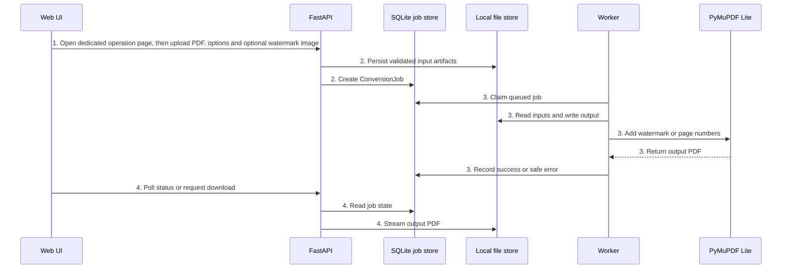
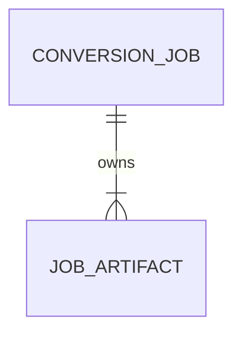

# PDF watermarks and page numbers

**Approved**: 2026-11-19 - user: "sim porra, só vai. Não fica perguntandpo toda hora, eu só quero que vc faça uma cópia do ILovePDF e ILoveIMG Caralho"
**Settled mid-build:** user delegated sequencing and scope coverage: "Você decide; cubra o objetivo completo por etapas".
**Review:** sent at 761e1d3
**Fix pass:** done - restored the full 31-PDF/13-image catalog with future tools marked “Em breve”, added workflow/image category filters, centered the home hero, matched the captured PDF tool headings, made “Remover arquivo” clear selections, and expanded PDF output and option-validation tests.

## Problem

People using the current self-hosted converter can merge, split, rotate and optimize PDFs, but they cannot add a watermark or page numbers without installing another tool. This creates an avoidable gap in the browser-based PDF workflow. The supplied objective identifies both operations but provides no usage metrics.

When the complete roadmap ships, a visitor can use a broad, documented set of local PDF, image and document tools through one simple browser workflow, then download results from the same self-hosted service. This plan starts that expansion with PDF watermarks and page numbers.

## Objective roadmap

The objective is cumulative. This sequence chooses an implementation order, not a reduction of the requested end state. Each milestone after S2 will get its own detailed feature plan and review while the same active goal continues.

| Stage | Capability groups retained from the request | Direction |
| --- | --- | --- |
| 1. PDF markup (this plan, S1-S2) | Text/image watermark and page numbers | Reuse the current PyMuPDF Lite pipeline and job model. |
| 2. PDF organization, editing and security | Reorder, delete and insert pages; crop; add text, images, shapes and annotations; sign; protect and unlock; forms; permanent redaction; repair; compare; PDF/A | Reuse the PDF pipeline where suitable; define cryptographic signature scope and verify redaction/security semantics in the stage plan. |
| 3. Document and web conversion | Word/PowerPoint/Excel to PDF and PDF to Word/PowerPoint/Excel; PDF to Markdown; extract embedded PDF images; HTML/URL to PDF and image | Publish a format-support matrix and install external renderers as explicit, documented self-host dependencies. URL rendering will be local to the user's selected task and must enforce network-address and redirect restrictions. |
| 4. Scan, OCR and PDF intelligence | Browser document capture; OCR/searchable PDF; AI summary and PDF translation | OCR and model processing remain local. AI model support is an optional self-hosted capability; no document is sent to a hosted model service. |
| 5. Advanced images | Animated GIF conversion/creation; crop; photo editor with text/effects/frames/stickers; upscale; background removal; image watermark; meme templates; HTML to image; face/plate/object blur; broader JPEG conversion including SVG/PSD/HEIC/RAW | Keep deterministic image tools on local libraries; heavyweight codecs and inference models must be clearly disclosed and optional where they materially increase installation size. |
| 6. Conversion coverage and release maturity | Extend conversion paths beyond the examples through a maintained input/output capability catalog; polished beginner flow; bilingual community documentation and easy self-host deployment | Never advertise a conversion path unless the installed engine supports and verifies it. Keep processing on the host and keep ads, analytics and external telemetry absent. |

The phrase “any file to any other type” is treated as the product direction for an expandable conversion catalog. It cannot be guaranteed literally for every proprietary, malformed or unsupported format; the application will show the supported input/output pairs instead of claiming unsupported paths.

## Shape

The milestone reuses the existing FastAPI upload and job lifecycle, SQLite job store, local file store, worker and PyMuPDF Lite dependency. Validation and PDF transformations run in the Python backend, where the repository's API and PDF tests can reach them.

1. `Web UI` (exists) collects one PDF, an operation, and validated form options; an image watermark operation also collects one raster image.
2. `FastAPI` (exists) serves dedicated operation pages matching the upload-first reference flow, then validates operation, options, PDF and optional watermark image, persists input artifacts in the `Local file store` (exists), and creates a `ConversionJob` in the `SQLite job store` (exists).
3. `Worker` (exists) claims the job, reads its artifacts from the local store, and calls `PyMuPDF Lite` (exists) to add the watermark or page numbers; it saves one output PDF and records success or failure.
4. `FastAPI` (exists) reads the job state and streams the completed PDF to `Web UI` (exists), which shows status and a download control.

**Changes underneath**

| Front | What changes |
| --- | --- |
| domain | `ConversionJob.operation` gains `pdf.watermark` and `pdf.page_numbers`; current operations retain their meaning. `Worker` branches on these operation identifiers today. |
| stored data | Existing `operation`, `options_json` and `job_artifacts` fields hold the new values; no schema migration or backfill. |
| readers | `Web UI` presents the new operations and forms; `FastAPI` validates the upload; `Worker` reads job options and artifacts. All three are named in criteria below. |

New: nothing - existing `ConversionJob` and `JobArtifact` records represent inputs and output. One-way constraints: `operation` values `pdf.watermark` and `pdf.page_numbers`, plus their JSON option fields, are consumed by `FastAPI`, `Worker` and `Web UI` (door 1).

## Surface

| Route | In | Out | Status | Who |
| --- | --- | --- | --- | --- |
| `POST /api/jobs` (extended) | `multipart/form-data`: `operation` equal to `pdf.watermark` or `pdf.page_numbers`; one PDF in `files`; for image watermark, one PNG/JPEG/WebP image also in `files`; `options` JSON described in criteria | Existing `{job_id,state,status_url}` response; successful status includes `download_url` and output `files` | `202`; `413 file_too_large` or `request_too_large`; `415 unsupported_format`; `422 invalid_file`, `invalid_options` or `too_many_files` | anyone |
| `GET /tools/pdf-watermark` (new) | none | Local watermark form, initially showing PDF upload | `200`; `404` for unknown tool route | anyone |
| `GET /tools/pdf-page-numbers` (new) | none | Local page-number form, initially showing PDF upload | `200`; `404` for unknown tool route | anyone |
| `GET /api/jobs/{job_id}` (unchanged) | opaque job UUID | Existing job state and, on success, output metadata | `200`; `404 job_not_found` | anyone with the job ID |
| `GET /api/jobs/{job_id}/download` (unchanged) | opaque job UUID | Resulting PDF | `200`; `404 job_not_found`; `409 job_not_ready` | anyone with the job ID |

## Landing

| One-way door | Literal shape | Alternative rejected |
| --- | --- | --- |
| Job operation identifiers and option JSON (door 1) | `pdf.watermark` options: `kind` (`text` or `image`), `position` (one of nine page anchors), `opacity` (0.1–1.0); text adds `text`, `font` (`helv`, `tiro`, `cour`), `font_size` (8–72 pt), `color` (`#RRGGBB`); image watermark uses the second uploaded artifact and preserves its alpha channel. `pdf.page_numbers` options: `position` (one of six footer/header anchors), `format` (`number`, `number_total`, `page_number_total`), `start` (1–999999), `font` (`helv`, `tiro`, `cour`), `font_size` (8–48 pt), `color` (`#RRGGBB`). All operations apply to every PDF page. | Store user-controlled behavior only in the uploaded file, because changing the option values per job is needed to let visitors choose typography and placement. |

- No new runtime dependency or database column is introduced.
- Other operation behavior and the existing unauthenticated local job model remain unchanged.

## Criteria

### S1: Add a watermark to a PDF (P1)

A visitor adds a text or image watermark to every page and downloads the resulting PDF.

**Acceptance Criteria**

1. WHEN a visitor opens `/` THEN the system SHALL show the combined PDF/image tool catalog using the reference's centered hero, category chips and card grid; PDF and image cards SHALL be grouped and ordered as recorded in `captures/ilovepdf-home.aria.yml` and `captures/iloveimg-home.aria.yml`; operations deferred to later roadmap stages SHALL remain visible as disabled cards labeled “Em breve” / “Coming soon” (AD-007).
2. WHEN the visitor selects the `Marca d'água` card THEN the system SHALL navigate to `/tools/pdf-watermark` and show the reference's upload-first flow recorded in `captures/ilovepdf-watermark.aria.yml`; the initial page SHALL not show the watermark editor until a PDF is selected.
3. WHEN the visitor selects text mode after choosing a PDF THEN the UI SHALL show a required text field, font choices Helvetica/Times/Courier, font size 8–72 pt (default 24), color (default `#808080`), opacity 0.1–1.0 (default 0.3), and nine position choices; choosing a control SHALL update the displayed selected value.
4. WHEN the visitor selects image mode after choosing a PDF THEN the UI SHALL show one image upload control accepting PNG/JPEG/WebP, opacity 0.1–1.0 (default 0.3), and nine position choices; selecting an image SHALL show its filename and allow replacing or removing it.
5. WHEN the visitor uploads one valid unencrypted PDF and valid text or image watermark settings, then activates the watermark submit control THEN `POST /api/jobs` SHALL return `202` and the UI SHALL show queued/processing status followed by one downloadable PDF.
6. WHEN the watermark worker processes a job THEN it SHALL apply the selected watermark to every page, preserve existing page dimensions and text content, and place it at the selected anchor with the requested opacity, font, size and color where applicable.
7. IF required text is blank, options are outside their stated bounds, or the color is not `#RRGGBB` THEN the system SHALL reject the request with `422 invalid_options`; IF the PDF is invalid/password-protected THEN it SHALL return `422 invalid_file`; IF the optional image is invalid or unsupported THEN it SHALL return `422 invalid_file` or `415 unsupported_format` respectively.
8. IF the visitor selects more than one PDF or more than one watermark image THEN the system SHALL reject the request with `422 too_many_files`; image mode SHALL contain exactly one PDF and exactly one image, while text mode SHALL contain exactly one PDF.
9. WHEN the visitor uses `Remover arquivo` before submission THEN the system SHALL clear the selected inputs and restore the empty upload state; WHEN the visitor activates `Baixar` after completion THEN the browser SHALL download the generated PDF.
10. WHEN the browser viewport is between 360 px and 1440 px wide THEN the watermark controls and job result SHALL remain usable without horizontal page scrolling.

### S2: Add page numbers to a PDF (P1)

A visitor adds formatted page numbers to every page and downloads the resulting PDF.

**Acceptance Criteria**

11. WHEN the visitor selects the `Números de página` card THEN the system SHALL navigate to `/tools/pdf-page-numbers` and show the upload-first flow recorded in `captures/ilovepdf-page-numbers.aria.yml`; the initial page SHALL show only the PDF upload step.
12. WHEN a visitor selects `Numerar páginas` after choosing a PDF THEN the UI SHALL show position choices (top or bottom, left/center/right), format choices (`1`, `1 / total`, `Página 1 de total` / their English equivalents), start number 1–999999 (default 1), font choices Helvetica/Times/Courier, font size 8–48 pt (default 12), and color (default `#000000`).
13. WHEN the visitor submits one valid unencrypted PDF and valid page-number settings THEN `POST /api/jobs` SHALL return `202`; on success the job SHALL expose one downloadable PDF with the requested numbering on every page, counting from the selected start number.
14. WHEN format `number_total` is selected THEN each page SHALL show `<current> / <page count>`; WHEN format `page_number_total` is selected THEN each page SHALL show the localized `Page <current> of <page count>` equivalent; format `number` SHALL show only `<current>`.
15. IF the PDF is missing, invalid or password-protected THEN the system SHALL return the existing `422 invalid_file` error; IF any option is outside its stated bounds or is malformed THEN the system SHALL return `422 invalid_options` without creating a job.
16. WHEN the visitor activates `Numerar páginas` and then `Baixar` THEN the interface SHALL show queued, processing, error or success state and deliver the generated PDF through the existing job download flow.

## Out of scope

| Excluded | Why |
| --- | --- |
| The other PDF capabilities in the objective (editing, sign, encrypt/decrypt, page organizing/cropping, repair, PDF/A, OCR, compare, redact, forms, Markdown, Office conversion, HTML conversion, scanning, AI summary and translation) | This milestone adds two PDF operations that reuse the current engine; the broader objective remains active and these capabilities require separate criteria and dependency/quality decisions. |
| New image operations (animated GIF, crop, editor, upscale, background removal, watermark, memes, HTML screenshot, face/plate blur) | They do not change the PDF watermark and numbering flows and need their own processing and dependency decisions. |
| A claim to convert every possible file type to every other type | The objective names a large but finite example set; each future milestone must publish and verify its supported format matrix. |
| Authentication, external storage, analytics, telemetry, advertisements, or third-party runtime assets | The approved initial project criteria require a self-hosted, local workflow without these services. |

## Assumptions

| Assumption | Chosen default | Rationale | Confirmed? |
| --- | --- | --- | --- |
| Milestone order and full request scope | Deliver all named capability groups in the staged order in `Objective roadmap`; start with PDF watermark and page numbering | The user explicitly delegated sequencing and asked that the complete objective remain covered in stages. | y - user: "Você decide; cubra o objetivo completo por etapas" |
| Existing languages | Keep PT-BR and English for both new operations | The accepted initial-project plan requires these languages across the UI; no request changes that behavior. | y - existing approved plan |
| AI processing | Local, optional self-hosted models, with no hosted inference service | Follows the user's requirement that files stay on the self-hosted system and no telemetry sends data outward; specific engine and model are deferred to the AI milestone plan. | y - user delegated the full objective; local-only is an explicit project invariant |
| UI handling for optional image input | Text mode takes exactly one PDF; image mode takes one PDF and one image in the existing repeated `files` field | Fits the existing multipart job model and avoids a new API route. | y - user delegated sequencing and product details |
| Image alpha | PNG/JPEG/WebP are accepted; PNG and WebP transparency are retained | These formats are already supported by Pillow; preserving transparency is needed for legible watermarks. Image opacity is applied through Pillow alpha compositing before PDF insertion. | y - user delegated sequencing and product details |
| Position anchors | Watermark uses a 3-by-3 anchor grid; page numbers use six header/footer anchors | Gives predictable placement without a drag editor or PDF preview in this milestone. | y - user delegated sequencing and product details |

**Open questions:** none - the user delegated sequencing and scope planning; defaults are recorded above for approval or correction with the plan.

## Differences from the source

| Source shows | Product shows | Confirmed |
| --- | --- | --- |
| iLovePDF/iLoveIMG branded logos and app name | I Love Open Converter identity and its own logo, preserving the same prominent header placement and visual hierarchy | y - AD-006 |
| Google Drive and Dropbox import buttons on PDF tool pages | Local file selection only; the project must keep conversion inputs on the self-hosted server and avoid third-party file transfer | y - AD-006 |
| Account registration, sign-in and Premium promotion | Free, self-hosted tools with no account, paywall, ads or telemetry | y - AD-006 |

The public product homepages and the watermark/page-number upload screens bind the tool grid, card grouping, headings, upload-first flow, hierarchy and spacing. Their captured accessibility structures are in `captures/`; screenshots were visually inspected in the browser during plan approval.

## Sources

- `.specs/features/project-foundation/request.md` - binding for the long-term goal and named operation examples.
- [iLovePDF home](https://www.ilovepdf.com/pt) and watermark/page-number tool pages - binding - tool categories, card hierarchy and upload-first conversion flow.
- [iLoveIMG home](https://www.iloveimg.com/pt) - binding - image tool categories and card hierarchy.
- `.specs/features/project-foundation/captures/` - structural captures from the live references; screenshots were observed at the browser's 731 × 720 viewport.
- [Initial project plan](../initial-project/plan.md) - existing approved constraints: local processing, no telemetry, self-host Compose, and PT-BR/English.
- [PyMuPDF page API](https://pymupdf.readthedocs.io/en/latest/page.html) - primary documentation for text/image insertion and opacity options.
- [PyMuPDF tutorial](https://pymupdf.readthedocs.io/en/latest/tutorial.html) - primary documentation for page editing and saving.
- [Pillow image API](https://pillow.readthedocs.io/en/stable/reference/Image.html) - primary documentation for alpha compositing the watermark image before PDF insertion.
