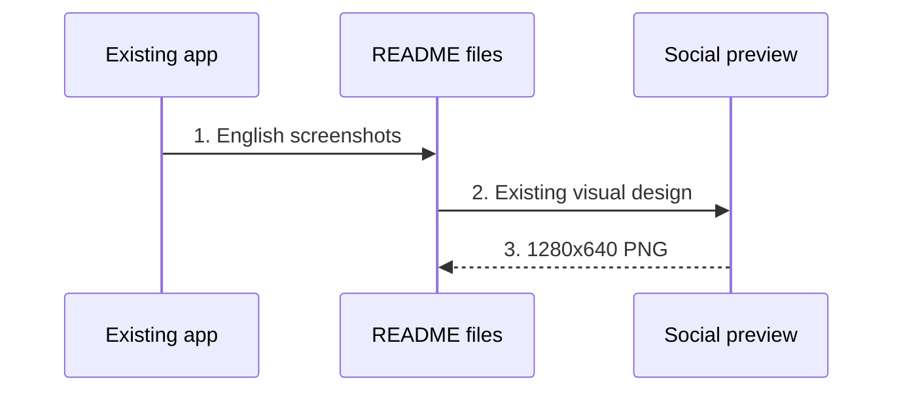

# English screenshots and concise READMEs

**Approved**: 2026-11-22 - user: "podemos seguir nas implementações de acordo com o plano que temos no momento."
**Settled mid-build:** Keep the app's selectable PT-BR and English behavior; use English screenshots in both READMEs and leave the PNG for the user to upload.
**Review:** pending.
**Fix pass:** pending.

## Problem

The README screenshots show the app in Portuguese even though the project is presented by default in English, and both READMEs are much longer than needed. The user wants the social preview image ready to upload personally, without sharing account credentials.

Visitors will see English product screenshots, concise bilingual documentation with its current visual opening, and a ready-to-upload social preview PNG.

## Shape

Reuse the existing README structure, app, screenshots paths, and SVG social preview instead of adding a documentation site or new rendering dependencies. The change affects documentation and generated image files only; no application behavior or data changes.

1. Existing app and synthetic inputs -> `docs/screenshots/` - capture catalog, completed image compression, and completed PDF page numbering at 1440x980 with the UI set to English.
2. Existing README layout -> `README.md` and `README.pt-BR.md` - use the same English screenshots, localized alt text, concise capability and setup guidance.
3. Existing SVG preview and screenshots -> `docs/social-preview.png` - render a 1280x640 PNG for manual upload.

**Changes underneath**

| Front | What changes |
| --- | --- |
| documentation | Replaces long capability inventories and low-level implementation notes with tool summaries and key limitations |
| image assets | Replaces screenshots with real English UI captures and refreshes the social preview |
| application and stored data | nothing changes |

New: nothing. One-way constraints: none.
Data: none - only static documentation assets change.

## Surface

| Surface | In | Out | Status | Who |
| --- | --- | --- | --- | --- |
| `README.md` | English copy and existing image paths | concise project, tool, limit, Docker, privacy, development, and license guidance | 200 (file) | anyone |
| `README.pt-BR.md` | Brazilian Portuguese copy and existing image paths | same guidance as English README | 200 (file) | anyone |
| `docs/social-preview.png` | existing SVG plus English screenshots | 1280x640 PNG, under 1 MiB | 200 (file) | anyone |

## Landing

None - documentation and generated screenshots are reversible; no application state or public service is changed.

## Criteria

### S1: English documentation assets (P1)

Visitors can review the product using concise documentation and English screenshots.

**Acceptance Criteria**

1. WHEN a visitor opens either README THEN the system SHALL retain the title, tagline, link and badge blocks, and screenshot arrangement before the body text.
2. WHEN a visitor reads either README THEN the system SHALL show the same three real application screenshots with the interface in English and alt text in the README's language.
3. WHEN a visitor reads either README THEN the system SHALL summarize the implemented image and PDF tools, key format and behavior limits, Docker startup, privacy boundary, development setup, and license without claiming arbitrary file-to-file conversion.
4. WHEN the repository owner downloads `docs/social-preview.png` THEN the image SHALL be 1280x640 pixels, under 1 MiB, and show the existing English social-preview design with the English screenshots.
5. IF a screenshot or preview uses app text THEN the captured interface SHALL be in English; this does not change the app's selectable languages or default behavior.
6. IF this feature is completed THEN no GitHub account authentication or upload SHALL be performed; the PNG remains available at the repository path for the user.

## Out of scope

| Excluded | Why |
| --- | --- |
| Changing the app's default language or language switching | User asked for English documentation images; application behavior is unchanged |
| Uploading social preview to GitHub Settings | User will upload the provided PNG |
| Issues #33–#37, including profile/refactor work | User explicitly deferred major refactoring issues |

## Assumptions

| Assumption | Chosen default | Rationale | Confirmed? |
| --- | --- | --- | --- |
| Screenshot content | Current English app labels and synthetic sample files | Avoids personal or copyrighted source files | y |
| README length | Keep essential setup, safety, and capability guidance; omit per-tool implementation limits | User requested a direct, concise README | y |
| Social preview upload | User performs upload from their account | User explicitly asked for the PNG to upload themselves | y |

**Open questions:** none - all resolved or logged above.

## Differences from the source

None - the existing README opening layout and social preview design remain in use.

## Sources

- User request in `.specs/features/readme-english-refresh/request.md` - binding - English screenshots, concise README, preserved opening, PNG for manual upload.
- Existing README files and `docs/social-preview.svg` - binding - current visual opening and social preview composition.
