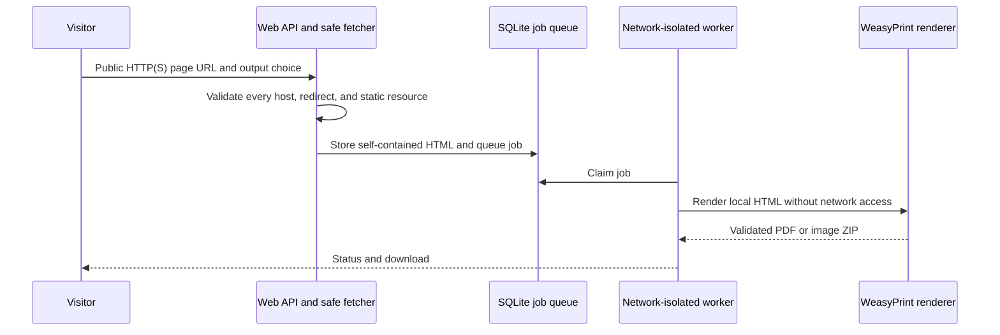
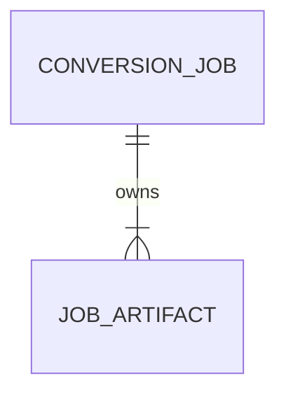

# Public URL conversion to PDF and images

**Approved**: 2026-11-22 - user: "É pra seguir, e ir criando PRs de tudo, mergeando, até finalizar completamente a implementação do nosso plano original!"
**Settled mid-build:** none.
**Review:** pending.
**Fix pass:** pending.

## Problem

Visitors cannot paste a web page URL into either HTML conversion tool. The original objective names pasting a URL for both PDF and image conversion, but the implemented stages accept only uploaded local HTML files. This leaves a visible part of the requested workflows unfinished.

When this ships, visitors can submit a public web page URL and download its rendered PDF or page images while file rendering remains local to the self-hosted instance.

## Shape

Reuse the existing HTML tool pages, job queue, offline WeasyPrint worker, and result/download flow. The connected web process retrieves only the URL the visitor submits and explicitly referenced static resources through a bounded SSRF-resistant fetcher, rewrites those resources into a self-contained HTML document, then queues the document for the existing network-isolated renderer. The remote URL is not persisted in job options or logs.

1. The visitor chooses URL input on the existing PDF or image tool, enters an HTTP(S) address, and submits.
2. `POST /api/jobs` validates the URL and output options, fetches the document and its static resources through a bounded safe fetcher, and stores a self-contained local HTML input under the existing job directory.
3. The existing no-network worker renders that HTML to a PDF or numbered JPG/SVG page archive and validates the output.
4. The existing status and download endpoints return localized progress, success, or safe failure.

**Changes underneath**

| Front | What changes |
| --- | --- |
| domain | Add URL-backed operations for PDF and image; validate source and output before job creation. |
| stored data | Reuse existing jobs and artifacts; store only a normalized local snapshot, not the submitted URL or credentials. |
| readers | Add URL input mode and explain static rendering, supported resources, limits, and private-address blocking in both languages. |

New: nothing - existing job and artifact records hold the self-contained HTML and output.

## Surface

| Route | In | Out | Status | Who |
| --- | --- | --- | --- | --- |
| `POST /api/jobs` (extended) | one URL in `url`; operation `html.to_pdf` or `html.to_image`; image operation also receives `format=jpg` or `format=svg` | Existing job ID and status URL; source URL is not returned | `202`, `413`, `415`, `422`, `429` | anyone |
| `GET /tools/html-to-pdf` (extended) | none | Local-file and public-URL input modes | `200` | anyone |
| `GET /tools/html-to-image` (extended) | none | Local-file and public-URL input modes | `200` | anyone |
| `GET /api/jobs/{job_id}` and `/download` (unchanged) | job ID | Existing status and one PDF or image ZIP | `200`, `404`, `409` | anyone with job ID |

## Landing

| One-way door | Literal shape | Alternative rejected |
| --- | --- | --- |
| URL fetch policy (AD-023) | HTTP/HTTPS only; reject credentials, non-global IPv4/IPv6 results, and any hostname resolving to a non-global address; connect to a validated IP while retaining the original Host and TLS name; validate each redirect and resource; at most 5 redirects, 50 resources, 10 MiB per resource, 50 MiB total, and 30 seconds total fetch time | Let the renderer fetch arbitrary URLs, which would break the worker's no-network boundary and expose SSRF/local files. |
| Rendered-page behavior | Static HTML/CSS through the existing WeasyPrint subset; JavaScript execution, authenticated pages, and browser-session state are unsupported; inline safe static assets before handing the document to the offline renderer | Claiming a full browser session or JavaScript runtime when the selected renderer does not provide it. |
| Job storage | Store a sanitized local HTML snapshot under the normal job retention window; do not persist the submitted URL separately or echo it in status/errors | Persisting URL credentials in job options or logs. |

## Criteria

### S1: Convert a public URL to PDF (P1)

Visitors can paste a public web page URL into the existing PDF tool and download a PDF.

**Acceptance Criteria**

1. WHEN a visitor opens HTML to PDF THEN the bilingual page SHALL offer local HTML upload and URL input, explain static rendering and public-only access, and show queued, processing, success, and error states for either mode.
2. WHEN the API receives one syntactically valid HTTP or HTTPS URL for `html.to_pdf` THEN it SHALL fetch the page and safe static resources within the limits in Landing and create a job containing a self-contained HTML input.
3. WHEN the worker renders a URL-backed `html.to_pdf` job THEN it SHALL use the existing Linux, Landlock, no-network subprocess and return one structurally valid PDF with 1–100 pages and no more than 256 MiB.
4. IF a URL uses another scheme, contains user credentials, resolves to any non-global address, redirects to a blocked address, exceeds redirect/resource/byte/time bounds, or returns a non-HTML main document THEN the API SHALL reject it without creating a job or contacting the blocked destination.
5. WHEN a page references public static CSS, images, and fonts THEN those resources SHALL be fetched under the same address and aggregate limits and rendered locally; unsupported active resources SHALL be removed or rejected without executing scripts.
6. WHEN the visitor submits a URL with embedded credentials or query parameters THEN the URL SHALL not be stored in job options, returned from the API, or written to application logs.

### S2: Convert a public URL to images (P1)

Visitors can paste a public web page URL into the existing image tool and download each rendered page.

**Acceptance Criteria**

7. WHEN a visitor opens HTML to image THEN the bilingual page SHALL offer local HTML upload and URL input, JPG or SVG output selection, localized progress and errors, and a ZIP download on success.
8. WHEN the API receives a valid public URL for `html.to_image` and `format=jpg` or `format=svg` THEN it SHALL create a job with the same bounded, self-contained snapshot policy as PDF conversion.
9. WHEN the worker completes an image job THEN it SHALL return one validated image per page in source order, named `page-001` onward in a ZIP, with the existing 100-page, 40-megapixel-per-page, and 256-MiB-output bounds.
10. IF the URL, format, renderer, or output is invalid or exceeds a bound THEN the job SHALL fail with a localized safe error and no partial download.
11. WHEN either tool is used at a 360 CSS-pixel viewport in PT-BR or English THEN its URL and file controls, status, and download SHALL remain usable without horizontal page overflow.
12. WHEN the README format matrix documents URL input THEN it SHALL disclose static-rendering limits, public-only URL policy, fetch bounds, required direct outbound access for the web service, unsupported proxy environment settings, and the network-isolated worker in both languages.

## Out of scope

| Excluded | Why |
| --- | --- |
| JavaScript execution, login/session pages, and authenticated URL rendering | The existing local renderer is WeasyPrint, not a persistent interactive browser. |
| HTTP, HTTPS, or file references from user-uploaded local HTML | Existing local HTML jobs remain data-URI-only and run in a networkless worker. |
| Arbitrary ports, private/local network destinations, cloud metadata endpoints, and URL credential forwarding | They violate the public-only fetch boundary. |
| Application modularization, dependency profiles, or service decomposition | Explicitly deferred by the user while the main tool roadmap is completed. |

## Assumptions

| Assumption | Chosen default | Rationale | Confirmed? |
| --- | --- | --- | --- |
| URL schemes | HTTP and HTTPS only, ports 80 and 443 only | Matches ordinary public web pages while limiting protocol abuse | y - user delegated implementation of the original URL conversion scope |
| Resource loading | Inline bounded static resources after validating every destination; strip scripts and reject unsupported active content | Makes the result useful for normal static pages while leaving rendering offline | y - user delegated implementation choices and required local processing |
| Renderer behavior | Preserve the existing WeasyPrint HTML/CSS support and disclose that JavaScript is not run | Reuses the shipped local engine rather than adding a browser runtime | y - existing approved HTML renderer decisions |

**Open questions:** none - the user delegated the complete implementation and local-only constraints are already approved.

## Differences from the source

No binding screen capture was supplied for the URL form. Existing local-upload screens remain available; the URL option is added within the same tool pages and does not change tool order or names.

## Sources

- `.specs/features/project-foundation/request.md` - original product objective names pasting page URLs to PDF and image.
- `.specs/features/html-to-pdf/plan.md` - local renderer, bounds, and explicit URL deferral.
- `.specs/features/html-to-image/plan.md` - local renderer, page output, and explicit URL deferral.
- `.specs/features/project-foundation/plan.md` - local processing, no telemetry, and complete cumulative objective.
