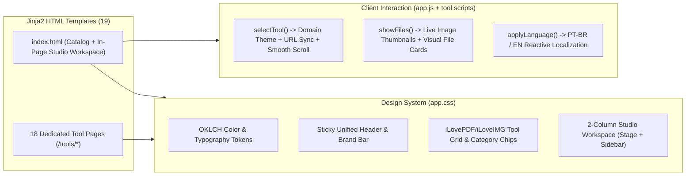

# iLovePDF & iLoveIMG Experience Redesign — Technical Design

**Spec**: `.specs/features/ui-ilovepdf-experience/spec.md`
**Status**: Approved

---

## Architecture Overview

The frontend uses server-rendered Jinja2 templates (`src/i_love_open_converter/templates/*.html`), a single self-hosted stylesheet (`src/i_love_open_converter/static/css/app.css`), and vanilla ES2022 modules (`src/i_love_open_converter/static/js/*.js`) with zero external runtime dependencies or CDN calls.

---

## Aesthetic Direction & Design Tokens (`/frontend-design`)

- **Aesthetic Persona**: **Warm Editorial Utility** — tactile, high-craft document and image studio inspired by iLovePDF and iLoveIMG, free of dark-mode neon clichés or generic AI gradients.
- **Typography**:
  - Display & UI Font Stack: `"Plus Jakarta Sans", "General Sans", "Converter Sans", -apple-system, BlinkMacSystemFont, "Segoe UI", sans-serif` (using local `@font-face` `Converter Sans` fallback so offline rendering is guaranteed).
  - Numeric Discipline: `font-variant-numeric: tabular-nums` on `.selected-file-size`, `.tool-count`, `.upscale-dimensions`, `#blur-region-count`, and range outputs.
  - Readable Hierarchy: Eliminate 8px–10px micro-text; body/card descriptions use `12.5px`–`14px`, card titles `15px` (`font-weight: 750`), section headings `clamp(22px, 3vw, 30px)`.
- **OKLCH Color System**:
  - `--paper: oklch(98.2% 0.005 80)` (`#f9f8f5` warm alabaster paper)
  - `--surface: oklch(100% 0 0)` (`#ffffff` crisp card surface)
  - `--surface-subtle: oklch(96.8% 0.006 80)` (`#f3f2ee` subtle stage well)
  - `--ink: oklch(21% 0.032 265)` (`#161c30` deep slate ink)
  - `--muted: oklch(48% 0.025 265)` (`#5d6478` accessible secondary copy, WCAG AA > 4.8:1)
  - `--line: oklch(91% 0.008 265)` (`#e3e4ea` structural hairline)
  - **PDF Domain Accent (iLovePDF Crimson Coral)**:
    - `--pdf-accent: oklch(59% 0.21 25)` (`#e53935` / `#e8424e`)
    - `--pdf-accent-dark: oklch(52% 0.21 25)` (`#c92a37`)
    - `--pdf-soft: oklch(95.5% 0.028 25)` (`#fff0f1`)
  - **Image Domain Accent (iLoveIMG Cobalt Indigo)**:
    - `--img-accent: oklch(54% 0.21 266)` (`#4c5ce8`)
    - `--img-accent-dark: oklch(47% 0.21 266)` (`#3b49cf`)
    - `--img-soft: oklch(95.5% 0.028 266)` (`#eef0ff`)
  - Dynamic Workspace Variables:
    - `#converter-panel[data-domain="pdf"]` maps `--active-accent: var(--pdf-accent)`, `--active-accent-dark: var(--pdf-accent-dark)`, `--active-soft: var(--pdf-soft)`.
    - `#converter-panel[data-domain="image"]` (default) maps `--active-accent: var(--img-accent)`, `--active-accent-dark: var(--img-accent-dark)`, `--active-soft: var(--img-soft)`.

---

## Contract & Test Preservation Matrix

To guarantee zero regressions across the test suite:

| Test File | Enforced Contract | Design Preservation Strategy |
| --- | --- | --- |
| `tests/test_api.py:1040` | `assert "https://" not in response.text` | No external URLs or CDN links in `index.html`. |
| `tests/test_api.py:1041` | `response.text.count('class="tool-card"') + response.text.count('class="tool-card ') == 50` | Keep exact class prefix `class="tool-card"` or `class="tool-card ..."` on all 50 catalog cards, and do not use `class="tool-card..."` on non-catalog elements. |
| `tests/test_conversion_coverage.py:545` | `test_every_form_option_is_inventoried_and_points_to_a_tested_operation` | Every `<input>`, `<select>`, and `<textarea>` (except `type="file"`) across all `.html` templates must keep its exact `id` from `FORM_OPTION_OPERATIONS` or `NON_OPTION_FORM_CONTROLS`. No new `<input>`/`<select>`/`<textarea>` controls with `id` attributes may be added to templates unless they are `type="file"`. |
| `tests/test_mobile_ui.py:61` | 360px viewport conversion flow (`scrollWidth === innerWidth`) | Keep `#first-use-title`, `#converter-title`, `#file-input`, `#output-format`, `#submit-button`, `#job-status-text`, `#job-result`, `#result-name`, and `#download-button` visible and responsive at `360px`. |
| `tests/test_mobile_ui.py:132,185,234` | `#pdf-compression-profile`, `#degrees`, `#selected-file-name li` visible immediately on tool click | Keep `.workspace-sidebar` controls visible in the DOM even before file selection, and render file items inside `#selected-file-name` as `<li>` elements containing the filename text. |
