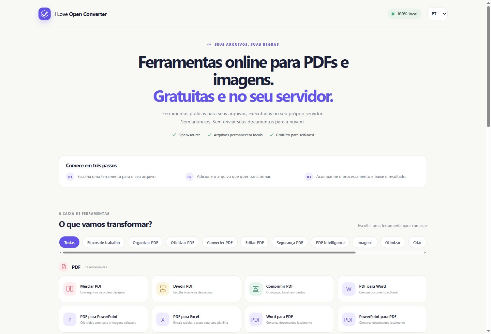

# I Love Open Converter

**A private, self-hosted toolkit for everyday PDF and image tasks.**

Upload a file, choose a tool, and download the result from a simple web
interface. Processing and file storage stay on your own server.

<p align="center">
  
</p>
<p align="center">
  
  
</p>

<p align="center">
  <a href="README.pt-BR.md">Português (Brasil)</a> ·
  <a href="https://github.com/paladini/i-love-open-converter/releases">Releases</a> ·
  <a href="https://github.com/paladini/i-love-open-converter/pkgs/container/i-love-open-converter">Container image</a> ·
  <a href="CONTRIBUTING.md">Contributing</a> ·
  <a href="SUPPORT.md">Support</a> ·
  <a href="SECURITY.md">Security</a> ·
  <a href="CHANGELOG.md">Changelog</a>
</p>

<p align="center">
  <a href="https://github.com/paladini/i-love-open-converter/releases/latest"></a>
  <a href="LICENSE"></a>
  <a href="https://github.com/paladini/i-love-open-converter/pkgs/container/i-love-open-converter"></a>
</p>

I Love Open Converter is a free, self-hosted toolkit for everyday PDF and image workflows. Choose a tool, upload a file, and download the result from your own server.

## Features

- **PDF:** organize, edit, merge, split, secure, OCR, summarize, translate, compare, redact, and convert PDFs.
- **Images:** convert, compress, resize, crop, edit, watermark, remove backgrounds, blur faces or plates, and more.
- **Documents and web:** convert Office files, render HTML pages, and export PDFs to Markdown or spreadsheets.

Supported formats depend on the selected tool. Processing stays on your server; the bundled PDF summarizer runs locally.

<details>
<summary>Supported formats and limits</summary>

### Formats and limits

| Input | Operation | Output |
| --- | --- | --- |
| JPEG, PNG, static GIF, WebP, BMP, TIFF | Generic image conversion | JPEG, PNG, WebP, or one-frame static GIF per input |
| JPEG (.jpg, .jpeg) | Convert to PNG or create an animated GIF from ordered JPEGs | PNG or animated GIF |
| SVG (.svg) | Convert static SVG locally | JPEG, PNG, or WebP |
| PSD (.psd) | Convert flattened image locally | JPEG, PNG, or WebP |
| HEIC, HEIF, HIF | Convert one static image locally | JPEG |
| Camera RAW (.3fr, .ari, .arw, .bay, .cap, .cr2, .cr3, .crw, .dcr, .dcs, .dng, .drf, .eip, .erf, .fff, .gpr, .iiq, .k25, .kdc, .mdc, .mef, .mos, .mrw, .nef, .nrw, .orf, .pef, .ptx, .raf, .raw, .rw2, .rwl, .sr2, .srf, .srw) | Develop locally; camera support varies | JPEG; up to 100 MiB per file |
| Unencrypted PDF | Merge, split, organize, edit, secure, OCR, translate, repair, compare, redact | PDF |
| PDF with selectable text | Convert to editable Office documents | DOCX, PPTX, or XLSX |
| Scanned PDF (up to 20 pages) | Optional local OCR, then export to Word or Excel | DOCX or XLSX; layout and OCR accuracy vary |
| PDF | Export to Markdown or extract embedded images | ZIP archive |
| Word, PowerPoint, Excel | Convert to PDF | PDF |
| HTML (.html, .htm) or public URL | HTML to PDF | PDF |
| HTML (.html, .htm) or public URL | HTML to images | ZIP archive |

Per-job defaults: 100 MB per file, 500 MB per request, 10 files, and 24-hour retention.
</details>

## Quick start with Docker

Requirements: Docker Engine and Docker Compose v2.

```sh
git clone https://github.com/paladini/i-love-open-converter.git
cd i-love-open-converter
cp .env.example .env
mkdir -p data
docker compose up -d
```

Open <http://localhost:8080>. The web app and worker run as separate services, and data stays in `./data`. On Windows PowerShell, use `Copy-Item .env.example .env` and `New-Item -ItemType Directory -Force data`.

## Limits and privacy

- Defaults: 100 MB per file, 500 MB per request, 10 files per job, and 24-hour retention. Change settings in `.env`.
- URL capture supports bounded public HTTP(S) resources only; JavaScript and login pages are unsupported. The worker processes files offline.
- PDF signatures are visual. Review redactions and generated summaries before sharing.
- No accounts, third-party analytics, or telemetry are built in. Keep the app on a trusted network or behind an authenticated proxy.

Use `docker compose ps`, `docker compose logs -f web worker`, and `docker compose down` to inspect, troubleshoot, and stop the services without deleting its files.

<details>
<summary>Configuration defaults</summary>

| Setting | Default |
| --- | --- |
| `APP_PORT` | `8080` |
| `IMAGE_TAG` | `latest` |
| `MAX_FILE_SIZE_MB` | `100` |
| `MAX_TOTAL_UPLOAD_MB` | `500` |
| `MAX_FILES_PER_JOB` | `10` |
| `JOB_RETENTION_HOURS` | `24` |
| `WORKER_POLL_SECONDS` | `1` |
| `PUID` | `1000` |
| `PGID` | `1000` |

Copy [`.env.example`](.env.example) to `.env` before changing settings.
</details>

## Development

Requires Python 3.14 and [uv](https://docs.astral.sh/uv/).

```sh
uv sync --all-groups
uv run playwright install chromium
uv run uvicorn i_love_open_converter.main:app --app-dir src --reload
```

See [CONTRIBUTING.md](CONTRIBUTING.md) for development guidance. Licensed under [AGPL-3.0](LICENSE).
