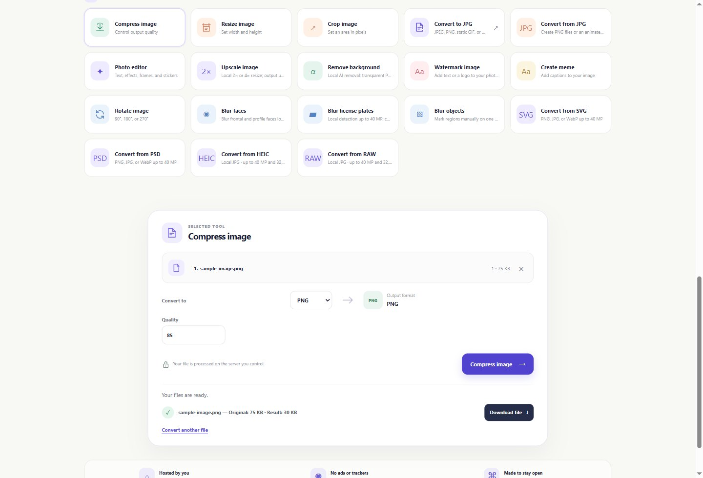
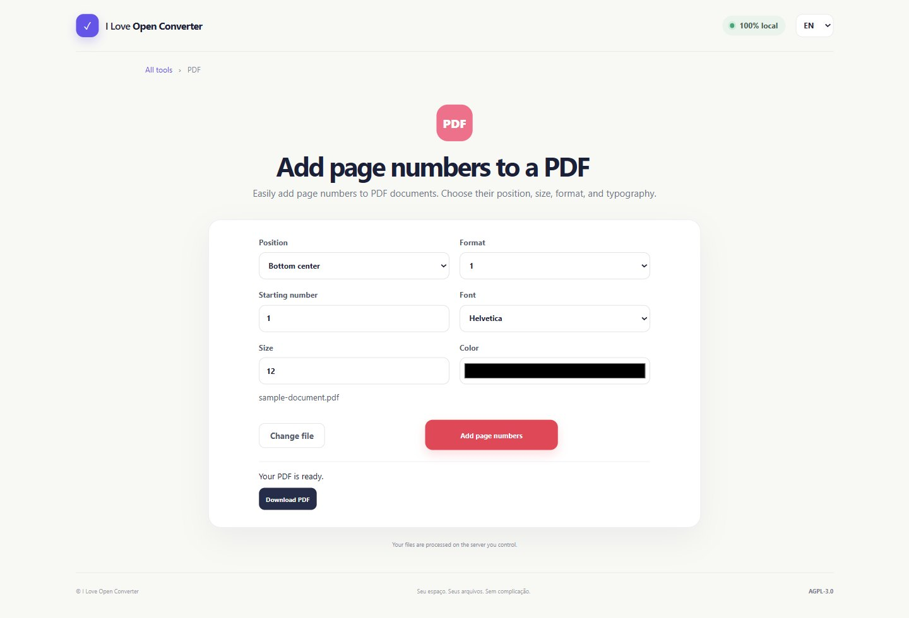

# I Love Open Converter

**A private, self-hosted toolkit for everyday PDF and image tasks.**

Upload a file, choose a tool, and download the result from a simple web
interface. Processing and file storage stay on your own server.

<p align="center">
  
</p>
<p align="center">
  
  
</p>

<p align="center">
  <a href="README.pt-BR.md">Português (Brasil)</a> ·
  <a href="https://github.com/paladini/i-love-open-converter/releases">Releases</a> ·
  <a href="https://github.com/paladini/i-love-open-converter/pkgs/container/i-love-open-converter">Container image</a> ·
  <a href="CONTRIBUTING.md">Contributing</a> ·
  <a href="SUPPORT.md">Support</a> ·
  <a href="SECURITY.md">Security</a> ·
  <a href="CHANGELOG.md">Changelog</a>
</p>

<p align="center">
  <a href="https://github.com/paladini/i-love-open-converter/releases/latest"></a>
  <a href="LICENSE"></a>
  <a href="https://github.com/paladini/i-love-open-converter/pkgs/container/i-love-open-converter"></a>
</p>

I Love Open Converter brings everyday PDF and image tools to your computer,
HomeLab, or NAS. Choose a tool, upload a file, and download the result.

## Tools

- **Images:** convert, resize, compress, crop, rotate, watermark, edit, create
  memes, upscale, remove backgrounds, blur faces or plates, and convert SVG,
  PSD, HEIC, and camera RAW files locally.
- **PDF:** merge, split, organize, edit, redact, visually sign, protect, unlock,
  repair, compare, OCR, translate, add page numbers, convert to and from Office
  files, images, and HTML, and export to Markdown or spreadsheets.

The home page lists available tools. Some optional operations, such as PDF/A
conversion, need additional local dependencies. See the
[project roadmap](.specs/features/project-foundation/plan.md) for scope.

## Important limits

- This is a set of supported PDF and image workflows, not a converter for any
  arbitrary pair of file types. Input and output formats depend on the tool.
- PDF signatures are visual marks, form filling supports existing fields, and
  summaries extract sentences from selectable text. Run OCR on scans first.
- Translation runs locally between Brazilian Portuguese and English. HTML
  capture supports static content; JavaScript and login sessions are not
  supported. URL capture makes bounded public HTTP(S) requests from your web
  server; the background worker has no network access.
- Files are limited by default to 100 MB each, 500 MB per request, and 10 files
  per job. Jobs and files are removed after 24 hours. Configure these defaults
  in `.env`.

## Quick start

Requirements: Docker Engine and Docker Compose v2.

```sh
git clone https://github.com/paladini/i-love-open-converter.git
cd i-love-open-converter
cp .env.example .env
mkdir -p data
docker compose up -d
```

On Windows PowerShell, use `Copy-Item .env.example .env` and
`New-Item -ItemType Directory -Force data` in place of `cp` and `mkdir`.
Open <http://localhost:8080>. The Compose setup runs the web app and a separate
worker. Data is stored in `./data`; back it up to preserve jobs and results.

Set `APP_PORT` in `.env` to change the host port. For other settings, see
[`.env.example`](.env.example). Use `docker compose logs -f web worker` to view
logs, `docker compose pull && docker compose up -d` to update, and
`docker compose down` to stop the services.

## Privacy and security

Files are processed on the server you control. The app has no accounts or
built-in authentication; anyone who can reach it can submit jobs. Keep it on a
trusted network, or put it behind a VPN or authenticated reverse proxy. Do not
expose it directly to the public internet.

The interface uses local assets and does not load third-party scripts,
analytics, or telemetry. Review redacted PDFs and other sensitive outputs
before sharing; redaction does not remove metadata, attachments, or the stored
original file.

## Development

Requires Python 3.14 and [uv](https://docs.astral.sh/uv/).

```sh
uv sync --all-groups
uv run playwright install chromium
uv run uvicorn i_love_open_converter.main:app --app-dir src --reload
```

See [CONTRIBUTING.md](CONTRIBUTING.md) for development and pull request
guidance.

## License

Licensed under the [GNU Affero General Public License v3.0](LICENSE).
