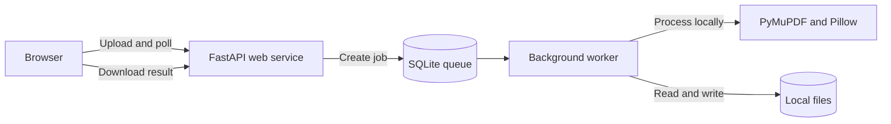

# I Love Open Converter

**A private, self-hosted toolkit for everyday PDF and image tasks.**

Upload a file, choose a tool, and download the result from a simple web
interface. Processing and file storage stay on your own server.

<p align="center">
  <a href="README.pt-BR.md">Português (Brasil)</a> ·
  <a href="https://github.com/paladini/i-love-open-converter/releases">Releases</a> ·
  <a href="https://github.com/paladini/i-love-open-converter/pkgs/container/i-love-open-converter">Container image</a> ·
  <a href="CONTRIBUTING.md">Contributing</a>
</p>

<p align="center">
  <a href="https://github.com/paladini/i-love-open-converter/releases/latest"></a>
  <a href="LICENSE"></a>
  <a href="https://github.com/paladini/i-love-open-converter/pkgs/container/i-love-open-converter"></a>
</p>

I Love Open Converter brings common PDF and image operations together in one
web app for your computer, HomeLab, or NAS. You do not need a command-line
workflow or a hosted file-conversion service.

## How it works

1. **Choose a tool** from the PDF and image catalog.
2. **Upload your file** and set the options for that operation.
3. **Download the result** when local processing finishes.

## Available tools

Only tools marked as available in the app are implemented today. Other catalog
entries are labeled **Coming soon** and belong to later roadmap stages.

### Images

- Convert static JPEG, PNG, GIF, WebP, BMP, and TIFF images to JPEG, PNG, or WebP.
- Resize images by width, height, or both while keeping the original aspect
  ratio.
- Compress JPEG and WebP output with a quality setting.
- Convert one or more JPG images to PNG or combine them into an animated GIF.
- Rotate images by 90°, 180°, or 270°.
- Upscale one image by 2x or 4x with local Lanczos resampling and light
  sharpening. This interpolation does not reconstruct details absent from the
  original; outputs are capped at 40 megapixels.
- Remove the background from one image locally with the U2NetP model and return
  a transparent PNG. The source is capped at 40 megapixels; edge quality depends
  on the image and is not guaranteed. Docker builds include the CPU model so the
  network-isolated worker needs no model download at runtime.
- Blur detected frontal and profile faces locally with OpenCV. Detection can
  miss faces; plates and arbitrary objects are not detected, so review the
  result before sharing. Images with no detected faces fail without output.
- Create a meme from one uploaded image with optional top and bottom captions,
  rendered locally in JPEG, PNG, or WebP. Captions wrap and scale to fit; on
  small images, captions that still do not fit end with an ellipsis. JPEG output
  flattens transparent pixels onto white.
- Edit one image with text, local filters, simple frames, and built-in vector stickers.
- Crop images with pixel coordinates and dimensions after applying EXIF orientation.
- Add text or image watermarks to image batches with placement and opacity controls.

You can process multiple images in one job. Multi-file results download as a
ZIP archive. Static GIF images are supported; animated images are not supported.

Background removal uses rembg (MIT), ONNX Runtime (MIT) and U2NetP weights
(Apache-2.0). See [third-party notices](THIRD_PARTY_NOTICES.md). When running
directly from a development environment instead of Compose, rembg downloads the
small U2NetP model into its local cache on first use.

### PDF

- Merge PDFs in the order you choose.
- Reorder or remove pages and insert pages from a second PDF.
- Crop selected pages, or add text, an image, a shape, or a note to a page.
- Add a drawn or uploaded visual signature, and protect or unlock PDFs with a password.
- Fill existing text fields and checkboxes, and permanently redact selected page areas.
- Attempt PDF repair, compare page appearance side by side, and convert and validate PDF/A-2b.
- Split a PDF by page ranges.
- Rotate every page by 90°, 180°, or 270°.
- Optimize a PDF with local lossless structural compression.
- Render each PDF page as a JPG image.
- Capture or select document pages in the browser, arrange and rotate them, and create a PDF locally.
- Convert Word (`.doc`, `.docx`), PowerPoint (`.ppt`, `.pptx`) and Excel (`.xls`, `.xlsx`) documents to PDF using local LibreOffice.
- Extract embedded PDF images as PNG files in a ZIP, preserving transparency. Repeated image objects are included once; inline images are included at each occurrence.
- Convert PDFs to Markdown with locally extracted text, tables and figures in a portable ZIP. Scanned pages require OCR, which is not part of this conversion; complex layouts may not be reconstructed faithfully.
- Create a local extractive summary of up to 12 sentences from selectable PDF text. Scanned PDFs need OCR first; the summary selects source sentences and does not generate new wording.
- Translate selectable PDF text locally between Brazilian Portuguese and English. The text-only output keeps source page order, dimensions, and page breaks; scanned pages need OCR first. The Docker image includes both offline Argos models (about 158 MiB unpacked) and the lightweight CTranslate2/SentencePiece runtime. See [model credits and licenses](THIRD_PARTY_NOTICES.md).
- Convert a PDF to an editable Word DOCX locally. Scanned PDFs need OCR, and complex layouts may differ from the original.
- Convert a PDF to an editable PowerPoint presentation locally. Text and embedded images become separate slide objects; vector drawings, charts, page backgrounds and scanned-page OCR are not reconstructed.
- Extract detected tables and selectable text from a PDF to an Excel workbook locally. Table rows and page references go to `Tables`; other text goes to `Text`. Values remain literal strings. Unusual table layouts can be missed, and scanned pages require OCR.
- Convert one local `.html` or `.htm` file to PDF. Inline CSS and embedded `data:` resources are supported; relative files, remote URLs and JavaScript execution are not. The renderer is WeasyPrint and requires the isolated Linux worker.
- Export each page of one local `.html` or `.htm` file as JPG or SVG in a ZIP. Inline CSS and embedded `data:` resources are supported; relative files, remote URLs and JavaScript execution are not.

- Turn images into a PDF with one page per image.
- Add a text or image watermark to every page. Choose its position and
  opacity; text watermarks also support font, size, and color options.
- Add page numbers to every page. Choose a header or footer position, number
  format, starting number, font, size, and color.

PDF-to-Markdown uses the full PyMuPDF layout engine and CPU-only ONNX Runtime locally. ONNX telemetry is disabled before initialization.
To bound rendering memory, pages exceeding 16 million pixels at 150 DPI are rejected; conversion is also subject to time and output-size limits.
PDF-to-Word uses the local `pdf2docx` library, which its upstream no longer actively maintains. It applies the same page-size, time and output-size limits. It requires the network-isolated Linux worker configured below; other environments fail closed.
PDF-to-PowerPoint uses PyMuPDF and `python-pptx` to create editable text boxes and picture shapes. One slide represents each page; scanned-page OCR and complex vector artwork, chart and background reconstruction are not supported. The conversion is limited to 200 pages, 20,000 slide objects, 16 million page pixels at 150 DPI, 180 seconds and 256 MiB of output. It requires the network-isolated Linux worker; other environments fail closed.
PDF-to-Excel uses PyMuPDF table detection and XlsxWriter. Detected tables and other selectable text are placed on separate worksheets with source page references; every value remains literal text. Unbordered or unusual tables may not be detected, numeric values are not inferred, and scanned pages need OCR. Limits are 200 pages, 16 million page pixels at 150 DPI, 200,000 table cells, 100,000 text lines, 180 seconds and 256 MiB of output. It requires the network-isolated Linux worker; other environments fail closed.
HTML-to-PDF uses WeasyPrint 70.0. It accepts one local HTML file up to 10 MiB, renders at most 100 pages, and limits the child to 120 seconds, 2 GiB of address space and 256 MiB of output. Only embedded `data:` resources are loaded; the custom URL fetcher rejects remote and local-file references. It requires a Linux worker with no external network and Landlock; unsupported environments fail closed. JavaScript is not executed and CSS support may differ from a browser.
HTML-to-image uses the same isolated renderer. It exports every page as JPG at 144 DPI or SVG in a ZIP. Documents are limited to 100 pages, 40 megapixels per JPG page and 256 MiB of output; only inline content and embedded `data:` resources are supported.

OCR uses OCRmyPDF and Tesseract installed in the Docker image with Portuguese and English language data bundled. The worker downloads no models or languages and has no network access. Each job accepts up to 20 pages, uses one process, and is limited to 600 seconds; pages with selectable text are preserved. Recognition may fail on blurry, skewed, small, or low-contrast scans.

PDF tools accept unencrypted PDFs. A split or multi-page PDF-to-JPG result
downloads as a ZIP archive.

### Formats and limits

| Input | Available operations | Output |
| --- | --- | --- |
| JPEG, PNG, GIF, WebP, BMP, TIFF | Convert, resize, compress, rotate, crop, watermark, photo edit | JPEG, PNG, WebP |
| Unencrypted PDF | Merge, organize, crop, edit, fill forms, redact, sign, protect, repair, compare, PDF/A-2b, split, rotate, optimize, PDF to JPG, Markdown, Word, PowerPoint or Excel, extract images, watermark, page numbers | PDF, DOCX, PPTX, XLSX, HTML, JPG, or ZIP |
| Word, PowerPoint, Excel (`.doc`, `.docx`, `.ppt`, `.pptx`, `.xls`, `.xlsx`) | Convert to PDF | PDF |
| HTML (`.html`, `.htm`) | Local HTML to PDF; embedded `data:` resources only | PDF |
| HTML (`.html`, `.htm`) | Local HTML to image; JPG at 144 DPI or SVG; embedded `data:` resources only | ZIP of numbered page images |
| Password-protected PDF | Unlock with the current password | PDF |
| Static image | Images to PDF | PDF |

Default limits are 100 MB per file, 500 MB total per request, and 10 files per
job. Completed and failed jobs and their files are removed after 24 hours by
default. You can change these values in `.env`.

The home page shows the broader PDF and image catalog. Tools marked **Coming
soon** are not available for processing yet; the [project roadmap](.specs/features/project-foundation/plan.md)
tracks the remaining stages.

## Quick start with Docker

Requirements: Docker Engine and Docker Compose v2.

Office conversion uses LibreOffice and Linux Landlock inside the worker. The supplied Compose configuration disables worker networking and explicitly enables Office processing only in that isolated worker. A standalone worker must be placed in an equivalent network namespace with no external interfaces and configured with `OFFICE_NETWORK_ISOLATED=1`; otherwise Office jobs fail closed. The setting is an operator attestation and does not itself isolate a process. Office conversion also requires a Linux kernel and container policy that permit Landlock. Password-protected documents are unsupported, and fonts, layout and spreadsheet pagination may differ from the original application.

Office ZIP packages are limited to 64 MiB per expanded part and 256 MiB expanded in total. The converter has per-process memory, CPU and file-size limits; the supplied worker also limits memory, process count and temporary storage.

```sh
git clone https://github.com/paladini/i-love-open-converter.git
cd i-love-open-converter
cp .env.example .env
mkdir -p data
docker compose up -d
```

Compose pulls the published image from GitHub Container Registry. It starts a
web service and a separate background worker. Open
<http://localhost:8080> to use the app.

On Windows PowerShell, copy the environment file and create the data directory
with:

```powershell
Copy-Item .env.example .env
New-Item -ItemType Directory -Force data
docker compose up -d
```

Check the running services and logs with:

```sh
docker compose ps
docker compose logs -f web worker
```

To update to the latest published image, run:

```sh
docker compose pull
docker compose up -d
```

To stop the app without deleting its files, run `docker compose down`. The
SQLite database, queued jobs, and results are stored under `./data`. Back up
that directory if you need to preserve them across machine changes.

## Configuration

Copy `.env.example` to `.env` before changing settings. Compose reads these
values when the containers start.

| Setting | Default | Purpose |
| --- | --- | --- |
| `APP_PORT` | `8080` | Port exposed on the host |
| `IMAGE_TAG` | `latest` | Published GHCR image tag |
| `MAX_FILE_SIZE_MB` | `100` | Maximum size of one uploaded file |
| `MAX_TOTAL_UPLOAD_MB` | `500` | Maximum combined upload size per request |
| `MAX_FILES_PER_JOB` | `10` | Maximum number of files in one job |
| `JOB_RETENTION_HOURS` | `24` | How long job records and files are kept |
| `WORKER_POLL_SECONDS` | `1` | How often the worker checks the queue |
| `PUID` | `1000` | User ID for files created in `./data` |
| `PGID` | `1000` | Group ID for files created in `./data` |

Both containers need read and write access to `./data`. On Linux, set `PUID`
and `PGID` to the user and group that own the directory. Set `APP_PORT` if
port 8080 is already in use. Set `IMAGE_TAG` to a release version when you
want to pin the deployment instead of following `latest`.

## Privacy and security

- PDF comparison checks rendered page appearance; metadata and invisible content are not compared. PDF/A conversion verifies conformance, page count, and extracted text; review other layout and content in the result.
- Redaction removes content in selected areas. PDFs containing tagged or marked content are rejected because accessibility text may retain sensitive information. Review other pages, metadata, attachments, and copies separately; the uploaded original remains on the server until its job expires.
- Passwords for PDF jobs are temporarily kept in a local per-job file so the worker can process and retry them; the file is removed after processing. A crash can leave it until retry or job expiration. On systems that support it, the file is created with owner-only permissions.
- Files are uploaded to and processed by the server where you run the app.
- The interface uses local static assets and does not load third-party fonts,
  scripts, analytics, or telemetry.
- There are no user accounts or built-in authentication. Anyone who can reach
  the web service can submit jobs and access a job if they have its URL.
- Job IDs are unpredictable, but they are not an access-control boundary.

Keep the service on a network you control. If you need remote access, put it
behind a VPN or an authenticated reverse proxy. Do not expose the unauthenticated
service directly to the public internet.

## Architecture

The web app validates uploads and creates jobs in a local SQLite queue. A
separate worker processes each job with open-source Python libraries and saves
the result in the local data directory. The browser checks job status and
downloads the result from the same server.



## Development

Requirements: Python 3.14 and [uv](https://docs.astral.sh/uv/).

```sh
uv sync --all-groups
uv run uvicorn i_love_open_converter.main:app --app-dir src --reload
```

Run the project checks with:

```sh
uv run pytest
uv run ruff check .
uv run ruff format --check .
```

See [CONTRIBUTING.md](CONTRIBUTING.md) for development and pull request
guidelines.

## License

I Love Open Converter is licensed under the
[GNU Affero General Public License v3.0](LICENSE).
