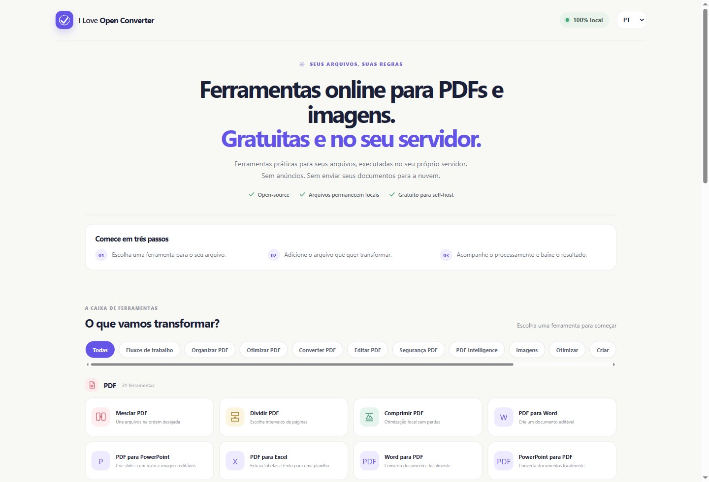
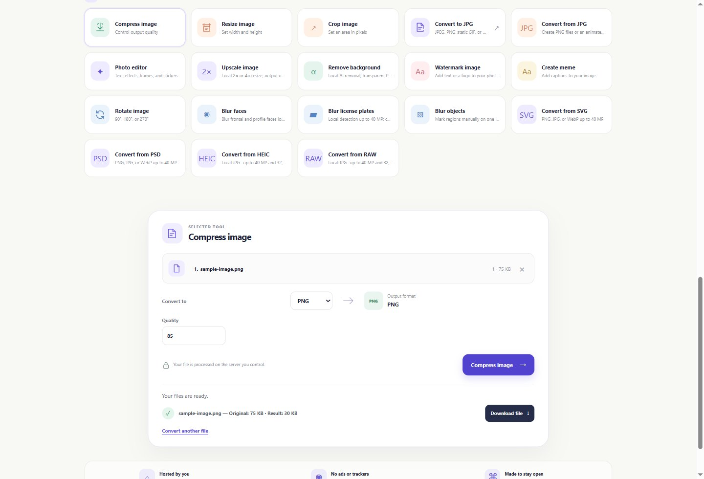
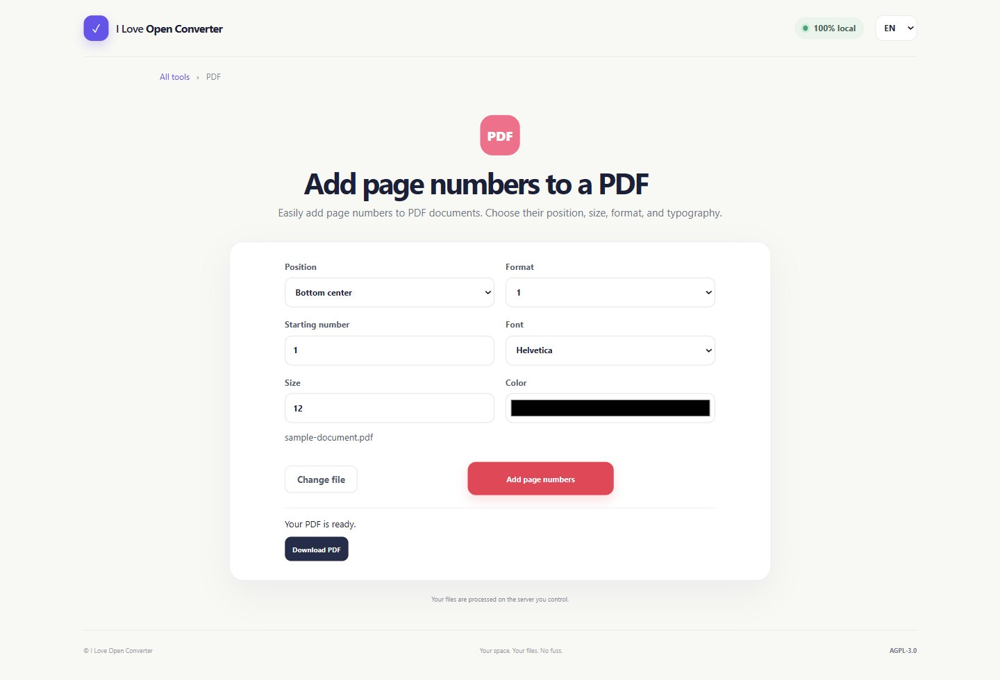

# I Love Open Converter

**Uma caixa de ferramentas privada e auto-hospedada para tarefas comuns com PDFs e imagens.**

Envie um arquivo, escolha uma ferramenta e baixe o resultado em uma interface
web simples. O processamento e os arquivos ficam no seu próprio servidor.

<p align="center">
  
</p>
<p align="center">
  
  
</p>

<p align="center">
  <a href="README.md">English</a> ·
  <a href="https://github.com/paladini/i-love-open-converter/releases">Versões</a> ·
  <a href="https://github.com/paladini/i-love-open-converter/pkgs/container/i-love-open-converter">Imagem de contêiner</a> ·
  <a href="CONTRIBUTING.md">Como contribuir</a> ·
  <a href="SUPPORT.md">Suporte</a> ·
  <a href="SECURITY.md">Segurança</a> ·
  <a href="CHANGELOG.md">Histórico de alterações</a>
</p>

<p align="center">
  <a href="https://github.com/paladini/i-love-open-converter/releases/latest"></a>
  <a href="LICENSE"></a>
  <a href="https://github.com/paladini/i-love-open-converter/pkgs/container/i-love-open-converter"></a>
</p>

O I Love Open Converter reúne ferramentas para PDF e imagens no seu
computador, HomeLab ou NAS. Escolha uma ferramenta, envie o arquivo e baixe o
resultado.

## Ferramentas

- **Imagens:** converter, redimensionar, comprimir, recortar, girar, adicionar
  marca d'água, editar, criar memes, ampliar, remover fundos, desfocar rostos
  ou placas e converter arquivos SVG, PSD, HEIC e RAW localmente.
- **PDF:** mesclar, dividir, organizar, editar, ocultar conteúdo, assinar
  visualmente, proteger, desbloquear, reparar, comparar, aplicar OCR, traduzir,
  numerar páginas, converter PDFs para arquivos Office e imagens, converter
  arquivos Office e imagens para PDF, gerar PDF ou imagens a partir de HTML e
  exportar para Markdown ou planilhas.

A página inicial lista as ferramentas disponíveis. Algumas operações
opcionais, como a conversão para PDF/A, precisam de dependências locais extras.
Consulte o [roadmap do projeto](.specs/features/project-foundation/plan.md).

### Formatos e limites

| Entrada | Operações disponíveis | Saída |
| --- | --- | --- |
| JPEG, PNG, GIF estático, WebP, BMP, TIFF | Conversão genérica de imagens | JPEG, PNG, WebP ou GIF estático de um quadro por entrada |
| JPEG (`.jpg`, `.jpeg`) | Converter para PNG ou criar GIF animado com JPEGs na ordem escolhida | PNG ou GIF animado |
| SVG (`.svg`) | Conversão local de SVG estático | JPEG, PNG ou WebP; scripts e recursos externos são recusados |
| PSD (`.psd`) | Converter a imagem achatada localmente | JPEG, PNG ou WebP |
| HEIC, HEIF, HIF | Converter uma imagem estática localmente | JPEG |
| Camera RAW (.3fr, .ari, .arw, .bay, .cap, .cr2, .cr3, .crw, .dcr, .dcs, .dng, .drf, .eip, .erf, .fff, .gpr, .iiq, .k25, .kdc, .mdc, .mef, .mos, .mrw, .nef, .nrw, .orf, .pef, .ptx, .raf, .raw, .rw2, .rwl, .sr2, .srf, .srw) | Revelar localmente; suporte varia conforme a câmera | JPEG; até 100 MiB por arquivo |
| PDF sem criptografia | Mesclar, dividir, organizar, editar, proteger, aplicar OCR, traduzir, reparar, comparar, ocultar conteúdo e mais | PDF |
| PDF | Converter para arquivos Office editáveis | DOCX, PPTX ou XLSX |
| PDF | Exportar para Markdown ou extrair imagens incorporadas | Arquivo ZIP |
| Word, PowerPoint, Excel | Converter para PDF | PDF |
| HTML (`.html`, `.htm`) ou URL pública | HTML para PDF | PDF |
| HTML (`.html`, `.htm`) ou URL pública | HTML para imagens | Arquivo ZIP |

Limites por job: 100 MB por arquivo, 500 MB por requisição, 10 arquivos e
retenção por 24 horas.

## Limites importantes

- O projeto oferece fluxos compatíveis para PDF e imagens; não converte
  qualquer tipo de arquivo para qualquer outro. Os formatos variam conforme a
  ferramenta.
- Assinaturas em PDF são marcas visuais; formulários podem ser preenchidos ou
  criados. Resumos usam um modelo de IA local, com alternativa extrativa. Aplique
  OCR a documentos digitalizados e confira os detalhes no original.
- A tradução é local e funciona entre português brasileiro e inglês. A captura
  de HTML aceita conteúdo estático, sem JavaScript ou sessões autenticadas. A
  captura de URLs faz requisições limitadas a endereços HTTP(S) públicos pelo
  serviço web; o worker não tem acesso à rede.
- Por padrão, cada arquivo pode ter até 100 MB, cada requisição até 500 MB e
  cada job até 10 arquivos. Jobs e arquivos são removidos após 24 horas. Altere
  esses padrões em `.env`.

## Início rápido com Docker

Requisitos: Docker Engine e Docker Compose v2.

```sh
git clone https://github.com/paladini/i-love-open-converter.git
cd i-love-open-converter
cp .env.example .env
mkdir -p data
docker compose up -d
```

A imagem Docker inclui um modelo local de resumo. Nenhum texto do documento é
enviado a um serviço de IA hospedado.

No Windows PowerShell, use `Copy-Item .env.example .env` e
`New-Item -ItemType Directory -Force data` no lugar de `cp` e `mkdir`. Abra
<http://localhost:8080>. O Compose inicia o aplicativo web e um worker
separado. Os dados ficam em `./data`; faça backup para preservar jobs e
resultados.

Altere `APP_PORT` em `.env` para mudar a porta. Veja os padrões na tabela
abaixo. Use `docker compose ps` e `docker compose logs -f web worker` para
inspecionar os serviços, `docker compose pull && docker compose up -d` para
atualizar e `docker compose down` para parar sem apagar os arquivos.

## Configuração

| Configuração | Padrão | Finalidade |
| --- | --- | --- |
| `APP_PORT` | `8080` | Porta do host |
| `IMAGE_TAG` | `latest` | Tag da imagem de contêiner |
| `MAX_FILE_SIZE_MB` | `100` | Tamanho máximo por arquivo |
| `MAX_TOTAL_UPLOAD_MB` | `500` | Tamanho máximo por requisição |
| `MAX_FILES_PER_JOB` | `10` | Máximo de arquivos por job |
| `JOB_RETENTION_HOURS` | `24` | Retenção de jobs e arquivos |
| `WORKER_POLL_SECONDS` | `1` | Intervalo de consulta da fila |
| `PUID` | `1000` | ID do usuário da pasta de dados |
| `PGID` | `1000` | ID do grupo da pasta de dados |

Copie [`.env.example`](.env.example) para `.env` antes de alterar as opções.

## Privacidade e segurança

Os arquivos são processados no servidor que você controla. O aplicativo não
tem contas nem autenticação integrada; qualquer pessoa que alcance o serviço
pode enviar jobs. Mantenha-o em uma rede confiável ou use VPN ou proxy reverso
com autenticação. Não o exponha diretamente à internet pública.

A interface usa recursos locais e não carrega scripts, analytics ou
telemetria de terceiros. Confira PDFs com conteúdo ocultado e outros arquivos
sensíveis antes de compartilhá-los; a ocultação não remove metadados, anexos ou
o arquivo original armazenado.

## Desenvolvimento

Requisitos: Python 3.14 e [uv](https://docs.astral.sh/uv/).

```sh
uv sync --all-groups
uv run playwright install chromium
uv run uvicorn i_love_open_converter.main:app --app-dir src --reload
```

Consulte [CONTRIBUTING.md](CONTRIBUTING.md) para orientações de desenvolvimento
e pull requests.

## Licença

Licenciado sob a [GNU Affero General Public License v3.0](LICENSE).
