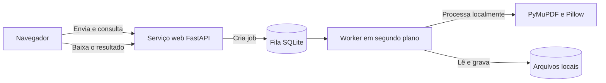

# I Love Open Converter

**Uma caixa de ferramentas privada e self-hosted para tarefas do dia a dia com
PDFs e imagens.**

Envie um arquivo, escolha uma ferramenta e baixe o resultado por uma interface
web simples. O processamento e o armazenamento ficam no seu próprio servidor.

<p align="center">
  <a href="README.md">English</a> ·
  <a href="https://github.com/paladini/i-love-open-converter/releases">Versões</a> ·
  <a href="https://github.com/paladini/i-love-open-converter/pkgs/container/i-love-open-converter">Imagem de container</a> ·
  <a href="CONTRIBUTING.md">Como contribuir</a>
</p>

<p align="center">
  <a href="https://github.com/paladini/i-love-open-converter/releases/latest"></a>
  <a href="LICENSE"></a>
  <a href="https://github.com/paladini/i-love-open-converter/pkgs/container/i-love-open-converter"></a>
</p>

O I Love Open Converter reúne operações comuns de PDF e imagem em um único
aplicativo web para seu computador, HomeLab ou NAS. Você não precisa usar
comandos no terminal nem enviar arquivos a um serviço de conversão na nuvem.

## Como funciona

1. **Escolha uma ferramenta** no catálogo de PDF e imagens.
2. **Envie seu arquivo** e defina as opções da operação.
3. **Baixe o resultado** quando o processamento local terminar.

## Ferramentas disponíveis

Somente as ferramentas marcadas como disponíveis no aplicativo já estão
implementadas. As demais aparecem como **Em breve** e fazem parte de etapas
futuras do projeto.

### Imagens

- Converter imagens estáticas JPEG, PNG, WebP, BMP e TIFF para JPEG, PNG ou
  WebP.
- Redimensionar por largura, altura ou ambas, preservando a proporção original.
- Comprimir imagens de saída JPEG e WebP com ajuste de qualidade.
- Girar imagens em 90°, 180° ou 270°.

Você pode processar várias imagens em um job. Resultados com vários arquivos
são baixados em um arquivo ZIP. Imagens animadas não são suportadas.

### PDF

- Mesclar PDFs na ordem escolhida.
- Reordenar ou remover páginas e inserir páginas de um segundo PDF.
- Recortar páginas selecionadas ou adicionar texto, imagem, forma ou anotação a uma página.
- Adicionar uma assinatura visual desenhada ou enviada e proteger ou desbloquear PDFs com senha.
- Preencher campos de texto e caixas de seleção existentes e ocultar permanentemente áreas selecionadas.
- Tentar reparar PDFs, comparar a aparência de páginas lado a lado e converter e validar PDF/A-2b.
- Dividir um PDF por intervalos de páginas.
- Girar todas as páginas em 90°, 180° ou 270°.
- Otimizar PDFs com compressão estrutural local sem perdas.
- Renderizar cada página de um PDF como imagem JPG.
- Converter documentos Word (`.doc`, `.docx`), PowerPoint (`.ppt`, `.pptx`) e Excel (`.xls`, `.xlsx`) em PDF usando LibreOffice local.
- Extrair imagens incorporadas do PDF em PNG dentro de um ZIP, preservando a transparência. Objetos de imagem repetidos são incluídos uma vez; imagens inline são incluídas em cada ocorrência.
- Transformar imagens em um PDF com uma página para cada imagem.
- Adicionar uma marca d'água de texto ou imagem em todas as páginas. Escolha
  posição e opacidade; marcas de texto também permitem configurar fonte,
  tamanho e cor.
- Numerar todas as páginas. Escolha posição no cabeçalho ou rodapé, formato,
  número inicial, fonte, tamanho e cor.

As ferramentas de PDF aceitam arquivos sem criptografia. Resultados de divisão
ou de conversão de PDF com várias páginas para JPG são baixados em ZIP.

### Formatos e limites

| Entrada | Operações disponíveis | Saída |
| --- | --- | --- |
| JPEG, PNG, WebP, BMP, TIFF | Converter, redimensionar, comprimir, girar | JPEG, PNG, WebP |
| PDF sem criptografia | Mesclar, organizar, recortar, editar, preencher formulários, ocultar, assinar, proteger, reparar, comparar, PDF/A-2b, dividir, girar, otimizar, PDF para JPG, extrair imagens, marca d'água, números de página | PDF, HTML, JPG ou ZIP |
| Word, PowerPoint e Excel (`.doc`, `.docx`, `.ppt`, `.pptx`, `.xls`, `.xlsx`) | Converter para PDF | PDF |
| PDF protegido por senha | Desbloquear com a senha atual | PDF |
| Imagem estática | Imagens para PDF | PDF |

Por padrão, cada arquivo pode ter até 100 MB, cada requisição pode enviar até
500 MB no total e cada job pode incluir até 10 arquivos. Jobs concluídos ou
com falha e seus arquivos são removidos após 24 horas. Você pode alterar esses
valores em `.env`.

A página inicial mostra o catálogo completo de PDFs e imagens. Ferramentas
marcadas como **Em breve** ainda não processam arquivos; o
[roadmap do projeto](.specs/features/project-foundation/plan.md) registra as
próximas etapas.

## Início rápido com Docker

Requisitos: Docker Engine e Docker Compose v2.

A conversão Office usa LibreOffice e Linux Landlock no worker. O Compose fornecido desativa a rede do worker e habilita o conversor nesse ambiente isolado. Um worker executado separadamente precisa estar em um namespace de rede equivalente, sem interfaces externas, e receber `OFFICE_NETWORK_ISOLATED=1`; caso contrário, as tarefas Office falham sem conversão. Essa variável é uma declaração do administrador e não isola o processo por si só. A conversão Office também requer um kernel Linux e uma política de contêiner que permitam o Landlock. Arquivos protegidos por senha não são suportados, e fontes, layout e paginação de planilhas podem diferir do aplicativo original.

Pacotes Office ZIP têm limite de 64 MiB por parte descompactada e 256 MiB no total descompactado. O conversor limita memória, CPU e tamanho de arquivo por processo; o worker fornecido também limita memória, quantidade de processos e armazenamento temporário.

```sh
git clone https://github.com/paladini/i-love-open-converter.git
cd i-love-open-converter
cp .env.example .env
mkdir -p data
docker compose up -d
```

O Compose baixa a imagem publicada no GitHub Container Registry e inicia o
serviço web junto de um worker em segundo plano. Abra
<http://localhost:8080> para usar o aplicativo.

No Windows PowerShell, copie o arquivo de ambiente e crie a pasta de dados
com:

```powershell
Copy-Item .env.example .env
New-Item -ItemType Directory -Force data
docker compose up -d
```

Confira os serviços e os logs com:

```sh
docker compose ps
docker compose logs -f web worker
```

Para atualizar para a imagem publicada mais recente:

```sh
docker compose pull
docker compose up -d
```

Para parar sem apagar os arquivos, execute `docker compose down`. O banco
SQLite, a fila de jobs e os resultados ficam em `./data`. Faça backup desse
diretório se precisar preservá-los ao trocar de máquina.

## Configuração

Copie `.env.example` para `.env` antes de alterar as configurações. O Compose
lê esses valores ao iniciar os containers.

| Configuração | Padrão | Finalidade |
| --- | --- | --- |
| `APP_PORT` | `8080` | Porta exposta no host |
| `IMAGE_TAG` | `latest` | Tag da imagem publicada no GHCR |
| `MAX_FILE_SIZE_MB` | `100` | Tamanho máximo de cada arquivo |
| `MAX_TOTAL_UPLOAD_MB` | `500` | Tamanho total máximo por requisição |
| `MAX_FILES_PER_JOB` | `10` | Quantidade máxima de arquivos por job |
| `JOB_RETENTION_HOURS` | `24` | Tempo de retenção dos jobs e arquivos |
| `WORKER_POLL_SECONDS` | `1` | Intervalo entre consultas do worker à fila |
| `PUID` | `1000` | ID do usuário dono dos arquivos em `./data` |
| `PGID` | `1000` | ID do grupo dono dos arquivos em `./data` |

Os dois containers precisam ler e gravar em `./data`. No Linux, configure
`PUID` e `PGID` com o usuário e grupo donos da pasta. Altere `APP_PORT` se a
porta 8080 já estiver ocupada. Defina `IMAGE_TAG` como uma versão publicada
para fixar o deployment em vez de acompanhar `latest`.

## Privacidade e segurança

- A comparação verifica a aparência renderizada das páginas, sem comparar metadados ou conteúdo invisível. A conversão PDF/A verifica conformidade, número de páginas e texto extraído; confira o layout e os demais elementos do resultado.
- A ocultação remove conteúdo das áreas selecionadas. PDFs com conteúdo marcado ou estruturas de acessibilidade são rejeitados, pois podem manter informações sensíveis. Confira separadamente outras páginas, metadados, anexos e cópias; o original enviado permanece no servidor até o job expirar.
- Senhas de jobs de PDF ficam temporariamente em um arquivo local do job para que o worker possa processá-las e retomar o trabalho; o arquivo é removido após o processamento. Uma interrupção pode mantê-lo até uma nova tentativa ou a expiração do job. Em sistemas compatíveis, o arquivo é criado com permissão apenas para o proprietário.
- Os arquivos são enviados e processados pelo servidor onde o aplicativo foi
  instalado.
- A interface usa recursos estáticos locais e não carrega fontes, scripts,
  analytics ou telemetria de terceiros.
- Não há contas nem autenticação integrada. Qualquer pessoa que alcance o
  serviço web pode enviar jobs e acessar um job se tiver sua URL.
- Os IDs dos jobs são imprevisíveis, mas não substituem controle de acesso.

Mantenha o serviço em uma rede que você controla. Para acesso remoto, use uma
VPN ou um proxy reverso com autenticação. Não exponha o serviço sem autenticação
diretamente à internet pública.

## Arquitetura

O aplicativo web valida os arquivos enviados e cria jobs em uma fila SQLite
local. Um worker separado processa cada job com bibliotecas Python open-source
e grava o resultado no diretório local de dados. O navegador consulta o status
e baixa o arquivo pelo mesmo servidor.



## Desenvolvimento

Requisitos: Python 3.14 e [uv](https://docs.astral.sh/uv/).

```sh
uv sync --all-groups
uv run uvicorn i_love_open_converter.main:app --app-dir src --reload
```

Execute as verificações do projeto com:

```sh
uv run pytest
uv run ruff check .
uv run ruff format --check .
```

Consulte [CONTRIBUTING.md](CONTRIBUTING.md) para orientações de desenvolvimento
e pull requests.

## Licença

O I Love Open Converter é licenciado sob a
[GNU Affero General Public License v3.0](LICENSE).
